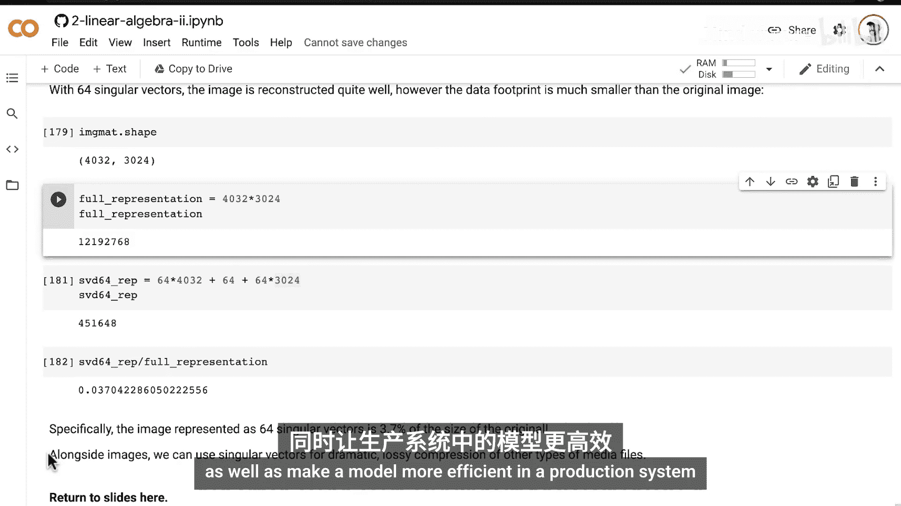

# 机器学习的线性代数及Python实现 ｜ Linear Algebra For Machine Learning p43 P43_使用SVD进行数据压缩 — 主题36 -BV1L8nLz6E8C_p43-

In this video， we take advantage of the SVD theory that we already know to dramatically compress data with a hands on Python demo。

Back now in our linear Albra 2 notebook， we're in the image compression via SD section。

 which follows immediately on the heels of the singular value decomposition section。Alright。

 so here this section features code adapted from Frank queries。 Thank you very much， Frank。

We start off by importing the image method from the Python Iaging library。

And this will allow us to fetch a photo from the Internet。And then use that image method to open。

The image is a plot right within our Jupiter notebook。And this image of Oboe。

 the mascot of the machine Learning Foundation series。With my book， deep learningning Id。

So let's convert this image to gray scale so that we don't have to deal with the complexity of multiple color channels。

And great。 now we have that black and white image。 and the reason why this is helpful here is because if we want to have a full color red。

 green blue image like this one， you need three color channels， red。

 green and blue to represent this image。And yeah， that layer of complexity is beyond the scope of what I wanted to cover in this machine learning foundation series。

 the point is to show you an application of a singular value decomposition and the easiest way for me to do that was to use a matrix that just has one layer so it's not a three tensor it's just a two dimensional matrix。

Where we have 4000 odd rows in our matrix and 3000 odd columns， and at every element in that matrix。

 there is a number that indicates how dark the point should be。

 how dark that element should be or in imaging terms， how dark that pixel should be。

So now that we have our image， let's convert the image data。Into a Ny matrix。

 which doesn't impact the image data， it just brings it into a format that we can work with nicely in Numpy。

And then given that， we can calculate the SD of the image。

 so we're using the same SD method from the Ny linear algebra module that we used in the preceding section。

So because in the preceding section， we were using the SVD method on a very small matrix with three rows and two columns。

 the computation to decompose it into singular vectors and singular values was instantaneous。

But because we now have an image with a matrix rather with 4000 rows and 3000 columns。

 it takes a few moments， but in Google Coabab with the beefy cloud compute server that we have access to。

 it yeah， doesn't take too long， it's done now in real time。

So as eigenvalues are arranged in descending order in the dig lambda matrix。

 remember that from the eigen decomposition segment earlier in this machine learning foundation series。

 So just as eigenvalues are arranged in descending order， so too our singular values。

 at least by convention， and so by being arranged in this descending order in the matrix D in our singular value decomposition formula。

 So we have。Recall that formula from earlier。It is right here。So that matrix D。

 it consists of a diagonal matrix with singular values along the main diagonal。

We can represent that either as a matrix D， or you can represent it as D of some vector。

 In this case， we're calling the vector sigma thus。With this convention in place。

Where these singular values are arranged in descending order。

 this means that the first left singular vector of U。As well as the first right singular vector of V。

May represent the most prominent feature of the image。

 so it will tend to contain the most relevant aspects。Of your data so we can use that。

To reconstruct the image。Using only。That first singular value。

 the first left singular vector of U and the first right singular vector of V。

 So that's what we're doing here。 We're grabbing the first left singular vector。The first。

Rightite singular vector。And the first。Singular value。

And we're multiplying them by each other in the same way that if we had more than just single values in single vectors。

 we would use matrix multiplication like we did here。To multiply u times D times v transpose。

All right， so that allows us。To reconstruct the image。Using。A very small amount of data。

 and we can plot that image out。 And all right， I admit with one set of singular vectors and one singular value。

 this doesn't really look like a reconstructed image， but。

We can add additional singular vectors to improve the image quality。So I have a four loop here。

That iterates over 2，4，8，16，32 and 64。Singler vectors。Her iteration， so。Yes。

 when we had just one singular vector， we didn't see very much。But what happens when we use two？

Stets of singular vectors and singular values。Well。

 now you can just kind of start to make out that my puppy oboe is here on the left。

 but you' would only be able to make that out if you already knew what the original image was。

Then as we add in even more singular vectors。So all of a sudden four， okay。

 maybe someone would start to think that this was a dog or a baby bear or something。

Once we have eight singular vectors， O， a dog really does start to come into view。

 maybe even the book。16， we have a fuzzy dog and a fuzzy book。32， it's starting to get pretty decent。

And by 64 singular vectors and singular values， we have successfully reconstructed the image。

With a far smaller data footprint。So with 64 singular vectors。Yeah。

 the image is reconstructed quite well。 and you could keep going and try 128，256。

 I'm going by powers of two because that will be a significant impact as you double the number of singular vectors。

But let's say with 64， 64， I'd say was good enough for compressing this image。

And let's look at how much smaller the data footprint is relative to the original image。

So the original image。Add 4032 rows and 3024 columns。So， the full representation。As 1。2 no has 12。

2 million individual elements， individual data points。In contrast。

Our SVD reconstruction with just 64 singular values。Has 64 left singular vectors。

 and each one of those left singular vectors has 4032 elements in it has a length of 4032。

 and that corresponds to the number of rows in our original image。

 and that follows along with theory that we talked about in the beginning of the SVD section where U is an M by M matrix corresponding to the number of rows in a and V is an n by N matrix corresponding to the number of columns of a。

So that's where these numbers are coming from。So we have。Yes，64 left singular vectors。

 Each left singular vector has a length，4032。 We have 64 singular values。

And then we have 64 right singular vectors and each one of those right singular vectors and the length of 3024。

 corresponding to the number of columns of our original matrix。So in total。We have。452。

000 data points。And that is far fewer than our full representation。 It's 3。7%。

As many data points required for our compressed image。Relative to our original image。So yeah。

 pretty impressive， right？Alongside images， you can use singular vectors for dramatic lossy compression of other matrices。

 any data of media files， certainly we could compress with this approach。

 And so this will be helpful to you in machine learning because you can shrink down。

The inputs into your model， often meaning that you can substantially reduce the compute required to train a model。

 as well as make a model more efficient in a production system。

SVD is very cool， right， I bet you never thought linear algebra could be so cool。 Well。

 hold on to your seats because what's up next is even crazier。 In the next video。

 we'll build upon the SVD theory that we've now covered to learn about pseudo inversion。

 which can almost like magic solve for unknowns in systems of linear equations。😊。

To be sure not to miss the next tutorial in this series， subscribe to my channel。

Thanks for taking part in the tutorial， I hope you enjoyed it。If you did， please like and comment。

To be sure not to miss any of my content， head to Johnchrome。com and sign up for my email newsletter。

You're also welcome to add me on LinkedIn。Simply mention that your reviewer of the Machine Learning Foundation series。

You can follow me on Twitter too if that's your social medium， of choice。

See you next time。