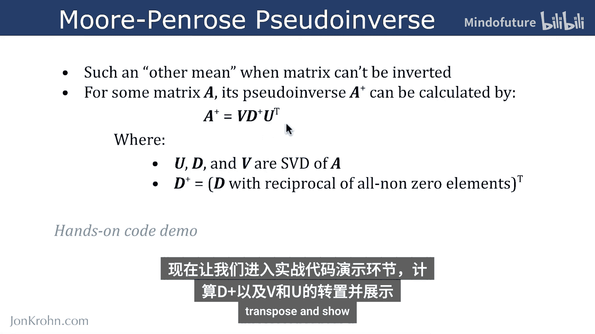
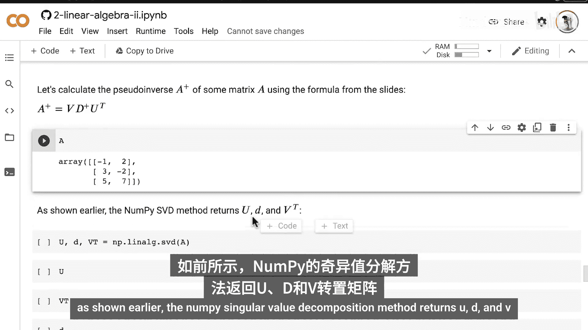
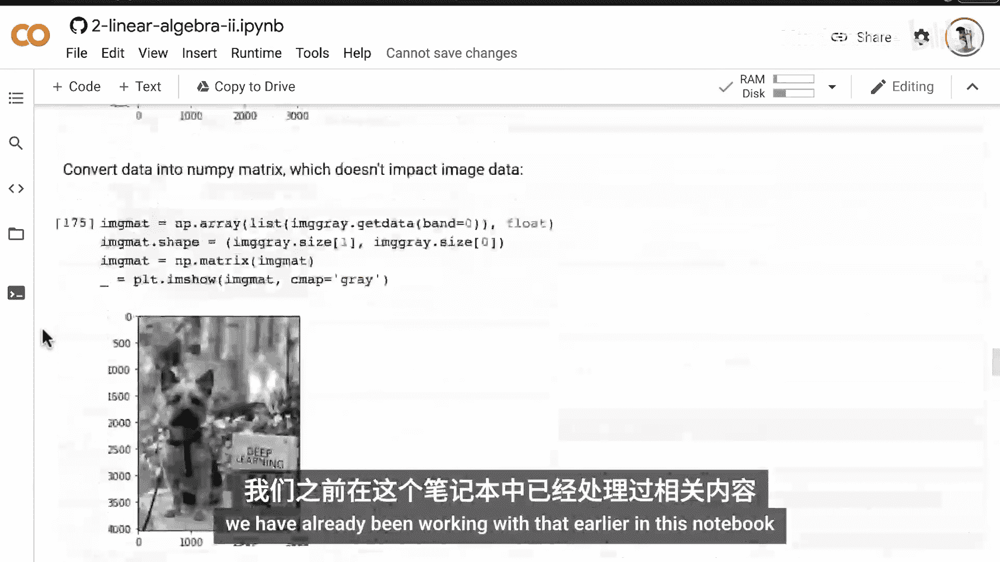
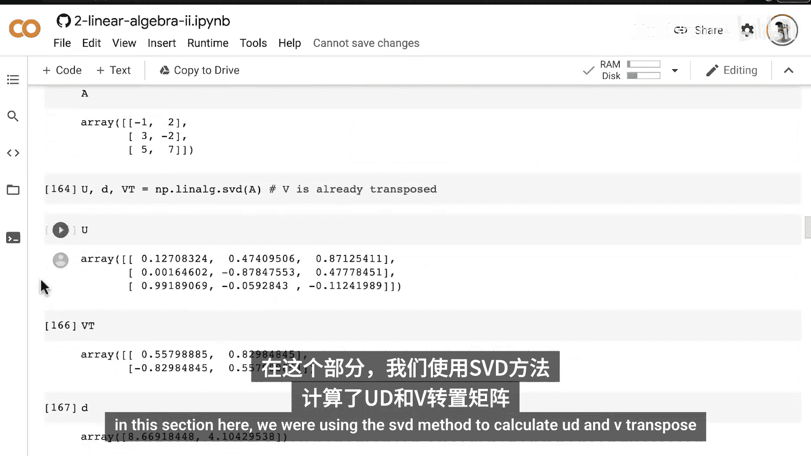
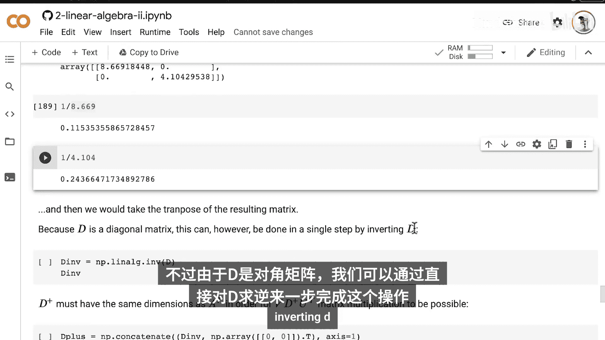
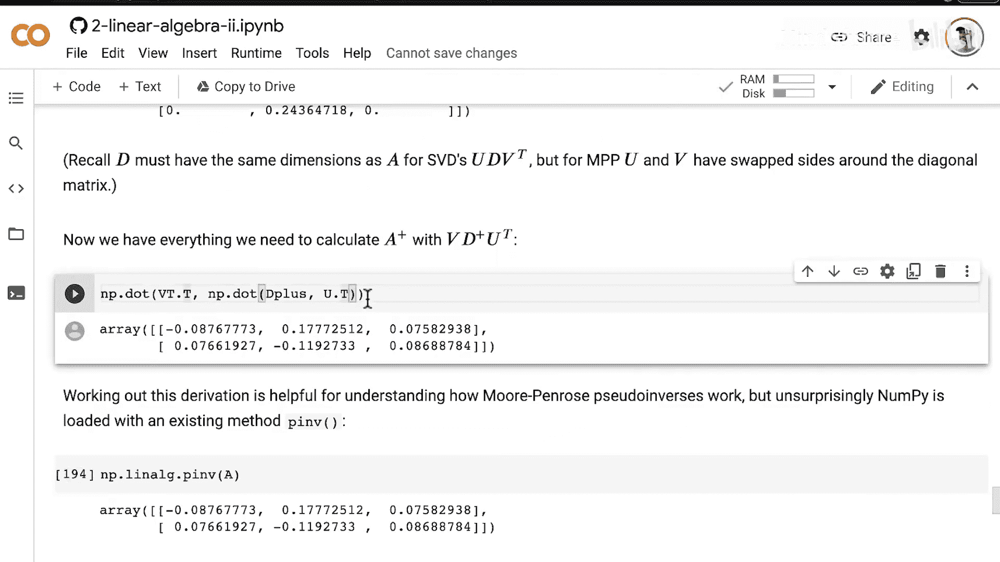
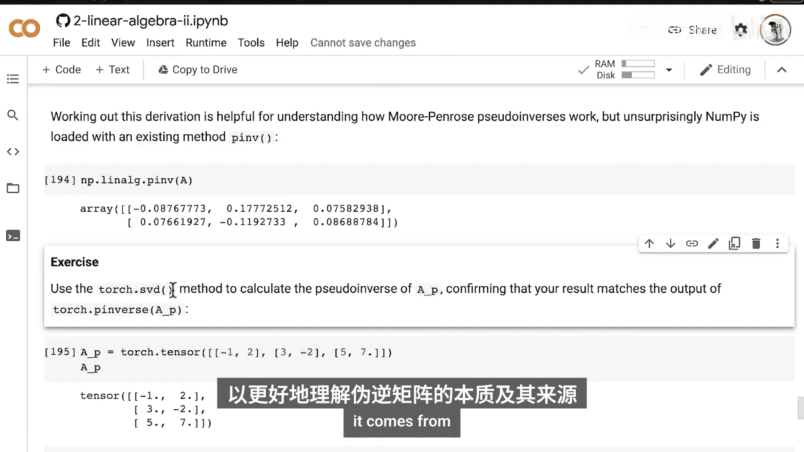
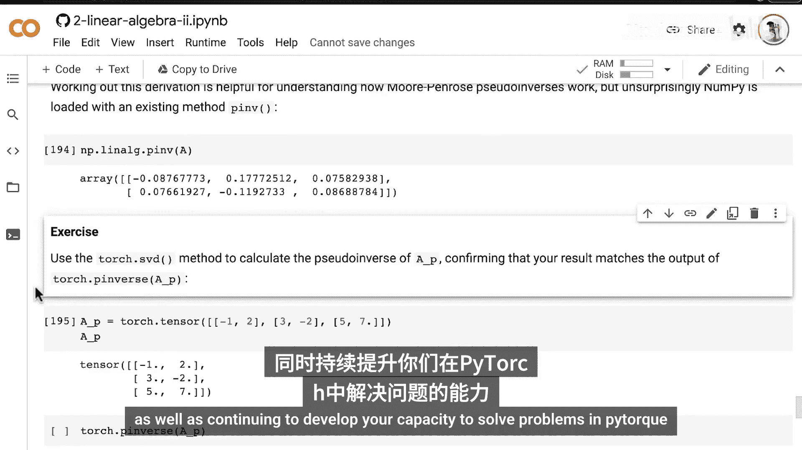

# 机器学习的线性代数及Python实现 ｜ Linear Algebra For Machine Learning p44 P44_莫尔-彭罗斯广义逆 — 主题37 -BV1L8nLz6E8C_p44-

Hey hey， this video introduces the Moore Penrose pseudo inversets。

 a linear algebra concept that enables us to invert non square matrices。

The pseudo inverse is a critical machine learning concept because it solves for unknown variables within the systems of equations that are common in machine learning。

To show you how it works， we'll use a hands on code demo。

At the end of subject one of my Ma learning Foundation series， the Intro to linear algebra。

We detailed why only some matrices can be inverted。 Let's revisit that now。

So matrix inversion is definitely a nifty trick， but it can only be calculated if a matrix is square。

 and that is the number of rows equals the number of columns in the matrix。

This avoids over determination， which is a situation where we have far more rows or at least one more row than we have columns。

 So this is an example of an over determinedtered situation here。

 where we have three equations for a line and only two dimensions。

 So three rows and two columns in our matrix。And of course。

 we can't solve for a single point where the lines intersect because there are multiple points。

 so this is an overdetered system。In contrast， an underdeed system is one where there are fewer equations than there are dimensions。

 So here's an example here where we have a matrix with one row representing one line equation and two columns representing the X and Y dimensions。

 So， of course， here we also can't solve for an unknown where lines cross over because there are known lines crossing over。

In addition to matrix inversion only being possible if a matrix is square。

 matrix inversion is also only possible if the matrix isn't singular。

So all of the columns in the matrix must be linearly independent。

So you can't have a situation where if one of the columns is 1，2， then another one can't be 24。

 which would indicate parallel lines and in that situation and of course， again。

 there's no point where the lines cross over to solve 4。

You also can have this situation where you have the same line equation twice as two different columns。

Because then， you know， then you have infinite solutions。

 And so you can't solve for that as a single answer either。 So， yes。

 So both of these plots here represent。Singular matrices where we have linear dependence in the columns。

So for any of these four reasons， you can't inver a matrix。However。

We noted even earlier when we talked about this in more detail that solving an equation。

May still be possible solving a system of equations。May still be possible by another means。

 even if the matrix can't be inverted。Such another mean。

Where matrix can't be inverted is the more Penrose pseudo inverse。 Our focus in this video。

So for some matrix a， its pseudo inverse is denoted as a superscript and then a plus symbol。

And it can be calculated by this formula here。Where U。

 D and V are the singular value decomposition of a。

 which we discussed earlier in a video on singular value decomposition。And then D plus。

 which we see here， is a special version of D from the singular value decomposition。

Wherein it has the reciprocal of all non zero elements and then is transposed。

Plus jump into a hands on code demo now to calculate D+ as well as V and nu transpose and show that this equation is true。

All right， make your way back to our linear Al 2 Jupiter notebook and the well named Moore Nros pseudo inverse section。

And I said on the slide in here， we will calculate the pseudo inverse a plus of some matrix a using the formula from the slides。

 so let's use this matrix A， which is clearly not square， it would not be invertible。

But it is pseudo invertible As shown earlier， the numpy singular value decomposition method returns U。

 D and V transpose。 So we have already been working with that earlier in this notebook。

In this section here。We were using the SVD method to calculate UD and V transpose。

So we're going to use those。To calculate the pseudo inverse now。So here's UD and V transpose again。

You。😔，Which is the left singular vectors of our matrix A。And then we have v transpose。

 which is the right singular vectors of a。And D， which is our singular values for a。

In order to create。A plus atoo inverse of a。We're going to need to transpose you okay。

 that's super easy。 We're also actually going to need to transpose V because by default it comes as v transpose out of the nuy SVD method。

 but transposition is trivial， so that's no problem。What about calculating D plus， well。

 that's going to be a little more interesting， I talked about it on the slides。

 but let's dig into it in more detail now。To create D+。We first invert the non zero values of D。

So remember that the matrix D， a capital D。Is a diagonal matrix with the singular values lowercase D along its main diagonal。

Well， to invert the non zero values of D， we could do that super manually and say， okay， well。

 I've got this one singular value that's about 8。669 so I'll invert that。And I've got this other one。

 4。104， and I can invert that。And so you could do that for these two values for the two non zero values。

In this major X D。And then we would take the transpose of the resulting matrix that would give us D plus。

However， because D is a diagonal matrix， we can do this in a single step by inverting D。

So simply passing our matrix D。Into the Nai inverse method。It automatically。

Inverts the nonze values here along the main diagonal。So 8。669 inverted becomes 0。115。

 just as when we did it manually， and same thing for the 4。1 when we inverted， it becomes 0。24 cool。

That's a little shortcut。Now， the last thing that we need to do is to ensure that D plus has the same dimensions as a transpose。

And this then enables us to have this， this matrix multiplication here be possible。

 remembering that we need to have all of our dimensions line up。

 So in order to perform matrix multiplication of D plus and you transpose， as well as of B。

 and then the result of that matrix multiplication。We need to have the right dimensions。

So one way to do that。Is to concatetnate。Some zero values。 so I'm just。

Creating a vector here in Numpy with a couple of zeroes， transposing it so that it becomes a column。

And then， concatenating。Those two zeroes。Onto our D inverse matrix， is these four elements。

And this axis equals1 means that we're tacking these on as an extra column on the right here。

Incatetnating them on the right。So there you go， there's our D plus， we've got it。

Now we have everything that we need。To calculate。A plus here。So。We can do that right here。

 We've got this matrix multiplication first of D plus and U transpose。

 And then we do matrix multiplication as well， of V。Which is V transpose transposed。

 also noting here that we have u transpose。Again， I already mentioned this earlier。

 but recall that by default， singular value decomposition in Nmpy gives us U and V transpose。

But we want U transpose in V。 So we get those by adding this dot T。

Onto our matrices easiest pie to transpose them。 And yeah。Then we are all set， so this is it。

 this is the pseudo inverse of our matrix a。So working out this derivation is helpful for understanding how more penrose pseudo inverses work where they come from。

 but unsurprisingly numpy is loaded with an existing method P in that calculates the pseudo inverse。

 so we could have just thrown our original matrix A into that P in method andvoila。

 you get exactly the same results as if we do it somewhat manually using singular value decomposition。

 but that also gives the opportunity to tie singular value decomposition to the more Penrse pseudo inverse。

Allright， so we know how to calculate the pseudo inverse in the next video。

 I'm going to show you how to apply it to awesome effect in order to solve for unknowns in a system of linear equations and fit a line to points but before we do that。

 I've got an exercise here for you to tackle to help you slow things down and get a deeper understanding for yourself on what the pseudo inverse is。

 so I want you to port over as with some of the other exercises I've had recently in this machine learning foundation series。

 port over the numpy process that we went through here。

From calculating the singular value decomposition through to calculating the pseudo inverse。

Pt over what we did in Numpy。Into high torch。 So you can use the torch SVD method to calculate the pseudo inverse of this matrix here。

A underscore P and confirm that your result matches the output when you use the torch pseudo inverse method。

 So obviously you could just jump and use this method right away but the point here is to slow things down and go through the same steps that we did above to develop a better understanding of what the pseudo inverse is where it comes from。

 as well as continuing to develop your capacity to solve problems in high torch。

Sweep now that we know what the pseudo inverse is in the next video。

 we'll use it to solve for unknowns in a data model。

