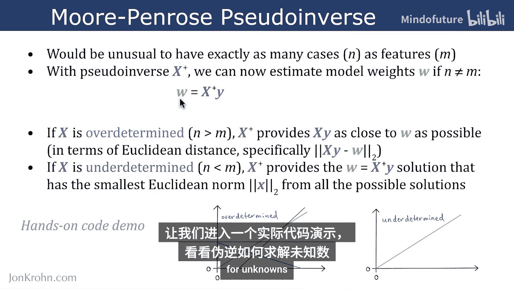
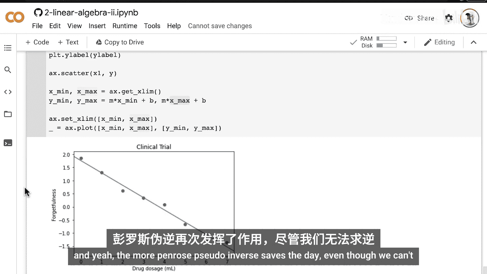

# 机器学习的线性代数及Python实现 ｜ Linear Algebra For Machine Learning p45 P45_使用广义逆进行回归 — 主题38 -BV1L8nLz6E8C_p45-

Yes， yes， this is one of my favorite videos in the Machine Learning Foundation series in it we'll use the more Penrose pseudo inverse to solve for unknowns。

 enabling us to fit a line to points with linear algebra alone。When I first learned how to do this。

 it blew my mind。 I hope it blows your mind too。The more Penrose pseudo inverse。

 which we denote as safe for the matrix A as a superscript plus。The more Penroutto inverse。

 however we annotate it， is mega useful because non squarere matrices are common in machine learning。

 So consider the example that we discussed already a couple of times earlier in this machine learning foundation series where we are using various attributes of a house to predict house value。

 So where why is our house price that we're predicting and then we have various inputs into our model like the number of bedrooms in the house could be this first model input and then distance from school could be this other model input all the way through to M model inputs。

😊，And in this kind of situation， we would typically have you know maybe a dozen features that we input into our model to predict house price。

 but we could have lots of houses。 we wouldn't it would be really bizarre actually if we had exactly as many houses in our data as we had features I mean so let's say we had 12 inputs into our model then we'd go out and find just 12 houses at the silly situation。

 you would have more data。 you would typically have more data and regression model like this than you have unknowns to solve for the unknowns here being B C and M。

 which are the weights that we learn for each of the inputs x1 x2 all the way through to XM and then we have a y intercept A that allows us to have an average house price in this case so that it's not fixed at zero and pretty much always going to want to have this y intercept So yeah。

 so we're typically going to have far more row。of data than unknowns to solve for。

 and so in this case we might have hundreds or thousands or tens of thousands of house prices in associated attributes。

 so you tens of thousands of rows， but only say a dozen features or unknowns in the model。

So obviously not a square matrix， and so would not be invertible with just regular matrix inversion。

 but we can calculate the more penroose pseudoinverse and solve for the unknowns， solve for A， B， C。

 and M。So that equation that I just showed you on the preceding slide。

 we can use the near algebra to make this much cleaner looking representation of the same equation。

Where we use matrix multiplication between a matrix of the inputs into the model。

 as well as a column of ones representing the y intercept a so that variable average for whatever y is and you know our house price example so that we can have an average house price。

 So yeah， so we have this one matrix of inputs into the model are features that we are predicting y with that we're predicting our output with in this case house price is。

And we multiply that matrix by a vector of the unknowns that we're trying to learn。

 So a for our y intercept B for this first feature。

 say the number of bedrooms in the house and C is distance from school and so on all the way through to M。

 so yeah， so matrix multiplication to represent the inputs and the unknowns and then a vector of house prices as our output from this matrix multiplication。

 so we can represent this regression formula as Y equals x W where W is a vector of weights A through M。

We talked about all of this， including the last slide already in the intro to linear algebra subject。

 the first subject of this machine learninging Foundation series， we talked about it in detail。

 but as a quick recap in that equation， we know the outcomes why。We know we have these values。

 which could be house prices。 We know the features X。

 which are predictors like bedroom count and distance from school and so on。

 And then vector W contains our unknowns， the models learnable parameters， As I just discussed。

 So assuming that the matrix inverse of X exists。 you could use matrix inversion to solve for W。

 And we already talked about this in detail in the intro till linear linear algebra subject。

 So I won't talk about this all in to that same level of detail again。

But the problem that we have here is in this real- worldorld scenario where we have a nons matrix which has far more rows than it has columns because we have far more houses in our data then we have features like bedroom count so we can't use matrix inversion in the intro to linear algebraa subject we did use matrix inversion to solve for the unknown weights in this really small model system of linear equations。

 so you can go back and visit that if you want to recap of matrix inversion， but again。

 this kind of thing that we were doing here when we had a square matrix。

 a two by two matrix where we could invert that's not possible with our realworld house price data。

So this is where the more Panorosutto inverse comes to the rescue。Right。

 it would be unusual to have exactly as many cases N。

 so in this case houses as features are predictors of house price。With the pseudo inverse x plus。

 we can now estimate model weights even if。N is not equal to N。So we can solve for the unknowns。

Using a variant of the equation that I just showed you on the last couple slides。

 the matrix inversion equation where we had x inverse here， the matrix inverse of X。

 Now we put the pseudo inverse in there。 We just plug that in and it allows us to solve for unknowns。

 This is great。So how does it do it exactly， you don't need to memorize this。

 memorizing these next two bullets isn't going to make or break a machine learning or data science career。

 but just for the sake of completeness I wanted to spend a moment here talking about it。

If the matrix x is an overdetermined system， so the number of rows is much greater than the number of columns。

 and we have an overdetermined system like this here。In that kind of situation。

The pseudo inverse provides a Xy matrix multiplication as close to W as possible。

In terms of Euclidean distance， So L2 norm， you know， plain old distance specifically。

It finds x times y minus W and the L2 norm of that difference。In contrast。

 if x is an underdetermined system where our number of cases is smaller than our number of features。

 and so you know this isn't what we would typically see with a regression model。

 but this is the kind of scenario you might have with a deep learning models so deep learning models might have millions of features so M might be very。

 very large number but you might only have thousands or tens of thousands of cases in your data set and that's common in deep learning so in that kind of situation where you have an underdetermined system。

 then the pseudo inverse provides the solution to this equation。That has the smallest Euclidean norm。

 L2 norm from all of the possible solutions。 and it's a bit silly in this super underdetermined system。

Where we only have two dimensions and one line， but it's harder for me to draw these plots in many dimensions where this kind of reasoning that we have here makes sense。

 So， yeah， I don't want you to labor on this too much。

 you can definitely dig into these details more if you'd like to。 And I at the end of this subject。

 I have resources for learning more linear algebra in detail。

 But for our purposes for being able to apply machine learning algorithms to understand data science better。

 just knowing that we can calculate a pseudo inverse to approximate the inverse of a matrix when it's nons square when it can't be inverted properly。

And yeah， that's good enough。 so let's jump into a hands on codede to see this pseudo inverse in action solving for unknowns。

All right， so we're back in our linear Algebra 2 subject notebook。

 and we're just below the more Penrose pseudo inverse code that we executed in the preceding video。

So now we're here where we're going to tackle a regression problem with the more Penrose pseudoinverse。

 so four regression problems， as I mentioned on the slide， we typically have many more cases。

 n or rows of x， than features to predict or M or columns of x。

 so let's solve a miniature example of such an overdetermined situation。

In this situation we have eight data points， I've completely made these data points up。

 so we have this input。Which we'll call x1， which is a dosage of a drug。

That treats Alzheimer's disease， so let's say， you know milliliters of drug dosage。

 so you know you administer zero milliliters of control or 1，2，3，4。

5 all the way up to seven milliliters of this Alzheimer's drug。

And then our outcome that we're measuring is the forgetfulness of the patient on some。

Test of forgetfulness。 I'm just making this stuff up for the sake of an example。 All right。

 So we'll create some labels for our plot。 We'll call this a clinical trial。 And along our X axis。

 we'll put the drug dosage and along our Y axis， we will put the forgetfulness。

So let's plot that out。Pretty simple plot here， create the plot in mapplot Libb。

 We add our title X label and Y label respectively with these three lines of code。

And then we use a scatter plot to plot our X and Y values against each other。

 So we can see clearly the more drug dosage。The less forgetful our patient is。

 So our Alzheimer's drug is working， and our patient is less forgetful the more drug that we provide to them。

So although it appears， there is only one predictor here。If we want to fit a line to these points。

 we do need a second one， which I'll call x 0。In order to allow for the y intercept。

 so therefore our number of columns m is equal to 2。

 our number of rows n is equal to8 because we have eight data points。

So this again having this y intercept allows the mean outcome to be away from zero。

 So if you didn't have a y intercept， you would be forced to have your line intercept the y axis here at zero。

 but as we can tell the y intercept is closer to2 so we definitely want and you almost always it would be very unusual to not have a y intercept in your model。

 So the y intercept is constant across all of our points and so we set it equal to one across the board so we can just set x0 equal to an array of ones eight of them because we have a data points。

And then now we can concatenate our x0 and x1 vectors into a matrix。

 So I'm going to transpose both vectors。And then concatenate them together。

 setting axis equal to one so that they're concatenated as columns next to each other。

So here's x0 for our a Y intercept， and then we have our actual varying drug dosage values。

As the other column in matrix X。All right， so armed with our matrix X。

 we now have everything we need to start solving。For the weights。

 the weights that will allow us to fit a line to these points。 So from the slides。

 we know that we can calculate the weights using the equation here where our weights are equal to the pseudo inverse of x multiplied by y。

So we just throw our matrix X here into the numpy pseudo inverse method and we perform matrix multiplication between that pseudo inverse and our vector y。

 which contains all of the outcomes， the patient's forgetfulness score， the y axis values。

So there you go。 These are her hour weights。 That's it。 It's that easy。 I。

 my mind was blown completely the first time that I learned this。

 I didn't know that we could use linear algebra to solve for unknowns like this。 And yeah。

 just totally mind blowing for me。 I hope it is for you， too。

 We've solved that now the Y intercept for this line。😊，Is equal to 1。76。

 and the slope of the line is negative05， roughly negative 05。

So if the significance of that hasn't sunk in yet let's now plot things out so you can see it。

 and maybe then your mind will finally be blown。 So the first weight here corresponds to the y intercept of the line。

 which we typically denote as B in a line equation。

 So this little chunk of code here is just to extract this first value and put it into a standalone variable。

And then the second weight corresponds to the slope of the line， which again。

 in the equation of line we typically denote as M。 So let's extract that out of here as well。

 The difference between these two code chunks being that here I'm asking for the first element and here I'm asking for the second element。

Now that we have the weights， we can plot the line to confirm that it fits the points。

 So these lines of code here are the same as we used earlier to make this plot here。

 but now we're going to add a line。So we do that with these lines of code here。

 we find out what the limits of our plot are， and we use that for our lowest x value in the plot through to our highest x value in the plot。

And then we use those。To plot a line from that lowest x value。To the highest x value。

 so we use the equation of a line m times x plus b to give us our first y value。

 which corresponds to x min。 So slope of a line M times our x min where x min is the furthest left point。

 the lowest x value in our chart x max is the highest x value。

 we're going to calculate what y is at this minimum value of x as well as what y is at this maximum value of x。

 and that will give us two coordinates we're plotting a line。 Yeah。

 so the first one is So we use the line equation M times x with our low x value。Plus。

 our Y intercept B。Our wayter said， B。To calculate the left hand y value。

 and then for the right hand y value where x is maxed out， that's， again。

 our slope times x max now plus the same y intercept B。And then we can plot them out。So here we go。

 We just use the plot method here。To plot from those points。 So from our first point。

Where x is equal to x min and y is equal to this and to our right hand point。

Where x is equal to x max。And y is equal to the the result of the line equation with x mass gradient is the input。

 So there you go。 Our line fits our points very， very well。And this is all thanks to linear algebra。

 we didn't need any fancy machine learning because we just have a few data points and yeah。

 the more Penrose pseudo inverse saves the day even though we can't invert。

Wow， pseudo inversion is awesome。What a way to approach the end of the linear algebra theory covered in my Ma Learning Foundation series。

Up next is a quick video on the trace operator， the final little piece of linear algebra theory in the entire series。

 See you there。To be sure not to miss the next tutorial in this series， subscribe to my channel。

Thanks for taking part in the tutorial， I hope you enjoyed it。If you did， please like and comment。

To be sure not to miss any of my content， head to Johnchrome。com and sign up for my email newsletter。

You're also welcome to add me on LinkedIn。Simply mention that your reviewer of the Maine Learning Foundation series。

You can follow me on Twitter too if that's your social medium of choice。

See you next time。