# 机器学习的线性代数及Python实现 ｜ Linear Algebra For Machine Learning p46 P46_迹算子 — 主题39 -BV1L8nLz6E8C_p46-

This is a quick video on the trace operator， a relatively simple linear algebra concept。

 but one that frequently comes in handy for rearranging linear algebra equations。

 including ones that are common in machine learning。All right， so back in our linear Al 2 notebook。

 we are at this section called tracece operator。

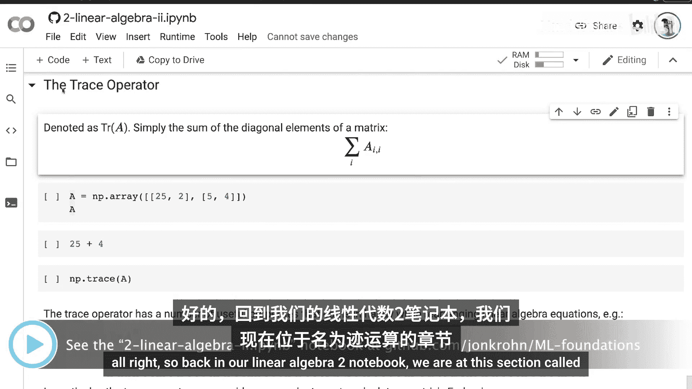

And the trace operator is denoted as capital T lowercase。 R open bracket。 your matrix。

 say matrix A closed bracket。 And despite the funky notation， the trace operator is pretty simple。

 it's simply the sum of the diagonal elements of the matrix。 So this expression here。

 shows you how to do that。 So for our matrix A at all of the values iterating over I where I is the same in the row in the column。

 So the element that's in burst row in the first column。 Second row second column。

 These are the diagonal elements of a matrix。 We just sum them up。

 Hopefully that expression is easy enough。 But if not， I'll show you in a handson code demo here。

 how to calculate trace。 So let's say we have this matrix A here。😊。

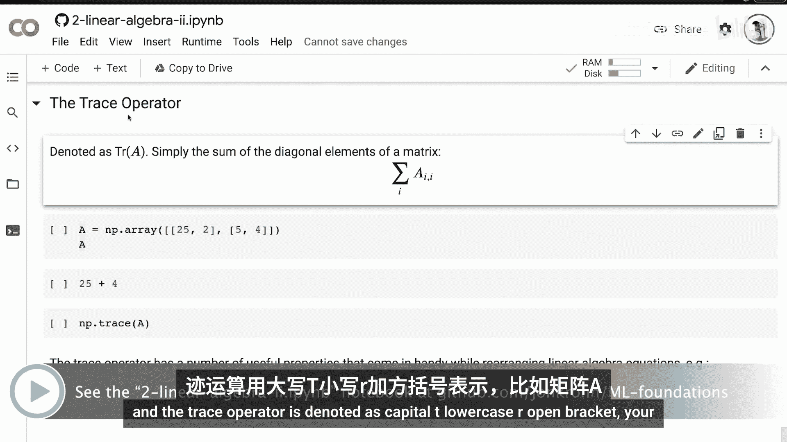

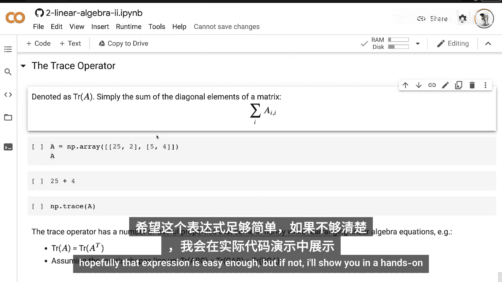

The trace is simply the sum of the diagonal elements of the matrix， though 25 plus 4 in this case。

 that comes out to 29。

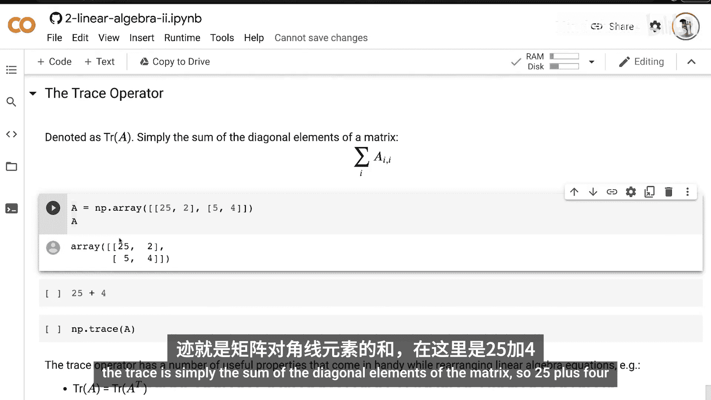

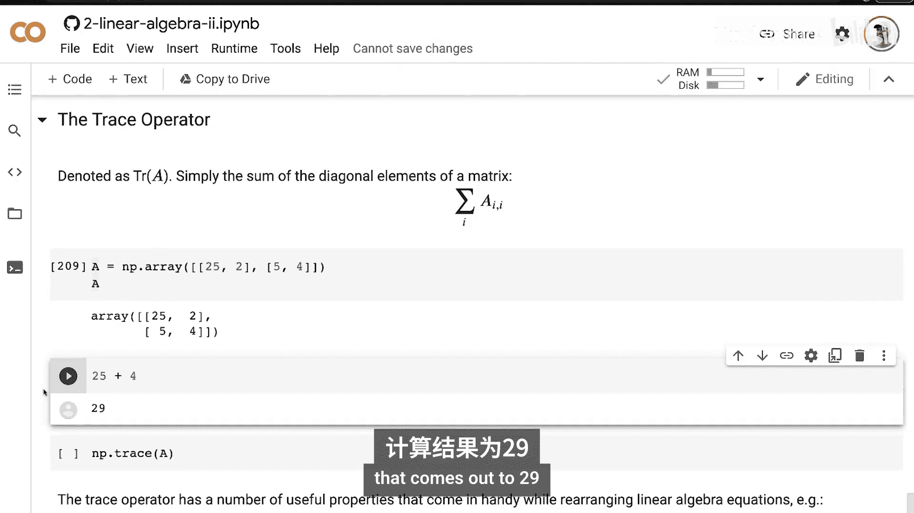

Now there is a built in nuy trace method so we can toss a in there。

 and that gives us the same answer 29。

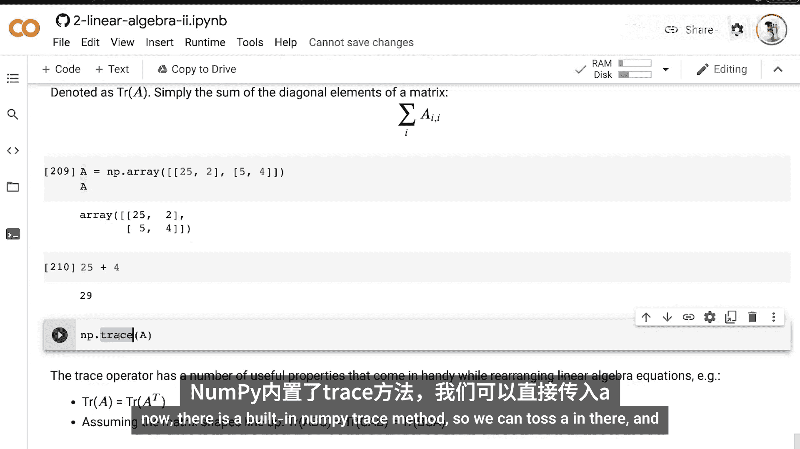

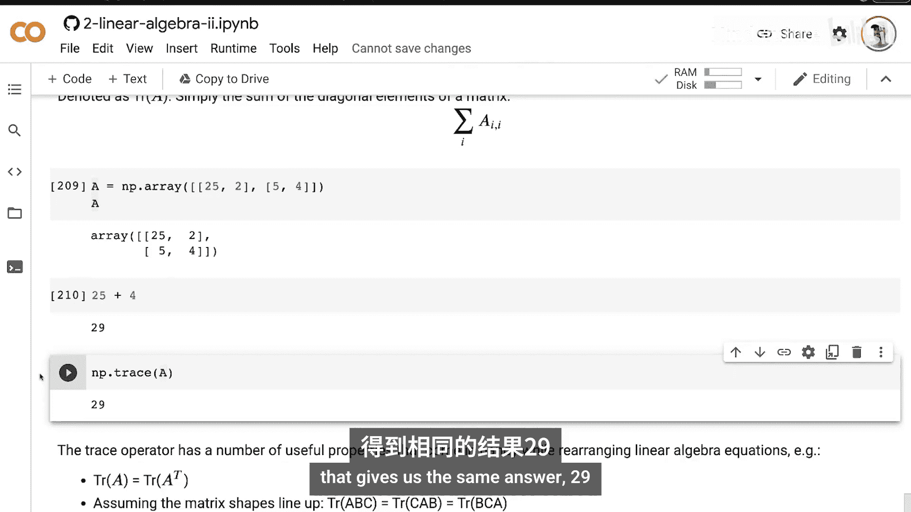

So the trace operator has a number of useful properties that come in handy while rearranging linear algebra equations。

For example， the trace of a is equal to the trace of a transpose。

 and this should be pretty obvious just from looking at this if you were to transpose this matrix A。

The main diagonal stays the same， and so the trace of a or a transpose is 29。In addition。

 assuming that the matrix shapes line up， then the trace of various combinations of matrix multiplications。

 if we have three matrices， A， B， and C， we could。Perform matrix multiplication of A， B。

 and C or C A and B， B CNNA， when we take the trace， it's the same we get the same answer out of it。

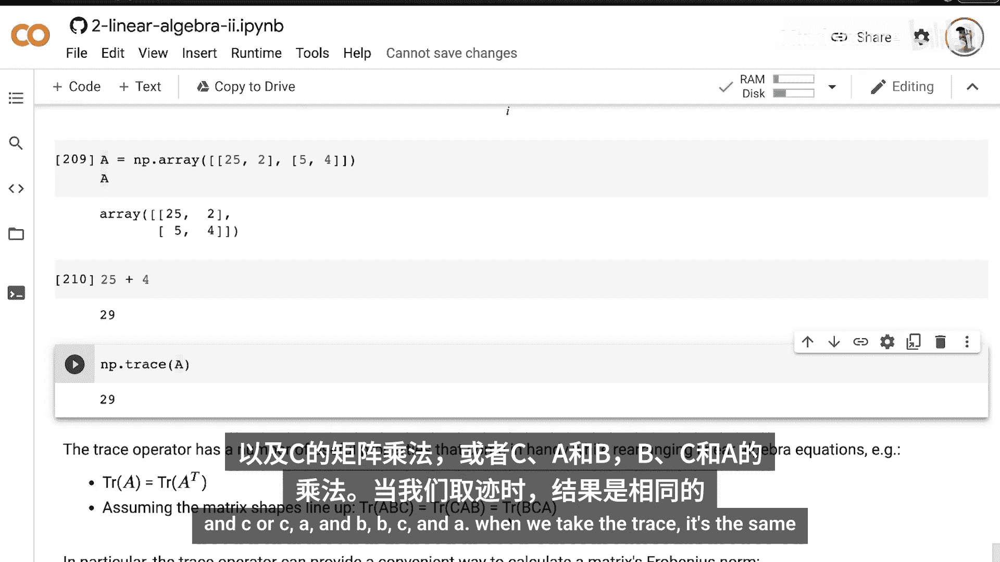

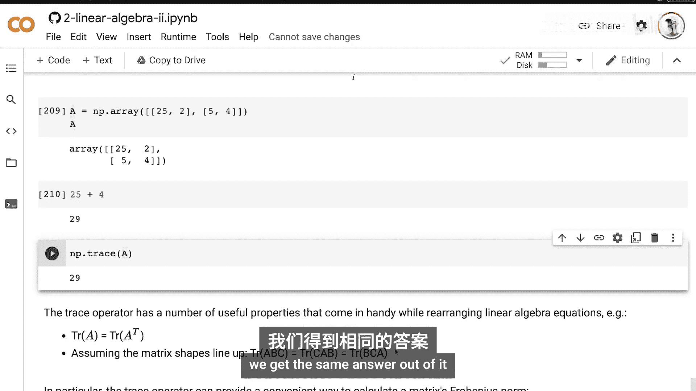

In particular， the trace operator can provide a convenient way to calculate a matrix's forbeius norm。

 so remember the Frbeius norm from near the end of our intro to linear algebra subject earlier on in this machine learninging Foundation series。

 this is the matrix analog of the L2 norm。

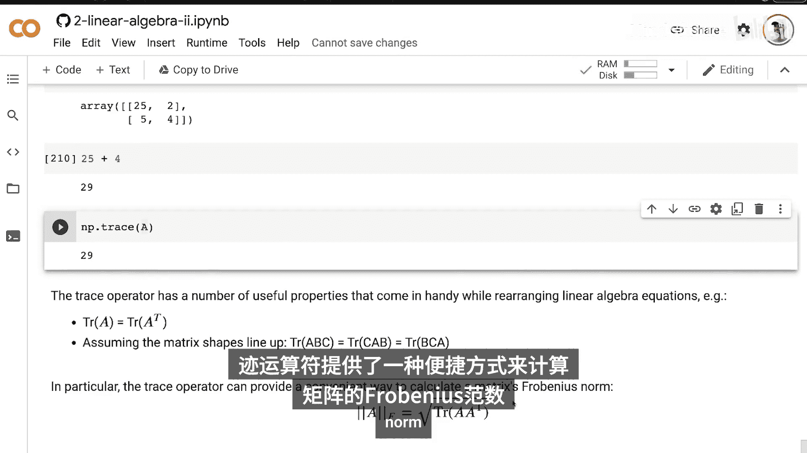

That we use for vectors and the forbeius norm can be calculated as the square root。

Of the trace of A a transpose。So there you go， so three nifty tricks that you can do with the trace operator。

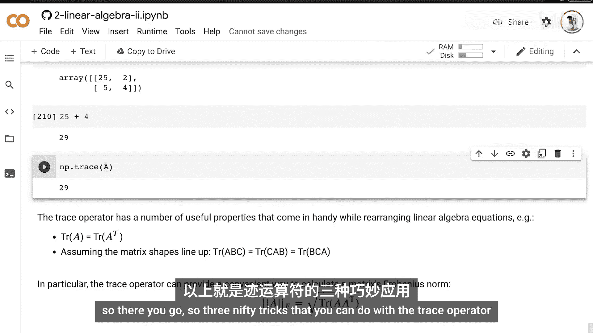

So to reinforce these concepts， let's use the matrix AP here。

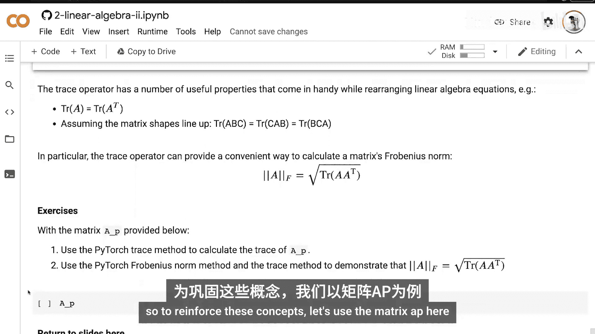

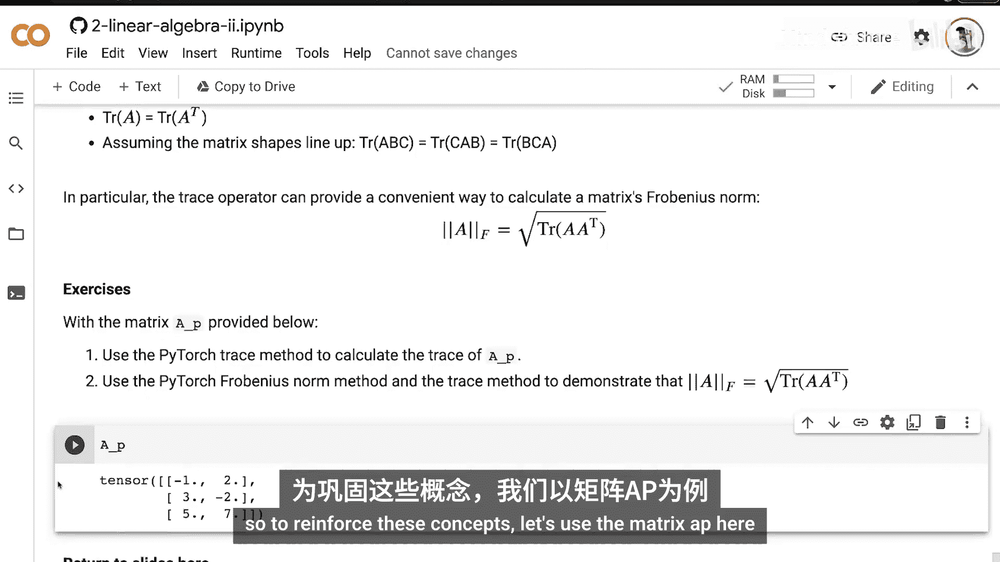

And for two exercises for you to carry out on your own。

Go and look up using your favorite search engine on the internet to find the Pytorch trace method。

And then use it to calculate the trace of a be here。And then similarly。

 browse the internet to find the Pytorch Bbeius norm method。

And use that in conjunction with the trace method to demonstrate that the Frbeius norm。

Is equal to the square root of the trace of A A transpose。

 So you should now have under your belt all of the ptorch theory that you need to calculate both the left hand and the right hand side of this equation。

 In that they are equal to each other。 And the only things that you'll need to look up that we haven't covered before are the pytorrch trace and for vennous norm methods。

 All right， I'll leave you to it。

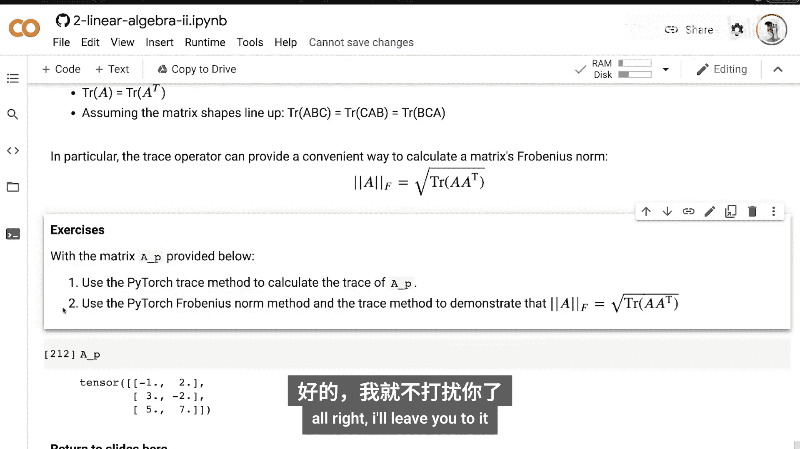

Nice， that's it。With that， we've now covered the final piece of linear algebra theory in my entire Ma learninging Foundation series。

To tie a bow on the series linear algebra content in the next video we'll apply a powerful machine learning technique called Pri component analysis。

 which is facilitated by the trace operator working in concert with several other linear algebra concepts that we learned earlier on in the series。

