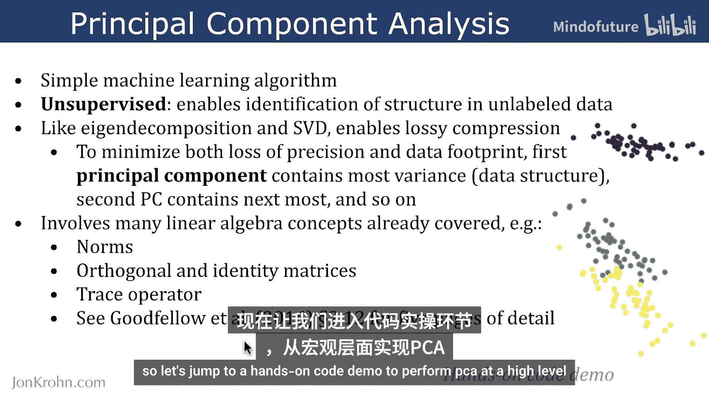
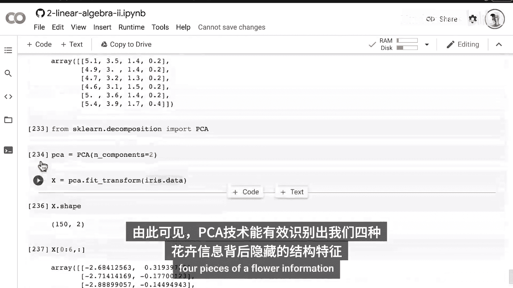

# 机器学习的线性代数及Python实现 ｜ Linear Algebra For Machine Learning p47 P47_主成分分析（PCA） — 主题40 -BV1L8nLz6E8C_p47-

Via highly visual hands on co demos in Python， this video introduces principal component analysis。

 a prevalent and powerful machine learning technique for working with unlabeled data Princ component analysis is a simple machine learning algorithm。

It is unsupervised， so this means that it enables the identification of structure in unlabeled data。

 So if you have a bunch of data say you have a bunch of measurements of flowers。

 but you don't have any labels for what kinds of flowers they are。

 you can nevertheless take those measurements and use an unsupervised learning algorithm like PCA。

To identify underlying structure in your data。Like eigen decomposition and singular value decomposition。

 PCA enables lossy compression of data。To minimize both loss of precision and data footprint。

 the first principal component contains the most variance， the most data structure。

 the second principle component contains the next most and so on。

 so as a process of applying this unsupervised machine learning method PCA to your unlabeled data。

 it will come out with a series of components， and that first component is the most important it contains the most variance。

 the most data structure in your dataset。PCA involves many linear algebra concepts that we already covered in this machine learning foundation series。

 for example， norms， orthogonal and identity matrices， the trace operator。

And if you want to see all of the equations， all of the linear algebra concepts that go into enabling principal component analysis to work。

 I recommend you check out the deep learning textbook by Ian Goodfellow in his colleagues which was published in 2016 and is available free online。

 check out section 2。12 for five pages of linear algebra detail that get you from these underlying concepts that we covered in this machine learning foundation series all the way through to this machine learning algorithm。

 which will allow us to identify structure like we see here in our data。

 So let's jump to a handson codede to perform PC at a high level and so make your way to the principal component analysis section of the linear algebra 2 Jupiter Note。

 The PC example code here is adapted from code that I adapted from。

A cognitive science course。 Let's start by importing this specific data set。

 It's called the Iis data set， and it's found in Psyit learn。

 and let's have a look at the data so it consists of 150 rows and four columns。

And those four columns correspond to four features， four measurements of flowers。 so petals are。

 I think pretty much everyone knows what petal of the flower is the bright colored part of the flower。

 and so we have measurements of the length of the petals。

 as well as the width of the petals for a given flower given one of the 150 flowers in our data set。

And then another part of flower anatomy that you might not be aware of is the sepel。

And these are green structures they kind of look like leaves and they're immediately below the petal on a flower。

 so anyway the details， the biology doesn't matter too much。

 the point is we have four measurements of plant anatomy specifically of different irisees。

 150 irisees and we have four measurements per iris。So we can have a look at these data。

 here are the first six rows， so for six irisees for six flowers， we have these four measurements。

 seepal length， seal width， pal length and pedal width。All right， so let's now import。

The PCA method from the psychic learn decomposition module。

And we're going to specify here that we want to return to principal components and the reason why we're asking for two principal components。

Is that we would like to be able to plot this as an Xy plot。

 so we're going to compress four features worth of information。

 four columns worth of information down to the two principal components that account for the most structure amongst all of the features in the data。

So in order to actually fit our PCA model， we use the fit transform method。And pass in our data。Now。

 the shape of our output here。Has 150 rows， so we still have 150 rows。

 one for each one of our flowers in the data set， each one of our irisees。

 But now we have there are two principal components instead of four separate features for each flower。

So now when we look at that， you can see we have these two values。

 the first principal component and the second principal component。

So now we can plot those principal components out using the Maplotlib scatter plot method。

So across the two principal components， we now have our 150 flowers laid out and we can see that there is a clear structure here。

 so for example， these flowers appear to be different in some substantial way from this group of flowers here。

And so you could then use that to investigate further and try to understand what's happening in your data now as it happens for these irIS data。

 we actually do have labels， so up until this point we've been considering our data unlabeled so we just have features but we don't have outcomes that we could predict with those features。

 and that's what I've been making it seem like so far。

 but in fact for our 150 irisees we do have a label which is called a target here。

 target because we could predict the label with our four features。

 so we could use these as inputs to a model to try to predict our target， our labels。

 but we're not going to try to predict labels here we're just going to use them to add color a third dimension to our plot of ires along two principal components。

So to do that， these two lines of code here are just to show you that for our 150 flowers。

 we have 50 each from three different species of iris， and specifically those three species are Ctoa。

 Versicol， and Virginiaica。So now let's add that color。

 so we're going to add this additional color option to our scatter plot alongside our two principal components。

And now we can see clearly that the three flowers， the three species of iris correspond to three characteristic regions of this plot when plotted by the two principal components。

 so the PCA technique was effective for identifying hidden structure underlying our four pieces of a flower information。

 so cool we've made it we've covered all of the linear algebra content in my machine learning foundation series。

Up next， I've got a short video that provides you with resources for deepening your linear algebra expertise even further on your own if you're so inclined。

