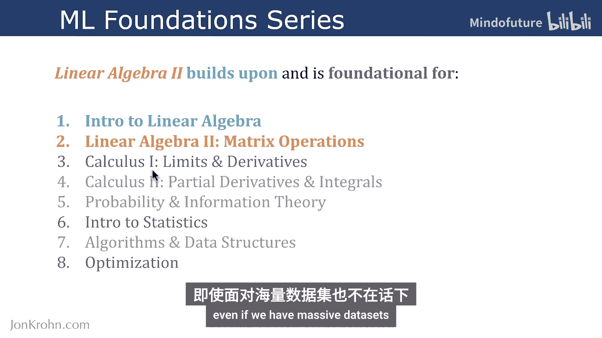
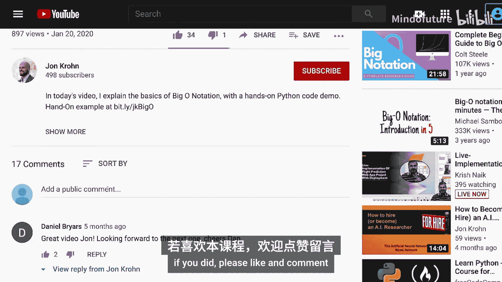

# 机器学习的线性代数及Python实现 ｜ Linear Algebra For Machine Learning p48 P48_线性代数资源 — 主题41 -BV1L8nLz6E8C_p48-

Welcome to the final linear algebra video of my Ma learninging Foundation series。

 it's a quick one to leave you with my favorite external linear algebra resources。

If you felt that you needed some brushing up on basic algebra， such as rearranging equations。

 like we did many times so far in this machine learning foundation series。

Then I recommend checking out the Khan Academy， which is a website packed with clear explanations of all manner of algebra concepts。

You can alternatively check out Khan Academy videos on YouTube or3 blue1 brown。

 another YouTube channel that provides amazing videos for basic algebra。In terms of linear algebra。

 more directly the kinds of concepts that we focused on so far in this machine learning foundation series。

I recommend the blue1 brown videos again。I also highly recommend checking out chapter2 of Ian Goodfeelow。

 Er Coorville and Yahua Benjiio's book Deep Learning， which is available free at deeplearningbook。

org。The content that we covered so far in this machine learninging Foundation series was influenced by the content in that chapter。

And that might not surprise you because I referenced sections of that chapter a number of times in the Ma Learning Foundation series。

 namely in situations where I showed you how to do something at a high level in Python。

 whereas the deep learning book provided the underlying math without any corresponding code。

You can also check out chapter2 of Dson Roth etal， their mathematics for machine learning book。

And Sheldon Axler's linear algebra done right is a well known general linear algebra text in the field without any particular focus on machine learning applications。

In terms of what I most highly recommend you study next， well that would， of course。

 be the next steps in the machine Learning Foundation series。

 So having now learned foundational linear algebra。

 we are well prepared to jump into calculus 1 on limits and derivatives as well as the calculus 2 class that will follow on partial derivatives and integrals。

Probability and information theory， which is the fifth of eight subjects in this series。

 also builds on the linear algebra subjects we've studied already， and finally。

 the eighth and final subject in the series on optimization ties together all of the preceding subjects。

 including the linear algebra we've covered so far。Right。

 so with that we've reached the end of segment 3 on matrixtri operations for machine learning。

 we talked about singular value decomposition， which allowed us to compress an image file。

 we talked about the more Penrose pseudo inverse， which allowed us to perform something like matrix inversion of non squarere matrices。

 enabling us to solve for unknowns in systems of equations like those that are common in machine learning。

We learned about the trace operator quickly。And then we learned about principal component analysis。

 which ties together the trace operator and lots of other concepts that we learned earlier in this machine learning Foundation series to power PCA。

 which is a simple machine learning algorithm for handling unlabeled data and finding structure in it。

And then just now， we talked about my favorite resources for further study of linear algebras。

 So that's the end of segment 3 on matrix operations for machine learning。

Which is the final segment of subject 2 in the8 subject Maine Learning Foundation series。

This linear algebrabra 2 matrix operation subject that we just wrapped up was made up of three segments。

 So we started off with a quick review of essential introductory linear algebra。

 And we moved on to decomposition of a square matrix into its eigenvectors and eigenvalues。

 and only moments ago， we wrapped up the matrix operations for machine learning segment。

That means that we're all done with the first two subjects of my machine learning foundation series。

 which also means we've completed all of the linear algebra content of the series。

Many aspects of the content we've covered so far， particularly the understanding we've developed of tensors and how to perform operations with them in Python。

 will serve us well in all of the remaining six subjects in the series。

 The content we covered in this linear algebra 2 subject will be particularly beneficial for calculus 1 intro to stats and optimization。

On that note， up next is calculus， the study of rates of change。

 which is essential in machine learning because it allows us to efficiently solvefur unknowns。

 even if we have massive data sets。

Calculus， particularly its applications to machine learning。Is so elegant and awesome。

I can't wait to see you there。To be sure not to miss the next tutorial in this series。

 subscribe to my channel。Thanks for taking part in the tutorial， I hope you enjoyed it。If you did。

 please like and comment。

To be sure not to miss any of my content， head to Johnchrome。com and sign up for my email newsletter。

You're also welcome to add me on LinkedIn。Simply mention that your reviewer of the Machine Learning Foundation series。

You can follow me on Twitter too if that's your social medium of choice。See you next time。

