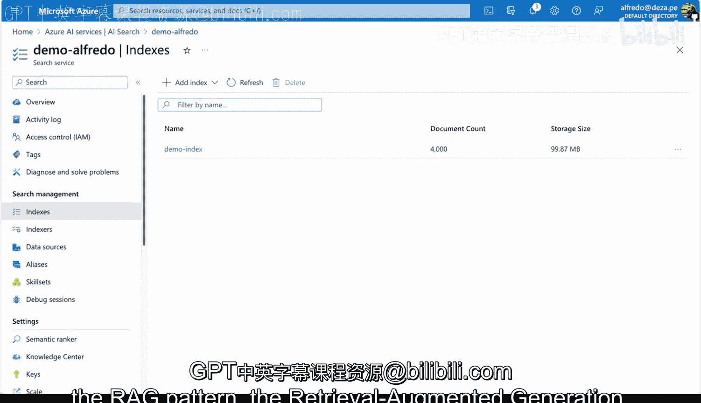

# 杜克大学《Azure的端到端 LLMs｜End to End LLMs with Azure 》中英字幕 - P10：10_01_02_Azure AI搜索概述.zh_en - GPT中英字幕课程资源 - BV13E421N777

The Azure AI search previously known as the Azure cognitivetive search， which is this one right here。

 basically is the powerhouse from Azure that will allow us to try to enhance our applications when we're trying to embed some documents so let's take a quick overview I'm going click here I have one that was previously created a while ago。

 but I will not only show you a couple things there。

 but I'll go through the steps on creating a new resource right here。

 so first off I'll just create one with demos a resource group as always I try to do demo demo demo search I can do so I always try to prefix with demo because it's always a good way so that we can destroy resource groups later on All right so service name we can say and I believe this has to be unique so we can say then。

Fredo search。And that should be good enough and then with US2 now there's a tier and I'm going to change these to make it free。

 so this is something very useful to understand because this means that you can have a free tier with 50 megabytes of storage that allows you to have very basic operations at no cost so we're going to select free。

And that's going to be very good， one replicas max， one partition。

 only one search unit which is fine for what we're trying to do whereas US2 is the region and're going I review and create so this is going to take a second it's going to do some validation and then it's going to proceed to do the actual creation。

Allright， these succeeded so we're going to go to the resource I can actually click right here or click to this it doesn't matter I'm going to click go to resourcesource so in here is where things start to get interesting you will get something like import your data which is really neat import and vectorize data which is actually one of the main steps in trying to get to work with data when we're looking to implement something with large language models vectorizing is definitely where we want to go now you can do it either here in the UI and'm going to click through here I'll have to create a blob storage account I don't have one otherwise you'll have to select if you have a search account you will select a container and what the folder is with your data I don't have this we won't go through these right now。

But I'll show you some other ways where you can actually do these All right so I have this other one that I had previously created。

 I want to show you something else I had an index and the index means that I have previously uploaded my data and index everything with my my vectorized data so you can actually do a search Explorer。

 you can do fields， you can do course I was doing something about wine so let's see that comes out and you can see there's lots of results coming up these are not relevant right now and that is fine for now and we'll see how to implement those later but in essence that is very quickly how you can get started with Azure A services and specifically AI search and create your own instance your own resource so that able you will be able to essentially connect your application later when you。

Are ready to go to start interacting with large language models and rag the rag pattern。

 the retrieval augmented generation。

