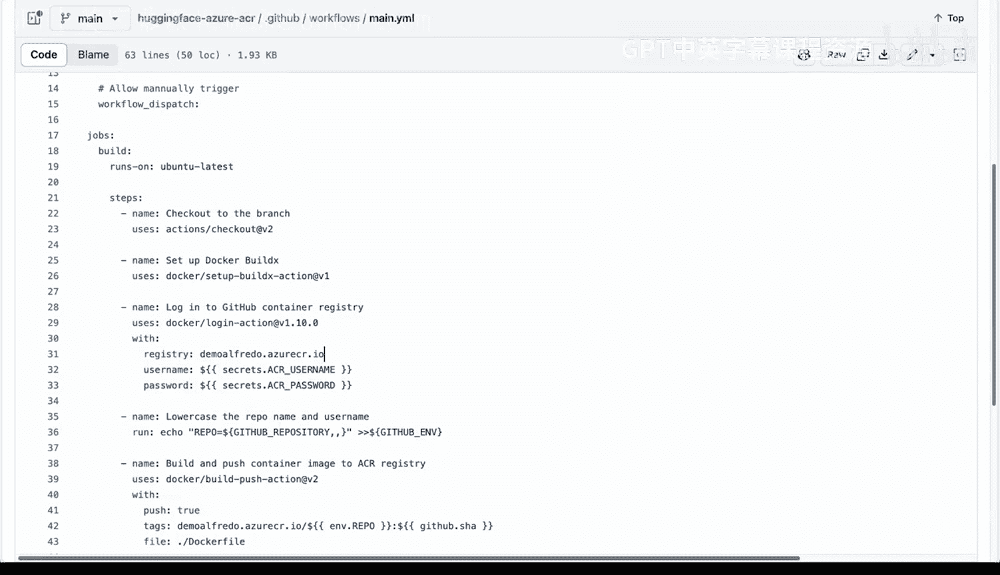

# 杜克大学《Azure的端到端 LLMs｜End to End LLMs with Azure 》中英字幕 - P11：11_01_04_使用GitHub进行自动化与部署.zh_en - GPT中英字幕课程资源 - BV13E421N777

Automation using GiHub actions is a powerful way and very straightforward way of deploying your end to end applications I'll go through not into a lot of details but into a very high quick overview on what that is and I have a repository here is for deploying hugin face application using models to Azure the Azure container registry so what you need to do is create a dot Github directory a subdirecty called workflows where you can put a Yaml file and the structure。

 the general structure of the Yaml file you actually get like a template if you want to get started with it。

And in here you see I have like a name。 I'm actually not using some of these environments。

 These are variables to are commented out。 that's why it's grayed out and I'm allowing to make this a manual trigger。

 That's what this little line here line 15 means。And then what we're going to do is going to check out all of the code and then we are going to do a Docker bill。

 that's what these actions， these steps are doing right here。

Then I'm going to logging into the GiHub not actually not the GiHub container registry Im going I'm going to do an authentication to the registry I had previously created a Azure container registry the details on how to create one is not important right now but it's just the ability for us to build and push to an actual registry all of this chunk right here means that this is going to be built using the Docker file and that repository and going to get pushed now why that's important and why it's the important step and why are we using GiHub actions I think it's a very nice way to store some secrets。

And in very few steps you can see that this is going to be 63 lines long to be able to not only build。

 but also deploy your container with your application that that can actually talk to something like Azure Open AI service so finally you're going to have like the deploy section and inside the deploy section we're going to authenticate to Azure which it's an interesting way of approaching this pattern where we will have to authenticate to Azure to be able to deploy and then finally we will deploy to a container app container apps in Azure or interesting we're building a container and when telling Azure hey。

 we have a container here and we to we want to deploy it So what we're doing here with all of these different options that are right there is essentially saying we have a container go fetch it from a specific registry。

It has to be with a certain type of memory and CPUs。

 so allocate those for me and then make sure that you pull the specific tag that I want in this case this one is called hugging face Azure ACR so again this is a very straightforward way of deploying or using GiHub actions。

And we will see these in more detail later， but I think it's a very straightforward not too complicated way of actually adding things Now the last thing I want to mention is that when you see all of these secrets and secrets are specific component of Github actions that will allow you to store certain things in GiHub itself for the repository and you can reference them later safely in something like a Github action in a workflow like this one so that you can reuse them so the setup is pretty straightforward to just add them and then you're going to go for reusability that is a quick overview of what Github actions are and we'll see them working in detail later。

