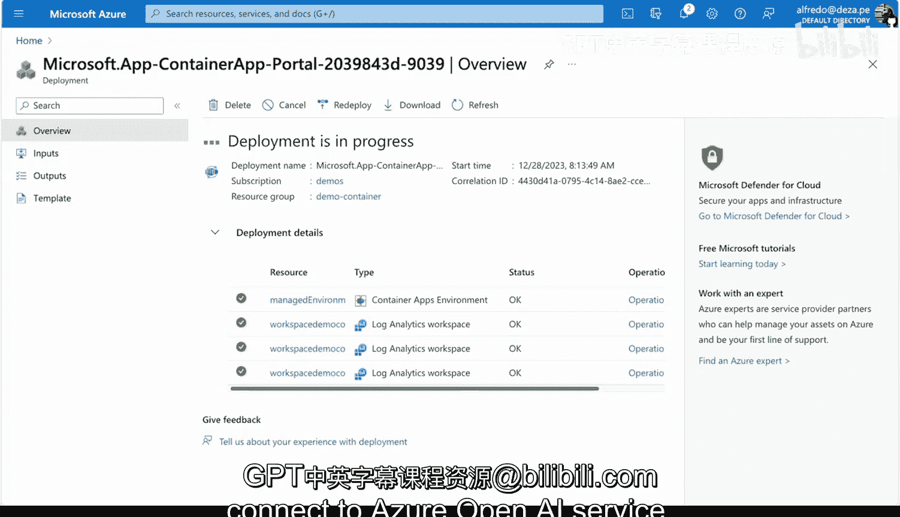

# 杜克大学《Azure的端到端 LLMs｜End to End LLMs with Azure 》中英字幕 - P12：12_01_05_设置Azure组件.zh_en - GPT中英字幕课程资源 - BV13E421N777

Let's start creating the services we're going to need in order to get started with our application or launching our application to the cloud。

 so we're in the Azure portal once again and what we're going to do is we're going to go into container apps and're to create a container app but before we do that there's one very important detail that we need to keep in mind when we do this our automation is already in place but one key aspect of it and I'm going to switch over to the repository here。

 I'm going to go to that Github s workflows and go and take a look at the Github action I've already premade these。

 there's an important detail， do you see the group name and the container app name those are crucial so and I need to get them correctly inputted into the creation so it doesn't matter the order like in my case this exists before creating the service but。

If you don't just make sure that these match when you're creating the container。

 So in the application， I'm gonna to go into container apps into Azure Port。

 I really have one previously created and I create one from scratch。

 So I'm going to create one and in this process I'm going select a right description and the resource group is what I was still on you before。

 So I'm gonna to say let's just verify and it's demo dash container and the container app name is going to be the same。

 So let's create that new resource resource group demo container。

And it seems that I already have one so perfect I can I can just use a dropdown and do search for demo container there we go and name my application the same so by doing that I'm going to ensure that things are going to actually work correct Australia East is not the region that I want I prefer East US and that seems okay to me Once I do that I can just review and create this will go through the verification and then I can just click create at the very end。

Perfect， this is going to take a second and once it's in place I will be able to to start using my automation。

 so these are all the resources that I need because I'm going to go back to the Github action here because what this GithHub action is going to be using is using the GiHub container registry by using the Github container registry。

 anything that I produce the container that I produce is going to be stored in Github itself。

 so it is sort of like like a type of architectural components or ordering that allows me to put the container in specific portion it doesn't mean that you have to use the Github container registry in this case GHCR that Io it could very well go into Azure but what we're going to do here is we are going to make use of。

These very easy， very straightforward container registry offered by GiHub so once you'll see that this will start making progress here by having some of these go through the deployment progress and once it completes everything again will be ready for us to continue make progress in trying to deploy these and automate the deployment of our application that will connect to Azure Open AI service。

