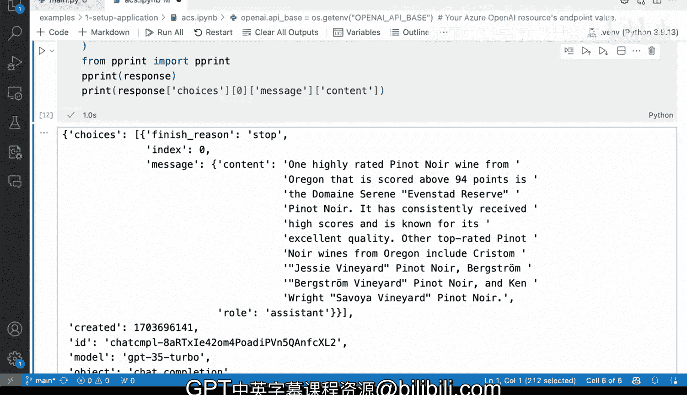

# 杜克大学《Azure的端到端 LLMs｜End to End LLMs with Azure 》中英字幕 - P13：13_01_06_在Azure OpenAI中使用RAG.zh_en - GPT中英字幕课程资源 - BV13E421N777

So last time we were looking at our Jupyter notebook。

 we stopped right here with our CSB loader and we had everything ready to go。

 so let's actually try it out after we've done the document and I'll show you a couple of things that we can do here。

What we're going to be what we're going to do is we are going to use the similarity search with relevance score。

 So we're going to say we're going to ask Azure container search which is this right here what is the best governance ofonwin in App Valley above  94 points so I'm going to run this and we're going to get a result right so in this case is let's say declaration App Valley governanceness whensure that looks okay next what we're going to do is we're going to set up open AI or Azure Open AI service so we're going to be using our keys and everything that we need in order to get that going so what are some of the components here so we're going to have here we're going to load this from the environment variable the open API base we're going to need the key。

 we're going say this is by the way Azure it is not open AI this is the open AI API version。

 this is something crucial because if you're needing or requesting something。

from a different or a newer API， this won't work。And the messages is where I want to draw your attention to。

 we have the system and we're going to say assistant is a chatbot that helps。

That helps you find the best wine for your taste。 Okay， great。

 so we're setting the context for the system that is not something that the user will have access to。

The user and this is where the query will come in， the query will go right here。

 What is the best governance so when you want in A Valley above and 94 points and then the assistant well have extra content and where's that content coming from this is coming from you guess that the Azure container search from right here so we need to capture all of these right here and get it right into content so once we have all of those messages ready and this is actually where you start seeing how all of these bits and pieces start coming together right we have the assistant and the system message we have the query right here and we have the content that came from the Azure search the Azure AI search or search engine as well so once those are done let's scroll here we're going to get finally going to talk to openaiI when I say chat completion create。

We're going to talk toang， this is our deployment name and we're not passing the messages where the messages。

 these ones that we created before， and then we're going to print actually the content or response so let's see what happens now。

Al right that took 1。2 seconds so it is worth talking to APIs behind the scenes so let's take a look。

 so choices finish reason stop index0 and the message the content is here is a highly rated Caness windum from Napa Valley with a score above 94 points so this is all the doing of the large language model the wine 1849 declaration Caness whenium from 2014 the rating though was not very good it's 91 points so not very good and。

And you can see here that it gathers finally like a nice way to print out the responses like this and we can actually try something slightly different。

 so let's change that in order from NAPA to 94 point when I do pin wine in Oregon noir wine in Oregon above 94 point now what I need to do in order for these to work is to make sure that that will get changed so let's just copy these and make sure that we can go here and search for that before before we actually send that response that extra context to to the open AI endpoint so that looks correct and now I'm going to run these and now with that context the large language model will be able to do this one highly rated pinot noir wine from Oregon that is scored above 94 points is this one right here perfect。

We're verified that everything put together， we glued everything together and everything works exactly as we wanted with Azure Open AI service and the Azure。

 the Azure container， the Azure， the AI search previously known as Azure Ctive search。

