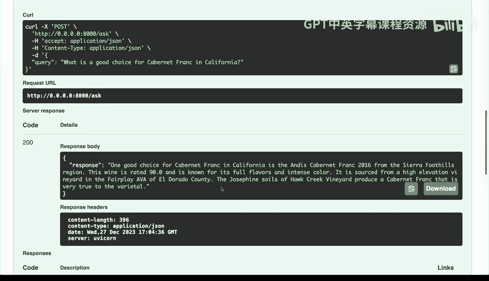
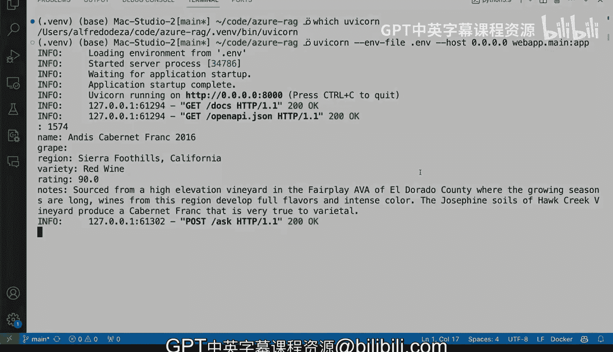

# 杜克大学《Azure的端到端 LLMs｜End to End LLMs with Azure 》中英字幕 - P14：14_01_07_应用程序概述.zh_en - GPT中英字幕课程资源 - BV13E421N777

Now we're ready to put everything together in an application and we're going to do this very straightforward way。

 we're going to import everything kind of like what we had before with a Jupyter notebook。

 except this time we're going to serve it as an API this is going to be an API in a container that is going to live in Azure but we're going to be available able to verify these locally before that so we're going to use fast API which is a Python framework。

 we're going to use the open AI embeddings and the Azure search like just like before。

 so to get started we're going to define our application right here。

 we're going to gather all of the information required to get into openaiI we're going to make sure that the embeddings are there and we're also connecting to our previously deployment for Azure Open AI embeddings remember that model that we had and we're going to connect to Azure cognitive search this is required because this is how we're going to extend。

To our query。We're going to expose a couple of routes， mainly the main route。

 which is all going to redirect to dogs and you will see why in a second。

And then we're going to allow a post request to slash ask the post request is going to do three things。

 it's going to first query submit that query to the search to Azure cognitive search and then it's going to then extend that to the assistant function that I'll show you in a second that will have both the query and the search result remember the query comes from the body and it goes to the search but it also goes to the large language model and finally that enhanced response is going to go to this JSOM response I'm going to say here response is a key and chatbot response is what comes from the LLM so helper functions the search this is exactly the same as what we had before and I've added the print statement so that we can see what's coming up from the search so we can verify that as we're running the application and this is going to do the similarity search with relevant scores exactly the same as we were doing。

With a Jupy notebook。And then finally we're gonna to have the assistant。

 this is the AI interaction with our open AI service where we are actually going to be using same pattern as before in the Upyter notebooks when I have the system chat that helps to find you helps you find the best one set the user query to what we had before and the content is the context。

 a thing that came the text that came from Azure AI search from the previous from the previous call from previous function Finally we're going to submit all of that together with the messages right here and our response is going to be this one right here response choices。

 the first choice the message key and the content from that message and all that is going to go all the way here to expose route which is ask All right so let me quickly very quickly show you again。

the requirements and the requirements for this is going to be Uicorn which is the web server。

 fast API， the web framework and that is pretty much it the other requirements are going to be all the same and if I show you the Docker file because this is going to get containerized this is how we run the application and it's being used with Uicorn which is the web server when install the requirements and that is pretty straight nothing too complicated to run these and once we run it will'll actually check it out we' are going to run these by toggling my terminal so I'm going say toggle my terminal and I'm going to make this a little bit bigger and in here I'm going to run the Ubiorn so let let me make sure that Ubiorn is there is perfect is coming from my virtual environment and I'm going to run that what is going on here so let's quickly decompose。

ThisUicorn is the web framework that has been pre installedal。

 it has a command line tool I'm passing my environment file so they will be able to load those all of those keys and secrets that I need I'm going to latch my attach myself or this application to0 that's zero that's zero I'm running this in local host web app is the directory where I have everything main is the main by file and app is the variable for fast API so I'm going to run this。

And now it's loading。 so I'm going to go ahead and go to this address， which is the local API。

 So I've opened up my browser。 This is local host order 8000 and I get a couple of routes right here。

 So what's going on and I have the route and I have to ask remember that is exposed。

 This is the post is going to allow post So what this allows me to is interact right away with my API So remember I had a query this is the user the user query。

 so I'm going to try it out。 I want to try it out。 I want to I'm going to edit these and I want to say what is a good choice for cabbernet。

Frank in California。So I'm going make that as a question mark and I'm going send that over。

 so I'm going to execute。 And what is going to happen behind the scenes is that this application is going to send this is my actual API is going to talk to the API is going to do that for me So I'm going send this I'm going execute is going to load and let's take a look at the response So response body was one good choice for Cabernet Frank in California is the Andy Cabernet Frank 2016 and give me the wine ratings and where is it coming from and perfect because he's talking I know it's talking to the Azure Azure search the Azure AI search if I go back to my my text data Vi Studio code。

 which is right here you will see that I got the couple good requests and remember I was printing the response This is a response where you can see the CSB that we originally loaded producing useful information that the large language model。

Can actually consume。 This is the application overview。 This is what we're going to deploy。

 and this is going to be end to end from gathering the data all the way to deploying it as a service in Azure as a container。

