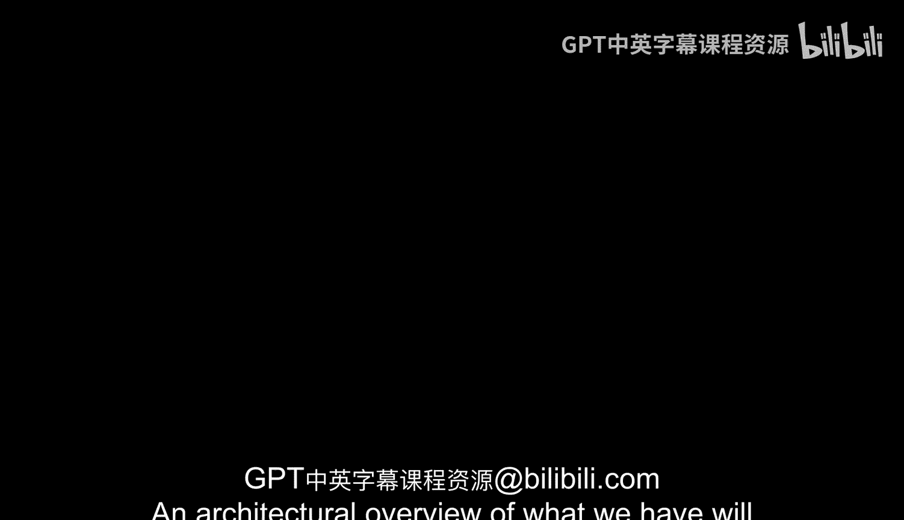
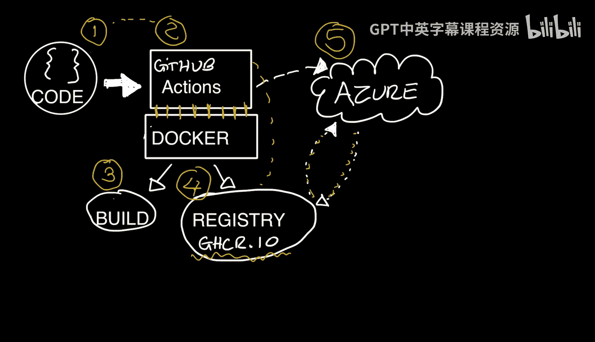
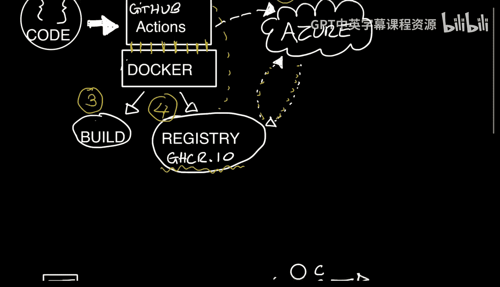
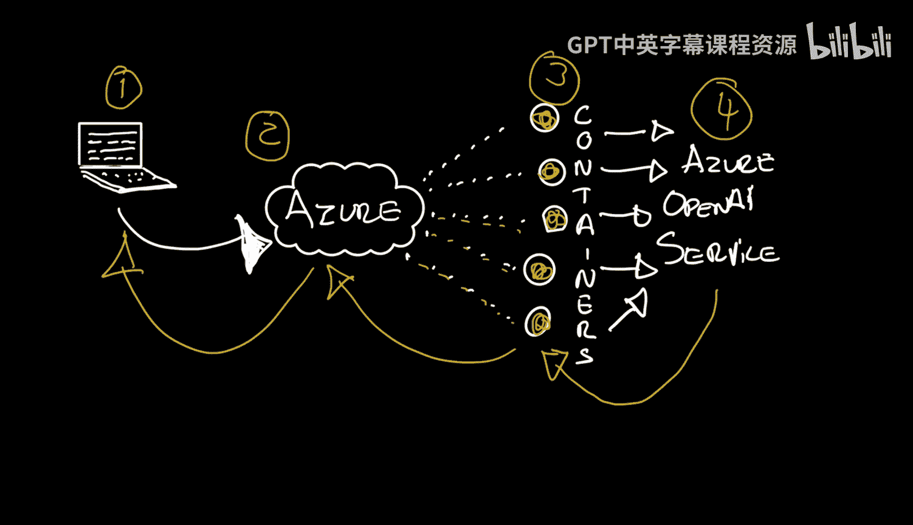

# 杜克大学《Azure的端到端 LLMs｜End to End LLMs with Azure 》中英字幕 - P15：15_01_08_部署与自动化概述.zh_en - GPT中英字幕课程资源 - BV13E421N777

An architectural overview of what we have will help us understand how everything is going to work together。

 so let's start right here with the code， we have our application and live some Github that's fine we have an HTP API is going to receive some requests is going to interact with a model and how is that going to actually get deployed well we're going to start with the code and we're going to use Github actions which is going to be our second step right here and Github actions is going to help us with the automation it is going to be interacting with Docker。

 so it's going to set up a Docker build system and some commands and with that we're going to be able to build our container application building a container application is an important step what we're trying to do which is actually get this to be deployed on the cloud on Azure so that process will build a container。

And then we'll move over to our step number four right here， which is to push the resulting image。

 the resulting container to the registry。 and in this case， we're using。G GithHub container registry。

 which does the Ghcr。o， you can actually use other registries as well。

 but in this case we're going to simplify because。The username and password。

 everything's already set up for us and we'll see those in details later when we were looking where we're poking around the GiHub actions workflow。

Now， when the registry step is done， we're going to go back。

We're going to go back into Github actions and then GiHub actions is going to say。

 hey Azure by the way you are ready to go to pull the resulting image from our registry so we're triggering it's a triggering effect we're saying hey Azure in this case when I use Azure container container service and it's going to pull that container from the registry and that's where this interaction is going to happen here where things are going to go to the registry from GiHub container registry。

 the GHCR that Io and going back to Azure and then that is going to get published Now let me move further here and actually show you how this is going to look so finally we are going to have a user when I start here when I call this step1。

 a user is going to interact with our application and it's going to send some prompts is going to send some queries and those are going to。

Be received by Azure the Azure cloud and in the cloud is where our application is going to live so Azure is going to be able to scale our application。

 this is called a horizontal scale because like more requests and more handling of requests will allow us to create these little blobs here that represent containers so the more we need the more Azure can deploy and can expand so that expansion that growth of containers is called a horizontal scaling system where we're going to be able to process all of these requests that are coming in into our containers so once it gets to the container as you know the application is going to be able to talk to so this would be a step three or containers is going to be able to talk to Azure open AI service。

So once we're able to talk to Azure Open A service。

 our request is going to get processed is going to go to the containers。

 which is going to back through Azure in finally back to the user with some sort of I response so this should give you a new good solid idea on how this is going to work beyond just looking at the application and the HtTP API and the code that is actually putting all of these together so next we'll see how we can get into the Gitthub actions and start the point and see all of these working live。

