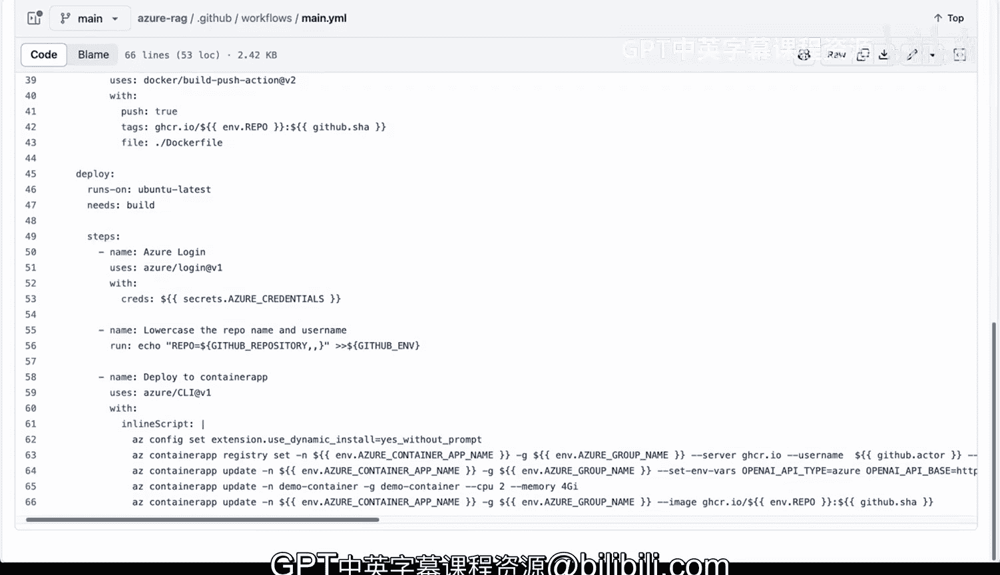

# 杜克大学《Azure的端到端 LLMs｜End to End LLMs with Azure 》中英字幕 - P16：16_01_09_在Azure中使用GitHub Actions.zh_en - GPT中英字幕课程资源 - BV13E421N777

Using Github actions with Azure is something that I really like to do and I highly recommend and as we've briefly seen before and this is actually the main Yaml file。

 everything is in a YaAMl file within our application repository with which is Azure dash rag under my account so what we're trying to do here is to define certain steps in the past we've seen we walk through very briefly through this but I'll highlight again some of the core components other than the name which can be actually anything you want this right here is crucial as you know when we were creating the Azure or the services on the Azure container app the demo container in this case is what I've chosen so if you using something else you will have to change it here then the workflow the workflow dispatch is an important component as well which will allow us to manually。

So we're not triggering on automatic push to a main branch in this case。

 you can definitely choose to do that in the future if you're confident enough that your changes have some sort of validation and you're get to go to deploy to the cloud this case we're going to rely on manual manual triggering and this is what this oddly named option here in the Yamo file is all about。

This section on building will actually build the container and will authenticate to the GiHub container registry。

 you can see here that the GiHub that actor which is going to resolve to my name and the GiHub underscore token are already predone and preset for me I don't need to do anything there and that will be good to go for authenticate into that which will allow me to push later when Docker wants to push that container registry so you can see here that something to keep in mind the tag is using GHCR that IO that is essential so that at the time that the build completes it will go and will get pushed over to the GiHub container registry and finally we'll have the deploy and this is where we're going to interact with with Azure in order to people to authenticate will have to have the Azure。

edentials already set for having the Azure credentials set we have to actually create a service principle。

 so let me quickly show you what that means we'm going to open up my repository here and I have everything explained right here on that create an Azure service principle in essence you need to authenticate to your to your Azure account or use a cloudhell on the Azure portal and run run this command you will have to have that Azure subscription ID and replace that and you will capture that output and you will put it inside a secret so how that's a secret work well you capture that JSON output I'm going to scroll away here I'm going to go to settings for this repository I'm going to go to this section here on security and going to select secrets and variables and I'm going select action。

And in actions， you will see that I have several different secrets。

 some of those are not important for what we're trying to do。

 but what we need is Azure credentials and the way you create new one is you will click on new repository secret you will give it a name and you will paste the contents here you will add that click on add that secret and that will become available that is how Azure credentials is there so once you have that you're going to be able to authenticate to Azure by using the Azure log in action。

And then we will be able to start our deployment to the container app so what I're going to say is when I use the Azure CLI action and we are going to run some Azure CLI commands in this case we're going to install anything that is required I think this usually for the container app subcom is not not needed。

 so this one right here， and we're going to go through setting some value so let's take a look at exactly what we're doing here。

 we are doing the container app registry set， we're using the container app name。

 the group is the Azure resource group， and then we're going to scroll here which is a bummer that GiHub doesn't allow you to scroll here dynamically but we're going to use the server is going to be the GiHub container registry and the username is going to be my name the GiHub my username GiHub that actor in the password。

Going to be the secrets， the personal access token so the personal access token is something that you will have to actually retrieve actually create and I have a handy link for that in the documentation here for the repository if I click here you will be able to see these generate a personal access token you will have to click here and have enough permissions to write to the packages now the way the way you do that is to actually let me show you the actual link。

And this link is this one right here and this link is GiHub。com/ settings s tokens snew。

 and I added a handy description which is Azure container apps with the scope of writing packages。

That will allow you again to be able to have a good a good token that you will then will need to capture so you go here。

 you have an expiration of 30 days which is fine you have some software read packages and write packages so you need to have something like these the expression set and once you do that it will create something new and then with that you will have to go here to action secret and put it right there with a pad。

 the P going back to the workflow， you will see that I'm using it right there and that will tell Azure not only with a source of the container but also the username and password the next one we're going to do is we're going to set some environment variables and this is going to be the open API type is going to be Azure。

Then I'm going to scroll very quickly here the open AI base that is going to be this one right here which is my deployment。

 demo Alre Open AI Open AI Azure， the secrets is going to be the Open AI API key again now you know how to set up a secrets on your GiHub actions and you will have to do that there then the search service name is your deployment for your search service which contains your index。

 remember we were playing around with an index， you will be able to reuse that。

And then you will use the search service API key This is the Azure AI search and that's what you need to add here the API key which we've already seen before。

 and finally the search index name in this case is demoredo now on to the next one will create a container with two CPUs and four gigs of Ram it is a Python application so we'll need to have those around and finally we will tell the container app。

 hey by the way you need to actually grab this image and start deployment this last line line 66 is in charge of doing that all that is required so that we can trigger that that deployment so once we're done with that we're going to be able to get our application already deployed on Azure deployed and working with Azure so those are all the things that you will need to understand and know for your Github actions to。

To work with Aure。