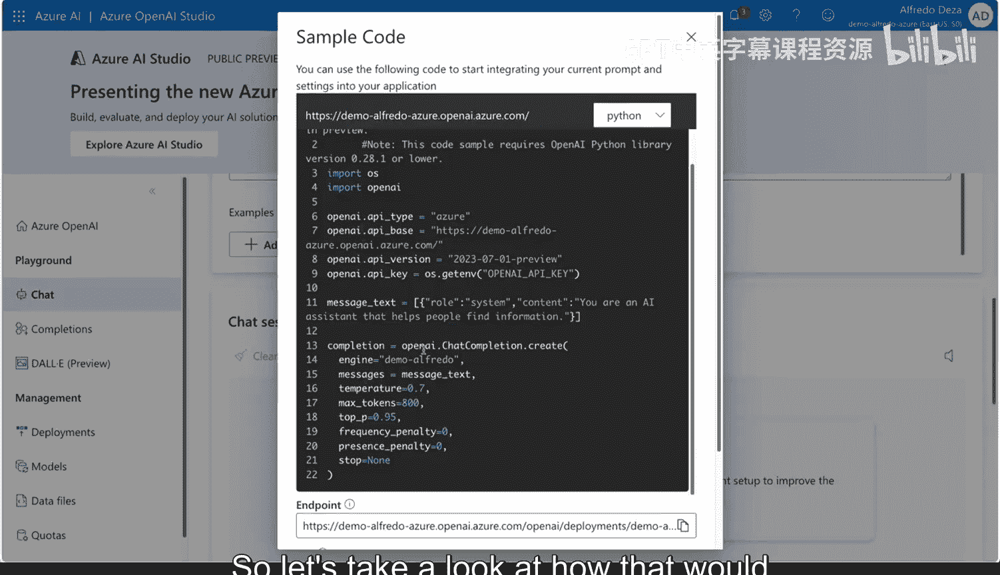
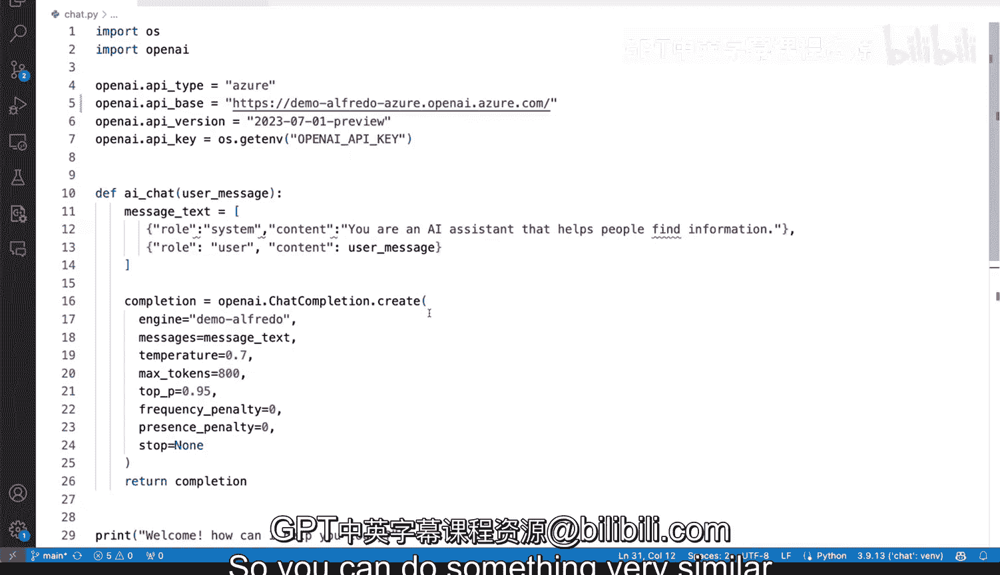

# 杜克大学《Azure的端到端 LLMs｜End to End LLMs with Azure 》中英字幕 - P4：04_01_04_创建Azure OpenAI服务资源.zh_en - GPT中英字幕课程资源 - BV13E421N777

We've left our sample code open here because now we're going to start interacting with it and we're going to be able to use Python。

 So a couple of things with Python。 well these if you copy these as is it won't work right here it is telling you these code sample requires openaiI Python library version 0。

28。1 or lower So right off the bat， you're gonna have challenges with Python Pack and if you've never use Python before。

 I would suggest you go and use the curl example right here which will use the curl command that is available in most terminals for Uni systems like Apple computers or Linux computers or if you're using the Windows subsystem Linux the Windows Linux subsystem。

 the WLS for Windows machines you will have to use something like this。

 but let's take a look and we're going to work with。

Python and see how that looks so I'm going to quickly very quickly switch over to my text data and show you how we're going to do this This is very top to bottom and you can see that there's no functions is just code so let's take a look at how that would look like in a script that I've put together All right so this is the same thing minus or with a couple of differences so we have the declaration here of things you can see that open AI API key is an environment variable so I've made sure that I've exported that before opening this and I'll show you how that looks。

And then instead of doing top to bottom， I created a very small function right here with a couple of changes。

 minor changes， I'm going to add user message and when I'm passing that it's going to get appended right there。

 this is how the model will interact with me I'll say the system is like you're an AI assistant it helps people find information perfect and the role user that means like hey。

 I'm a user I'm going to pass in a message then I'm going to go to the completion and the completion is going to have these parameters that are already prefixed same as before same as the code example that we saw in in Azure on the portal al right and then what I'm going to do is I'm going to loop forever and what I'm going to do is I'm going to say I'm going to say user message I'm going to require some input and the completion is going to pass in the user message that user message is here and that's going to go to the function。

And then I'm going to go and do this right here， which is the completion choices， the first one。

 the first item in choices， then the message from that first item and the content from that message。

 so this is because it's behind the scenes of Python Dictionary。

 we're not looking into the details of Python is just that this is how this is going to work。

Allright so this looks okay now one other thing I want to show you is I want to show you the requirements。

 so I'm going to close these up and you can see here that I've installed exactly what I was being told which is open AI dash but the double equal signs and 0。

28。1 that means that I'm pinning pinning the version means that I'm exactly precisely selecting version 0。

28。1。Okay， so I'm going to toggle my terminal。And in my terminal。

 I've already activated a virtual environment， so a virtual environment。

 if you've never used in Python， you will do something like Python 3， dashM， VM。

That BM and then double create a virtual environment that's where you would install your dependencies。

 I'm going to click no because I already have one prereated and then you would source that BM being activated and then once that's done you can actually go ahead and install your dependencies in this case we would install with Pip and we will do dash R requirements that text Now this video is not going to show you all of the in ins and outs of Python which is trying to go very quickly I have already preinstall all my dependencies So now what I'm going to do is I'm going to call Python chat pi。

All right， so welcome。 How can I help you today， So I can say I find Python dependency management kind of tricky。

So that will go send it over and then it will get the message back。 So here very fast。

 we get Python dependency management can be challenging， especially when working on complex projects。

 one popular tool for Python is Pip which we've been using。 So there you go going back to chat。

 That's how we've modified a little bit we've done a while true because it will allow us to keep that conversation going and keep adding more messages and get more responses back so you can do something very similar to this or add your own variations。

