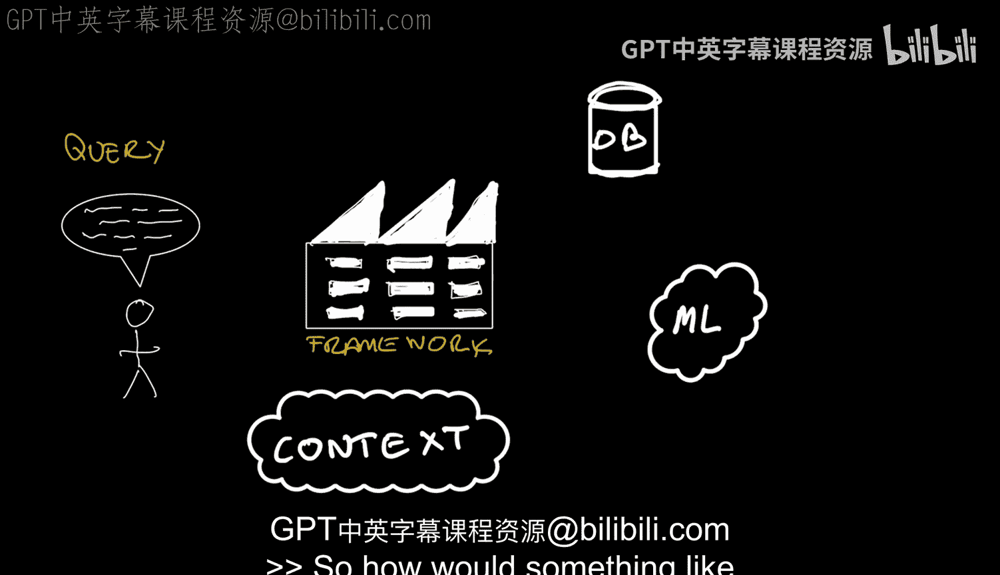
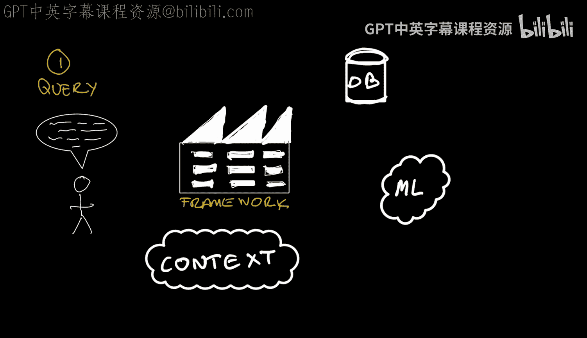
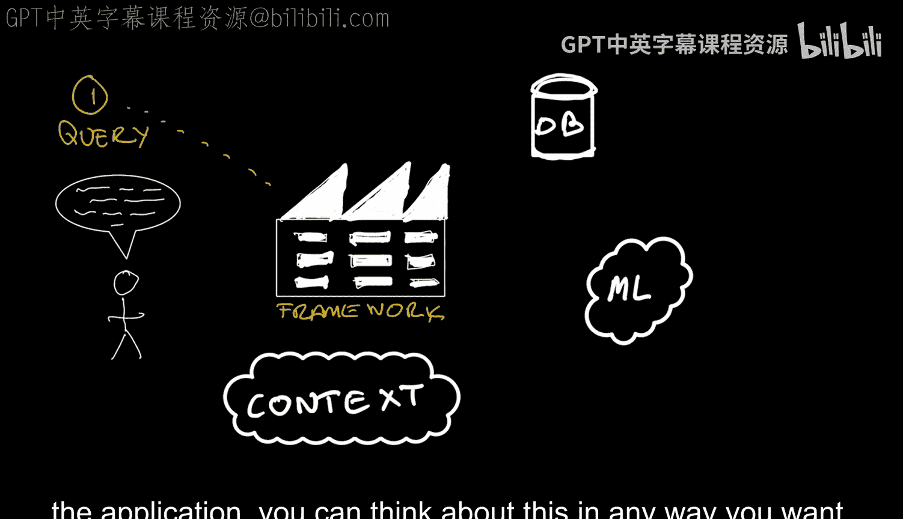
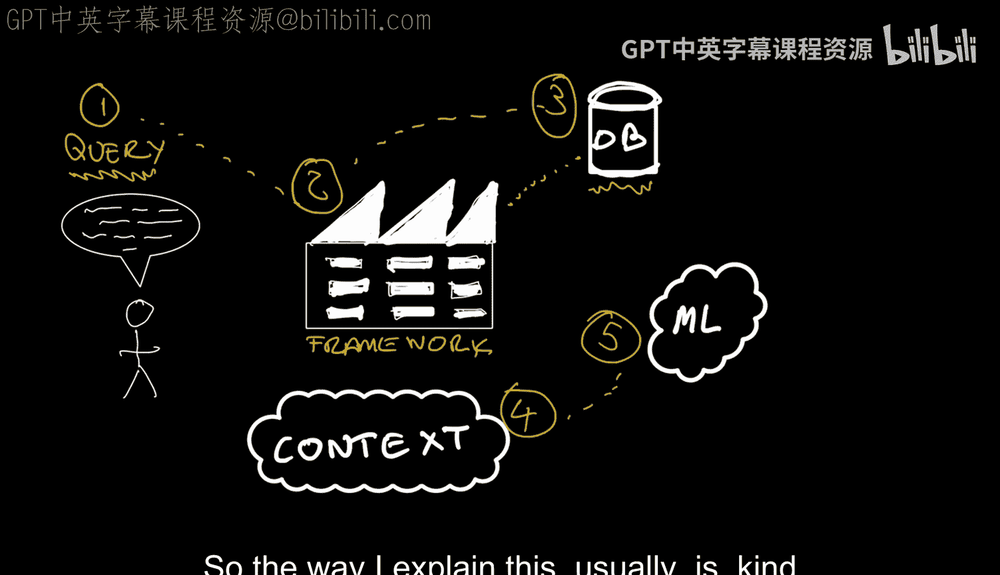
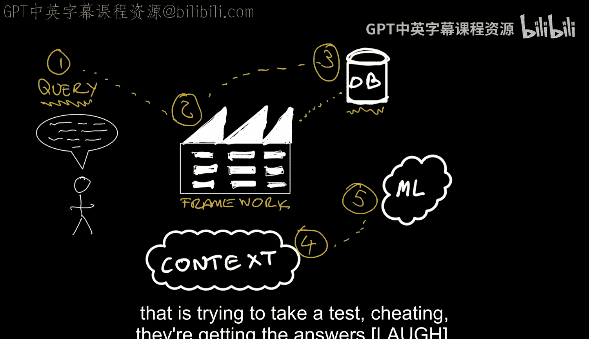
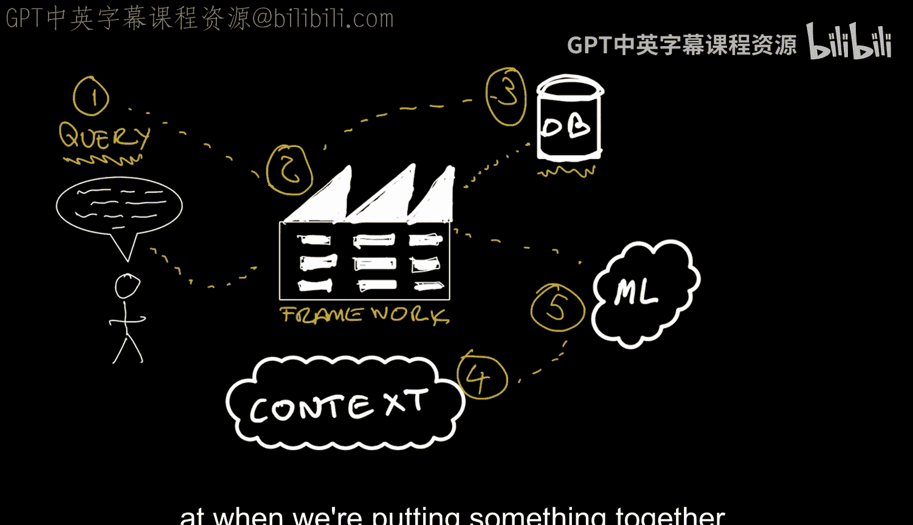
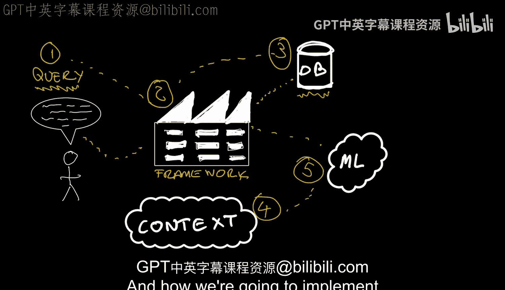

# 杜克大学《Azure的端到端 LLMs｜End to End LLMs with Azure 》中英字幕 - P9：09_01_01_架构概述.zh_en - GPT中英字幕课程资源 - BV13E421N777

So how would something like behaviorval augmented generation would work and what is the like let's go through a quick overview let's start here with a query。

 so we have a user with a query and usually that would go straight to the framework and to the machinery model and then back and in this case yes it will go all the way to the framework like a framework called the application you can think about this in any way you want but we've been using Lcha a little bit of semantic kernel and we want to know you know how would that work。

 but you can think of this either like a framework like semantic kernel or L chain or something else or just plain vanilla application that is just implementing the APIs all right so the query goes to the framework and then the framework instead of sending the query directly to the machinery model it will go to the vector database。

So I'm going to have the vector database and the vector database is going to perform a search。

 so let's say for example the query is， for example， what happened。

 what was the weather yesterday it could be something like yesterday's weather and the database could have that information which the machinery model doesn't and in that case that that context that information instead of。

Going going straight back to the user， that goes back to the framework and why back to the framework。

 because then the framework would produce the number four here at the very bottom that will produce that context。

 so the context will have both the query。

And the response from the vector database。And that extra context will go to the machine learning model。

 so the way I explain these usually is kind of like a student or someone that is trying to take a test cheating。

 they're getting the answers， so the context is already giving the answers。

And the machinery model， the only thing， the large language model。

 the only thing that he's doing is like， well， this person asked me for yes is weather or whatever the question is and I already have the context so I'm going to put it nicely wrap it up。

😊，And send it back to the framework， which will send it back to the user。

So this back and forth is nice and easy to。To try to give other extra context of relevant facts and things that may happen while the biggest training in the machine learning model has a high cost and but adding documents to a database in this case a vector database is not high cost is just actually pretty simple。

Now， we haven't touched on what that looks like， what that process looked like。

 but we'll see that later， but this is essentially a quick overview on what are the paths that we're looking at when we're putting something together like retrieval augmented generation and how we're going to implement that later when we decide to deploy。

