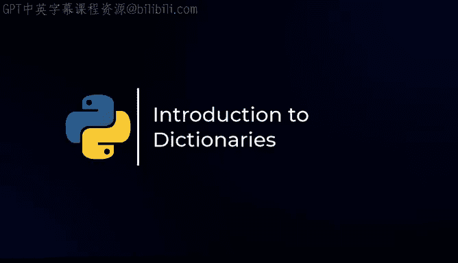
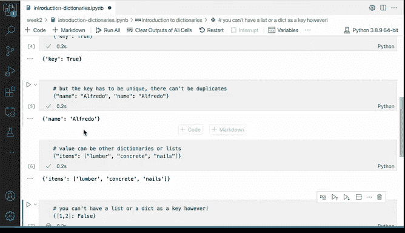
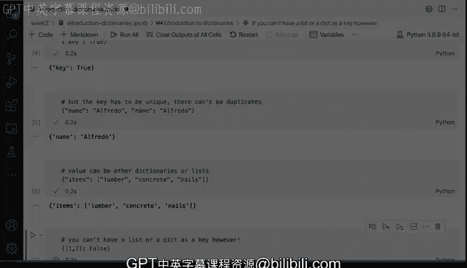

# 杜克大学《MLOps ｜ 机器学习运维（Python基础）｜MLOps ｜ Machine Learning Operations》 - P11：11_01_05_字典简介.zh_en - GPT中英字幕课程资源 - BV1kw4m167aV

。

Now let's see and talk about dictionaries， Python dictionaries is one of my favorite data structures in Python and the way you need to think about these unlike a list。

 which is a container of items， it is a mapping of items one of the examples I usually like to do is kind of like a phone book you know how you have a name and that name maps to a number。

 a phone number， a phone book is a perfect example of a dictionaries so it's a mapping of values。

 you will always have a key an N a value so here I'm going to run these the curly brackets are required to create one but you can create one in other ways which will be seen next。

 this is just an introduction and whenever you see curly brackets like this you should think about dictionaries you can create or prece values here I'm using two strings。

 a key and a value and that's separated。By a colon so if I run these nothing nothing really out of the ordinary you're gonna to have the same representation of what I created。

 which is the key and the value。 the key is a string and the value is a string as well but you can have other data structures and other types as well mapped which will be seen next here I'm going to use a booleion that's also allowed that's not a problem and when you want to have more than one key value you are going to separate those with a comma just like lists when you have many different items so the only con that they have to be unique here you can see that name alfredo and name alfredo are repeated if I run these you will see that I'll only get one Python requires that the keys are always always unique and in this case these are not unique so the second one will win and that will have just one item one mapping here。

Then what we can do also is also use other types of data structures like I mentioned before and what I'm gonna to have here is a list items and we' going have lumber concrete and nails and that's going to be mapped to the key of items so that's certainly possible but you have to be careful because it doesn't mean that you can have a list mapped a list as a key。

 the maps to a value， you will get into trouble if I run these youll get a type error。

 it's unhshable that means that Python can convert that to an actual key and make the inner workings of what makes a Python dictionary so awesome which is a uniqueness to find it it's almost like it works almost like a database。

 a mini database in memory you can use data structure like list and that's when you will have a type error and an unhashable type list or something similar when you try to use that so use something to be careful。

And that's how you would start working with dictionaries。

