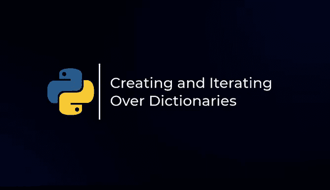
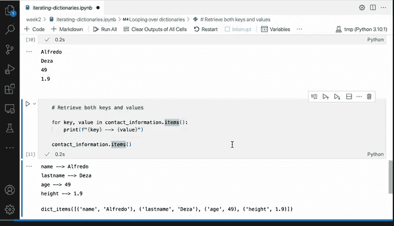

# 杜克大学《MLOps ｜ 机器学习运维（Python基础）｜MLOps ｜ Machine Learning Operations》 - P12：12_01_06_创建与遍历字典.zh_en - GPT中英字幕课程资源 - BV1kw4m167aV

。

Now let's see how we can iterate over dictionaries， how we can look at the data。

 the keys and the values or both when we're working with dictionaries。

 so as before when I instantiate a dictionary here is going to be contact underscore information。

 the variable that is going to hold our data and with curly brackets and preceded data is going to be name Alfredo and last name data which is my contact information just like before and that's fine。

 but you can also create one with the Dict built in which is a function when I run that and that will work the same now。

One of the things that I didn't show you before was that there's this other way that you can create a dictionary which is by passing pairs here's a list with pairs of name Alfredo and last name and dataa if I run these you will see that it will create a dictionary as well so you can pass that a list of pairs separate like tuples then well see also later on as a different type of data structure So and the last the last way of creatinging one is by using keyword arguments here I'm using first alfredo and last name and dataa and that will also work the same Allright so those are other different ways that you can create dictionaries。

 but now we want to see how we can loop over them so I'm going that create a more thorough contact information dictionary here and I run these and we execute it and it's going to have name last name H and height and you can have。

An explicit way of looping over the keys。 so if you only want to have the keys that would be name last name H and height。

 the way you would do that is4 key and key can be anything really it can be any word it will be treated as a variable just like when looping over lists。

 so we are going to do four key in contact information dot keys and parentheses and that is going to produce name last name H and height。

 but implicitly by default fault， Python works the same so if if I do that here。At the top。

 and I modify this cell and run it again。 It will be the same result name， last name， H and height。

 and that is4 key in contact information。 So if I don't say anything specifically like Dot keys。

 you will get a key just the same。 So that's that's definitely something that you can you can do now。

What happens if you want to retrieve the values Well。

 this next cell is what is going to be doing it's going to be processing the values and you're going to access that with dot values and parenthesesis。

 So if I run these you will see that alfredo which is the first name and then dea last name and then the H and then the height is going to be produced which these things are the thing the things that are right here。

 Alfredo desa 49 and 190 those are the things that are going to be produced those are the values of the dictionary All right so what happens if you want both keys and values well you're going to use dot items to the dictionary and you not only that but you also need to and this is called unpacking in Python you are going to have to use two variables here。

 key and one value and Python is going to be looping in producing two values every time it loops over each single item。

 each single pair。Each single mapping of data so if I run this you can see here it produces name Alfredo last name is age because it's printing that and if I do you can you can actually call that and see what that items means in this case its a this object here that looks like a list of pairs of items so that's it that's how you loop over dictionaries and you extract different types of data from a dictionary。

