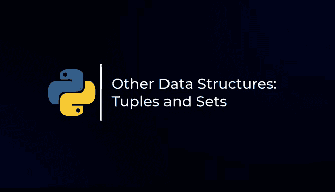
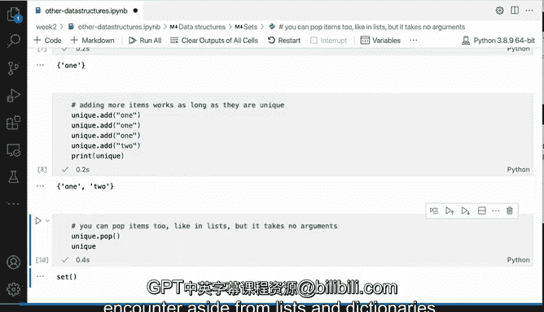

# 杜克大学《MLOps ｜ 机器学习运维（Python基础）｜MLOps ｜ Machine Learning Operations》 - P13：13_01_07_其他数据结构-元组与集合.zh_en - GPT中英字幕课程资源 - BV1kw4m167aV

。

There are two other data structures that I want to talk about Python has many data structures and in fact you can also create your own data structures with your own rules but there are two other that I think are relevant that you might encounter every now and then the first one is tuples and a tuple is just like a list but you need to think about it as a read only list right so we have here like I've named it RO underscore items for read only items so you have first second and third and you access the indexes just like a list here so this is going to say for example first item in the tuple is and it's going to find where first is if I run these you'll see that the index is zero for the first item and then we're going to have third first second and third。

Because here it is printing let's take this step by step。

 first is printingarrow items-1 that will give you third so that's -1 just like a list is the last item in the it in the tuple and then we're gonna loop over just like a regular list and we produce for a second and third。

 so if I wanted to make this a little bit more clear and comment this one out and that one out and run this again then we have first second and third just following the order so it keeps the order but it doesn't allow any modification。

 buts let's see what happens if we ask for an index that doesn't exist I'm going run this I'm going get an index error so I don't have 10 item so the index of9 doesn't exist and that's where we get an index error it says tuple index out of range similar very similar to。

A list Okay， so scrolling down here， same with indexes if we try to find get the index of an item that doesn't exist。

 but we're going to get also a value error there and then。

We want to know what are some of the methods available with a tuple。

 So you have like this very nifty for loop here that is going to go and do some splonging into the the tuple object and find all of the methods that are available。

 You do that with a di。Built in here， so you only have count an index if you remember for a list you have a pen。

 you have pop， but that's it for a tuple once you create one。

 you you can only count the items and get the index as you can't manipulate anything about a tuple It's a read only you can't you can't append。

 a pen doesn't exist。 Tple object has no attribute， aend。Allright。

 so those are twoples think about them as read only list once you create them。

 you can't modify them next is sets and sets also are kind of like lists we can app can we can do a lot of things there with sets but the one particular thing about sets is that it keeps things in this collection of items as unique it can be a little bit confusing because I'm gonna run these the notation。

 the syntax looks kind of like like a dictionary because it uses curly brackets but there's no mapping right so that means we created a set here and then we added a one which is a string and then we said and that's how we add items to a set and that created these object with a one item in there All right so what happens if I keep adding the same thing well if I one。

1， one and。two and you can see that the product of that operation still produces two items so thats thats the particularity of sets is that it helps keep keep things as unique and then you can still you can definitely still pop items but unlike lists pop does not take an argument pop doesn't take any argument at all and it will just pop the first item and in this case the first item was one over here and it was left with two so if I run this again it will produce an empty set over there so there you have it that's two other data structures that you might encounter aside from lists and dictionaries。

