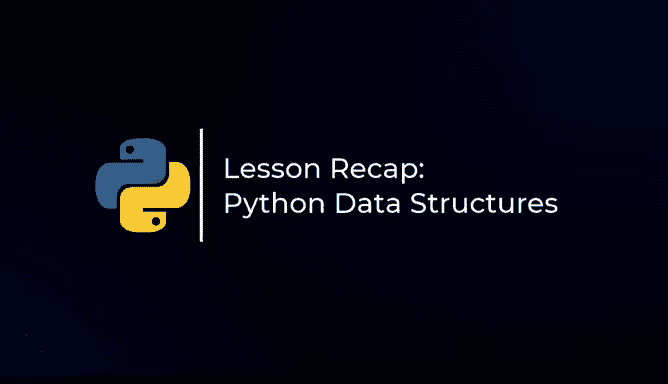

# 杜克大学《MLOps ｜ 机器学习运维（Python基础）｜MLOps ｜ Machine Learning Operations》 - P14：14_01_08_课程回顾-Python数据结构.zh_en - GPT中英字幕课程资源 - BV1kw4m167aV

。

In this lesson we were able to work with data structures。

 various different common data structures in Python and how to identify them like the syntax changes a little bit and we're also able to see how they work when to store certain things in one data structure versus the other and finally we saw some of the other less common but still useful。

 Python data structures and how they behave and what makes them unique。

