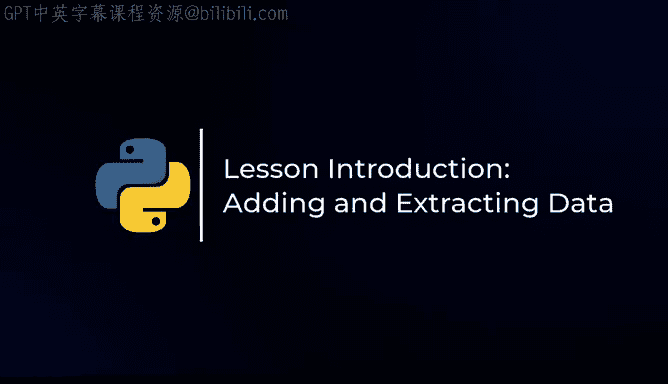

# 杜克大学《MLOps ｜ 机器学习运维（Python基础）｜MLOps ｜ Machine Learning Operations》 - P15：15_01_02_课程介绍-数据添加与提取.zh_en - GPT中英字幕课程资源 - BV1kw4m167aV

。

In this lesson we'll see how we can work both with lists and Python dictionaries for adding data and extracting data。

 these two very common data structures in Python behave kind of differently。

 but you really need to understand how you can add data to it extract data to it and all the various different ways where you can manipulate data from these data structures。

