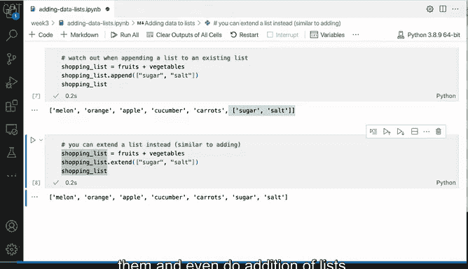

# 杜克大学《MLOps ｜ 机器学习运维（Python基础）｜MLOps ｜ Machine Learning Operations》 - P16：16_01_03_向列表添加数据.zh_en - GPT中英字幕课程资源 - BV1kw4m167aV

。

Let's see how we can add data to lists So before we've seen how we can define a list and we do that with a square brackets or stray brackets。

 and we've also seen that sometimes we can append thing So let's append some things。

 some items to these fruits list and you can see again that he preserves the order but another thing that it's similar to a pen is that you can do an insert and that's something that you might want to use every now and then depending on the type of operation so you're doing with data So in this case I want to use the index of0 and insert a melon So if I do that I will be able to insert melon as the first position。

 the index of0 and then follow by orange and apple remember lists keep track of positioning keep track of order and but if you want to alter that order well you will be able to use。

Insert for that because it allows you to pass an index。

 you have to watch out because the index is required。

 So if I take these out and try to run this again， I'm gonna get into trouble here。

 I'm going get a type error and insert expect the two arguments got one。

 the index number is absolutely 100% required。 Now you can add one list to another one which is something that we have not seen yet lists can use the addition opera and here to create or extend or produce a list that will be the addition of two list。

 So we have vegetables and we have cucumber and carrots in the vegetable list。

 and we'm going to add fruits and vegetables and let's see what happens。

 So if we add those two we're going to produce these list that has all of the items together。

 So we grab two lists and put them together as a new one。 So thats。It's good。

 And you can definitely use the addition。Now what happens if you want to app a list to an existing list So here before we had two lists and we did the addition there and you can see that we produce these list here。

 but what happens when when you want to append list to an existing list so let's see what happens so we had the shopping list was fruits and vegetables and we wanted to append sugar and salt and what happened here where we had melon。

 orange， apple cucumber and carrots but now we have a list within a list now that maybe what you want to have a list within a list but if that's not what you want to have then what you want to do is to extend now extend a list is similar to to a to a list or adding them actually append all of the items in the other list or adding both lists so you can say。

list that extend and then pass the list in this case is just sugar and salt。

 and let's see what happens when I do that。 perfect， you're going to end up with no nested lists。

 so thats those are a few ways where you can you can add more data to lists and work with different types of lists and appendem or extend them and even do addition of lists like add to lists together。

