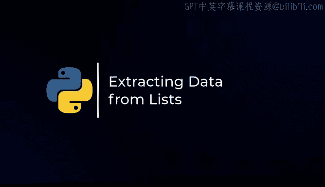
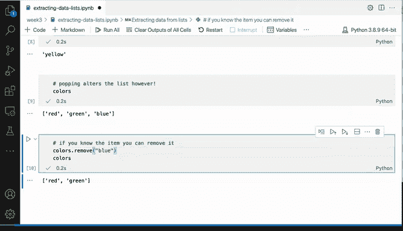

# 杜克大学《MLOps ｜ 机器学习运维（Python基础）｜MLOps ｜ Machine Learning Operations》 - P17：17_01_04_从列表提取数据.zh_en - GPT中英字幕课程资源 - BV1kw4m167aV

。

Now let's do a little bit of data extraction from lists。 Now in the past a few lessons。

 we've seen that we can definitely retrieve values from an index using an index from a list So here we have a list of colors。

 red yellow green and blue and we can retrieve that a specific item by using the index in this case I'm using zero and that will produce the red one that's great。

 but what happens if we want to do a range or or we want to use a subset like how do we do that。

 we wouldn't be able to do that with just indexes。 So that's where the slicing operation comes into play So that's that's used with a column right here。

 So I'm using square brackets and then column 3。 if I run these you can see it's red， yellow。

 green because it will produce just the first three items so red， yellow and。Green， again。

 I'm using here the， the。The indexes so if I wanted to do just the first two I would change that to2 and it would produce just red and yellow。

 so that is a very nifty way of producing subset of list if you know kind of like the range that you want to work with now where it gets tricky and actually have to check these all the time because I can never get it right is slicing for the last three items I sometimes just do a minus2 here and and I would do these but that doesn't that doesn't yield the right the right things So what you need to do is pass negative three at the beginning and that will get you yellow green blue so again yellow green and blue will be the second third and fourth item so that's produce with a negative three Now you can also slice for a range which makes it really interesting here so you can。

Extract yellow and green if I scroll away up， you can see that it will do this one。

 which is index of the second item and the third item or index of1 and an index of2 so that's how you would slice for a range now you can also pop an item from from from the list。

 but the index number must exist in this case I want to pop the item number 100 that doesn't exist I'm going to get an index error pop index at a range there's no10 items in that list I'm going to get a problem like an exception being raised So use an existing item to pop correctly so if I do that I'm going assign that's a nice thing here because the popped item gets returned so you can assign it to a variable so I have a pop I've assigned it I captured the value to pop underscore item variable you can see here that you popped。

The index of one and that was yellow Now popping alters the list。

 so now you can see that yellow is no longer part part of this list now we are left with red。

 green and blue and another thing that you can do if you don't really care about what you're removing is what you're popping is use the dot remove method so colors that remove and then pass pers and use blue and around these and it is going to remove blue out of the way is going to find where it is so the operation is it has a couple of steps is going to find where blue is and is going to remove that item from the list and the resulting is the result is going to be this list that only has red and green and blue is no longer there So there you have it that's a few ways。

 a few new ways for extracting data from lists。

