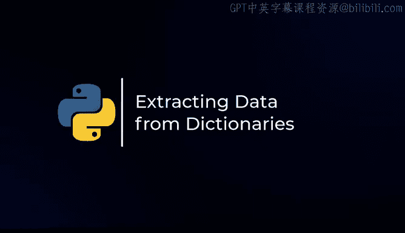
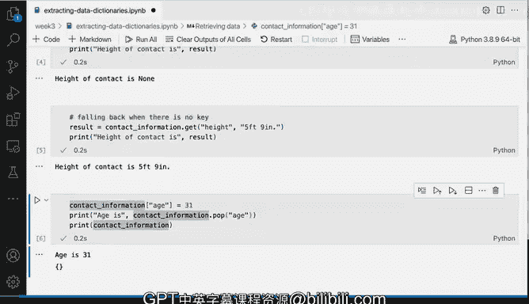

# 杜克大学《MLOps ｜ 机器学习运维（Python基础）｜MLOps ｜ Machine Learning Operations》 - P18：18_01_05_从字典提取数据.zh_en - GPT中英字幕课程资源 - BV1kw4m167aV

。

Now let's take a look at a few ways where you can retrieve or extract data from dictionaries。 I mean。

 we've already seen a couple of ways where we can do this。

 I'm going to instantiate this dictionary over here， which is conduct underscore information。

 I'm going to instantiate an empty dictionary。 and what happens if I retrieve a。

A key that doesn't exist。 Well I'm going to get a key error。

 That's what happens when you try to retrieve a key that that doesn't exist in the dictionaries in this case the dictionary is empty but could very well be full of information and metadata and plenty of keys and values。

 but if it doesn't have height， then you're going to get these key error so there's a couple of ways around these that I'm going to show you the first one is using seen a try accept block now I've not covered dealing with exceptions yet we'll cover those in another video but in another lesson。

 but this is the way you would work with with that key air so I'm going going try this operation of getting height but if I get a key error I'm going print six feet so if I run this I get six feet because the key air is being caught and I'm doing something else instead。

So that's one way that you can deal with that nasty key if you know what you want to do in case height doesn't exist。

 but another way that I really like actually is using that get the dot get method allows you to pass the key that you want to extract and it produces a specific value that we've seen before it's a type has a special type in Python that if the height is not found it will produce that value。

 so let's see what happens here if I run this So the height of contact is none。

 so I'm going to get a none I'm no longer going to have a key I'm going to produce a none value。

 So that's a helpful that's a helpful way because by default if it's not found is going to produce a none but。

What happens if you don't want a nu and you want some other value so let's take a look at that so let lets the dot get method allows you to have a falling back to another value when there's no key so here I'm saying contact and score information do get I'm going to say I want to get the height and if you don't find it is going to allow me to pass in the second argument I want to produce5 feet9 inches a string so do that and I'm going to run and there you go so height is not found and height of contact is 5 feet9 inches so that's how you will use get now you can also manipulate dictionaries using pop as you can see with lists before you definitely and actually sets as well you can you can use pop in dictionaries as well so in this。

I am setting H for contact information。 I'm going to say H is 31 and but I'm going to remove I'm going to remove that key with the value out of the dictionary。

 So when I print the contact information， it should be empty。 So lets let's run this。

And there you go so H is 31 so this print statement is looking into the contact information that pops so that produces the value。

 so it'll pop the H key and the resulting operation will produce 31 and when we try to look into the contact and risk information that's going to be empty because we've effectively remove that item。

 so there you go that's a few ways where you can extract data and manipulate data from dictionaries。

