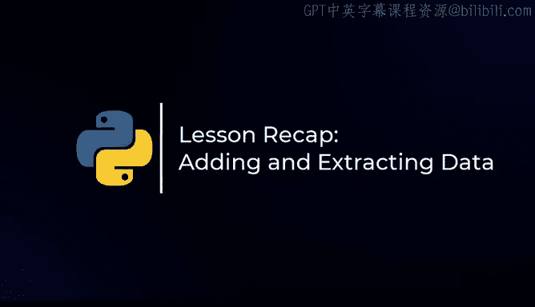

# 杜克大学《MLOps ｜ 机器学习运维（Python基础）｜MLOps ｜ Machine Learning Operations》 - P19：19_01_06_课程回顾-数据添加与提取.zh_en - GPT中英字幕课程资源 - BV1kw4m167aV

。

So now you know how to add data to lists， add data to dictionary。

 where all of the different various ways of working with these data structures and you'll be able to identify。

When is a certain type of data correct to use with one of these data structures and what are some of the efficient ways that you can extract and and interact with these data structures when you're dealing with data？

