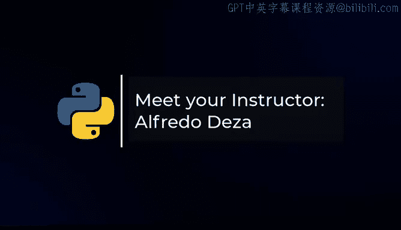

# 杜克大学《MLOps ｜ 机器学习运维（Python基础）｜MLOps ｜ Machine Learning Operations》 - P1：01_01_01_认识你的课程导师-Alfredo-Deza.zh_en - GPT中英字幕课程资源 - BV1kw4m167aV

。

Welcome to this course on Python for MLOs。 we're going to go through the most basic things in Python variabless。

 assignments， loops， logical conditions like if and else。

 and then well go a little bit onto functions then onto classes and it we will go through a little bit of data exploration。

 data analysis with pandas and Npy finally we'll go into building command line tools and we'll put all those things together those foundations of Python into building powerful command line tools Now why Python and why go through all of the basics well because it is an essential piece that will give you。

ough knowledge to interact with APIs， do all kinds of other MLOs related things in this case will go through some command line tools that you can create to build automation to automate some processes that you might be already doing manually or even some other engineers in your team or in your group might be doing manually。

 you can automate these checks， these processes， these steps， pipelines， deployments。

 even packaging machine learning models， you can automate a lot of it with knowing Python。

 so essentially at the end of this course you will have knowledge sufficient knowledge in Python to start building powerful automation that will serve you better so happy that you here let's take a look at how how you're going to apply all of these things to build these powerful automation by the end of it you should feel confident in applying。

And these concepts in your day to day operations。