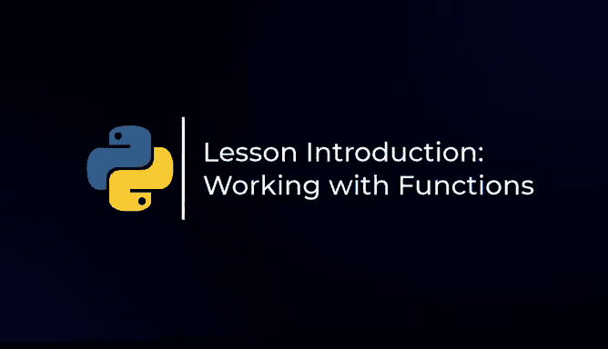

# 杜克大学《MLOps ｜ 机器学习运维（Python基础）｜MLOps ｜ Machine Learning Operations》 - P20：20_02_02_课程介绍-函数使用.zh_en - GPT中英字幕课程资源 - BV1kw4m167aV

。

In this lesson we will work with functions， well know how to or understand how to write them。

 but also how to require some arguments， how to make it mandatory that a function needs an argument。

 but we'll also try to make them flexible because sometimes you don't necessarily require arguments。

 sometimes you do and sometimes you don't and sometimes you need variable arguments from zero to 100 or even more。

 we know and understand when to use those and how to define them and write them for a function。

