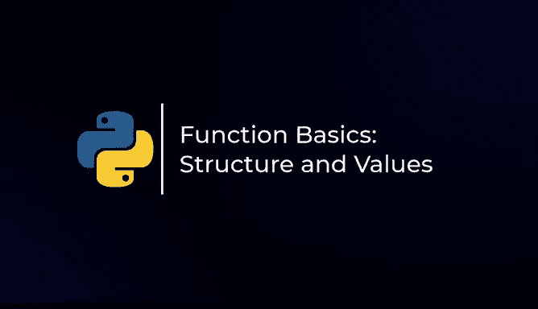
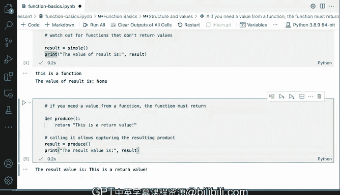

# 杜克大学《MLOps ｜ 机器学习运维（Python基础）｜MLOps ｜ Machine Learning Operations》 - P21：21_02_03_函数结构与返回值.zh_en - GPT中英字幕课程资源 - BV1kw4m167aV

。

Next let's look at functions and how we can work with functions in Python functions are the one or the first or the initial way how you may get exposed to writing some reusable code now to write a function that the most simple thing that you can do is like and I have it right here in this cell you will need to use the de DEF keyword and that will say hey I'm going going to start the definition for a function then you continue with a name no spaces and that's followed by parentheses and lastly with a colon and then the next line the following line needs to be indented so that in Python will mean hey。

 this next line is part of this function in every single line that comes and is part of this function will have to be indented at least for space。

In this case， so if I run these， it will create this function called simpleple and whenever I call it。

 I will produce this output so if I run this right here， you will see that it prints。

 this is a function。Now when I started working with functions and Python this was a little bit confusing for me because sometimes I wanted to catch these value。

 you know this is a print statement， but there's a core difference in functions functions that do half like actions and functions that return value so not not all functions that do things will return a value when you have a function that returns a value well that's great but not all of them do and there's a slight difference in this case this is a function that does something and it doesn't return a value there's no return value there so。

What happens if I want to assign the simple function that is going to do print statement to the result variable and then print it out what will happen。

 So I'm going to run this you will see this is a function and the value of result is none。

 so I'm getting a none and that is because in Python you will always get an implicit return value of none。

 so if you return a value that's good but if you don't Python implicitly will assign a value of none so theres nothing here being returned although these thing printed this is a function。

So it's something that to keep in mind and you， you have to be able to。

To acknowledge that there's a thing there that might return or not return。 And if you doesn't return。

 you'll get a none。 All right， so if you want to return a value in this case。

 I'm returning produce the produce function is going to return a value and I'm going to call it right here and I'm going to assign it to result and I'm going to print that and I'm going to execute the cells and I'm going to get the result value is this is a return value。

 So that's that's it those are some of the basic operations that you can do， that's how you create。

 you write a basic function functions can do things and not necessarily return if they don't return。

 you'll have a none as a value if they do well you'll have the ability to capture that value that is being returned。

 So that is how you work with functions。

