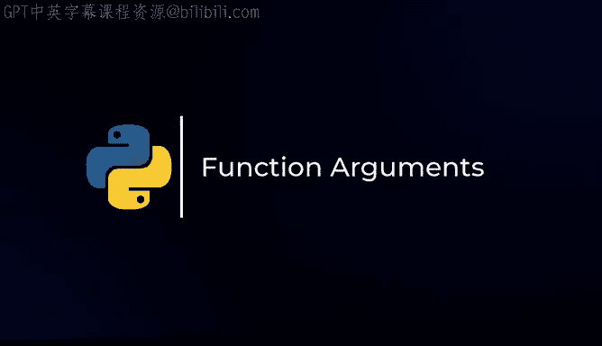
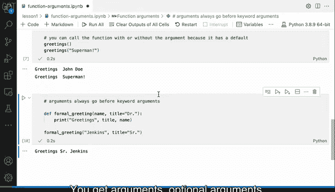

# 杜克大学《MLOps ｜ 机器学习运维（Python基础）｜MLOps ｜ Machine Learning Operations》 - P22：22_02_04_函数参数.zh_en - GPT中英字幕课程资源 - BV1kw4m167aV

。

Now functions can take arguments and in this case we'll see how those arguments work。

 a function definition with required arguments will have something between those per parentheesis so you can see here I have the squared function and this function all that it does is returns the squared product of whatever number were passing in so if I run these and I pass four as an argument I'll get a 16 so that's4 to the square of the power of two will produce 16 so this function is doing a mathematical operation and requires an input so some functions will require an input and in this case you have to pass a number。

 so what happens if you don't pass a number you don't pass an argument you're gonna get a type error and in this case you're seeing that squared missing one required positional argument and that is。

called number， So I need to pass that number Now whatever I'm passing in will take the variable names。

 So in this case I was saying hey， I need a number， and that's a named variable named argument。

 So when I pass that input that will become my variable so that's good。

 now there are functions with optional arguments。 this one in this case the int builtin function。

 you don't need to import it， it just appears in the global namespace in Python I didn't create this function。

 it comes with Python it will give you a0， so int is very useful because you can do a couple of things with it you can convert strings to an into your value so that's definitely something that you can use and it has some other uses as well。

 but the thing here。that if you don't pass any inputs。

 any arguments it works fine and if I pass here at 10。

 you can see produces a 10 not a string but an integer so that makes it flexible and sometimes you may want that flexibility some other times you may not want that flexibility kind of like what we do with a number with with that squared function here in the beginning we want to have that number so that we can provide a result but some times you may not want。

 so that flexibility is important next I want to show you what a keyword argument is Now a keyword argument is the ability to make it optional and and have a default so here I'm saying I'm creating a function called greetings I'm saying that the full name is John Doe and I'm then going to print greetings and then use the full name so I'm going create the function。

I'm going to execute it， I'm going to instantiate that and now I'm going to call greetings without an argument and a greetings with an argument if I do this。

 you're going to say greetings John Doe because I didn't pass anything。

And I'm gonna pass Superman and that says， oh Superman， okay， great so behind the scenes。

 Python is saying if I'm gonna get a full name， that's great， otherwise name it John Do。

 so that equals and then the string that's what is going to be using these type of mapping of a value in an argument is called a keyword argument。

 So this is the keyword is using a key and then a value。

 so that that's the default uses that as a fallback。

 and lastly one thing that you want to be careful about is that if you're mixing argument like this one and keyword arguments it has to have a specific errors order actually you have to pass first argument and then the keyword argument or Python will give you an exception a syntax error。

 this is incompatible， you have to be able to pass all of the arguments first and then your keyword argument。

 So let's see how。These works I'm going to pass a name which is required and the title is optional in these cases falls back to doctor so I'm saying formal greets just Jenkins as a name I'm not passing the title and then that's fine so if you wanted to pass something different you could do it two ways you could say you know you could say something like these without a name in that argument and it'll be used here as a senior but you could say also the following you could say title。

Equals to that。 And that works exactly the same。So that's how you work with function arguments。

 you get arguments， optional arguments， keyword arguments， and a specific order。

