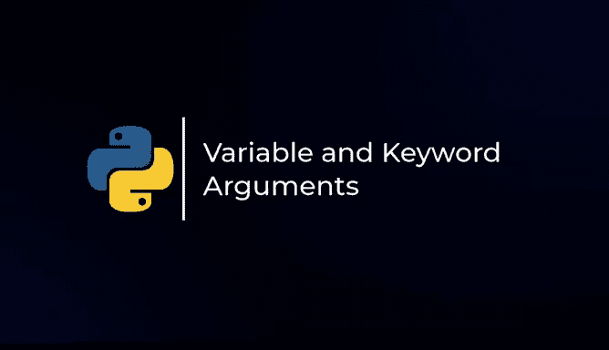
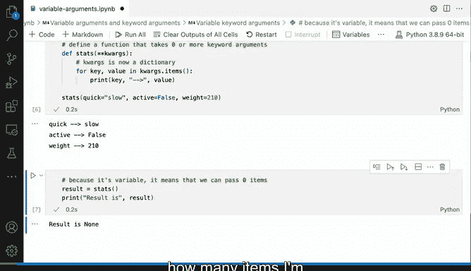

# 杜克大学《MLOps ｜ 机器学习运维（Python基础）｜MLOps ｜ Machine Learning Operations》 - P23：23_02_05_可变参数与关键字参数.zh_en - GPT中英字幕课程资源 - BV1kw4m167aV

。

Another thing to keep in mind when you're working with functions and arguments is that you may encounter variable arguments and I'm going to show you variable arguments and variable keyword arguments。

 these variable arguments and keyword arguments basically mean that a function can define0 or more arguments or keyword arguments and it doesn't care if you're passing one if you're passing0 or you're passing 100。

Why that might be useful well because sometimes you really don't know and I have like these very basic examples here with some functions and we'll see some situations where that might be needed。

 so say for example this function in this case is family members and the syntax is using the asterisk here the star star args and you can name these whatever you want you most commonly will see star args or asterisk args or star A both are used sometimes some developers might want to use some other thing here but within within the function will become the variable that has all of the items in there internally this will be a tuple that contains all of the items that you're going to be dealing with all of the arguments so I'm going to run these I'm is going to create these function。

The family members， I don't know how many family members are I'm going to pass but it's going to have the ability to accept any number and then I'm going to pass Lucy Matt and Bob those are three family members and I see what happens and what happened was that it went through each item in the as and he printed Lucy Matt and Bob so it did a full name in args and print name that's perfect and that's something that you can do but you can pass like also zero and that will be fine So if I pass zero there's no output because there's no arguments and because there's no arguments nothing is getting looped or printed so that makes it really flexible right you might want to have zero or more and that's definitely dogle with arguments now。

There is no need， like I said， to call it AGs or star A or star args， although that is very common。

 you can actually name it whatever in this case I'm saying family members is going to take star names and that is going to be the same the same effect so if I want to pass here family members。

And I want to say。We're going to say， John。And Sam and run these it's the same behavior。

 It that nothing changes。 but our loop does change because now we don't have arcs inside of the function。

 We have names。 So for naming names， print name perfect。 Now， the other thing is keyword arguments。

 Now， we've seen keyword arguments。 But what if you want to pass0 or more。 Well。

 you're gonna do that with star star or double star here， these asterisk asteriskis and。

KW As or keyword as。 if I run these， you're gonna see that I'm passing slow and now I'm passing these mappings。

 see how I'm passing these keyword arguments。 I'm saying speed equals slow active is false weight is 210。

 but I'm not defining those things right the stats function is not defining any but is's able to accept them and internally these become a dictionary So how we're going to loop over them or how we're going to look into what we're getting what we're gonna to use items here because I'm to loop over them and I want to capture the key and the value but internally it is a dictionary so you can work with it as if it was a dictionary。

 So if you want them pass all kinds of different mappings here。

 keyword arguments you can do that with star star and you can you can change this to anything here you know active。

 let's see if we can how are we say speed or。Quick when I say that and then changes the key。

 the key changes there。 So very flexible。 isn't it like you can you can do a lot of useful things。

 So because it's variable， you can see here that the result is going to be none and that's going to be fine。

 So again， very useful a couple of things there that you can do with variable arguments。

 I hope you find this useful， I certainly use it every now and then especially when I don't know how many items are going to I'm going to receive or the function is going to receive。

