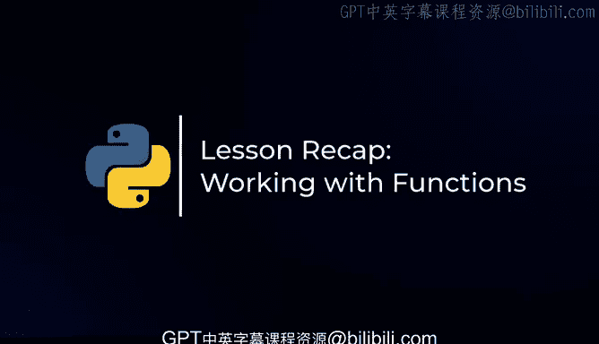

# 杜克大学《MLOps ｜ 机器学习运维（Python基础）｜MLOps ｜ Machine Learning Operations》 - P24：24_02_06_课程回顾-函数使用.zh_en - GPT中英字幕课程资源 - BV1kw4m167aV

。

You should now feel pretty confident in writing functions。

 but not only writing functions but also being super flexible in requiring sometimes requiring arguments。

 sometimes using variable arguments and keyword arguments which I also like for having a fallback value now you know all of these and you should be able to write functions without any problems。

