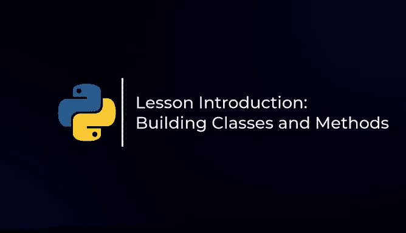

# 杜克大学《MLOps ｜ 机器学习运维（Python基础）｜MLOps ｜ Machine Learning Operations》 - P25：25_02_02_课程介绍-构建类与方法.zh_en - GPT中英字幕课程资源 - BV1kw4m167aV

。

In this lesson we' will talk a little bit more about classes， how to create them。

 what is a constructor， what is a dunder init method， what are class attributes。

 what is this pesky self thing that happens to be all around classes and when to use it and even a little bit about class inheritance that might sound complicated。

 but it shouldn't be and I'll show you in these few lessons。

 how they work and how you can work with them and in a very efficient way。

