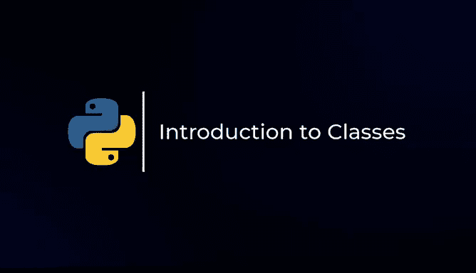
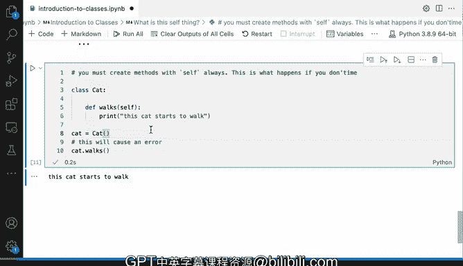

# 杜克大学《MLOps ｜ 机器学习运维（Python基础）｜MLOps ｜ Machine Learning Operations》 - P26：26_02_03_类简介.zh_en - GPT中英字幕课程资源 - BV1kw4m167aV

。

Aside from functions， classes is one of those things that you will encounter frequently in Python。

Now I tend to favor functions， but classes definitely have they have their own spot and their own reason for being used and implemented so that you can create powerful programs as well so I'll show you a few of the basics here with this notebook so the most basic class that you can create you will use the class keyword in Python and then you'll have a name similar like in functions you have de and then the name and then colon that's how you create or define a new class I'm using pass here because this class is empty that it is meaning meaningless。

 this line4 right here doesn't do anything and then in line6 I instantiate so once I call this class it becomes part of like it becomes an instance it has been created has been constructed think about line3。

through four kind of like the blueprint of what this thing is going to be。

 and then line six is when its it's up and running， it's being created， it's there， it exists。

So that's the most basic classes you can have now let's see what we can find once we try to poke around the attributes that we have here。

 there's certainly a lot of different things here， all of them start with double underscore and we'll see at least one of them which is the underscore in it underscore or also in Python we tend to say D in it。

Because of a double underscore now all of these are special special methods that belong to a class。

 you will probably not be using most of these your day to day。

 but they're useful to know that they're there and once you create an instance of a class even if it's as basic as these two line class that doesn't do anything。

 you will have a lot of things to work with。Let me scroll down here and now do another type of class construct that you may see and it might feel kind of weird online three here we have this basic class again。

But we are using an object like what is that object， Well。

 older versions of Python like really older version and versions of Python used to passing this object here to the class when it was defining the creation or the definition of a class this is no longer the case in modern Python so you won't be seeing it some people tend to use it still。

 but in modern Python that's not the case regardless of what you see it doesn't matter that the way the class is going to work is the same and it really doesn't matter if you have it or not。

 it just useful to know that in older versions of Python this was a thing。

Alright so what are the other things that you can do here so I'm going to create a class name dog and I'm going to use a thing called class attributes now I'll start explaining a little bit of all of the components of a class and then will be using them and try to call them and see what each of them though but in this casem line 5 I'm using a animal equals true that is called a class attribute and then I'm going to add a method now there is a bug here with this method。

And this method is missing something important， but let's go ahead if you're not familiar with classes you won't be able to to see what is wrong with this class。

 but if you are very familiar with classes you will see that theres there's a pretty substantial problem here on line number7 All right so I'm going make this run so I've defined the dog class here I've defined an is animal equals true and then I have a bark method。

 this is a method so this belongs to the dog class so if instantiated the object here created that instance of dog on line 10 now let's make it let's make a bark。

When I call that， you can see is dog that bark so bark belongs to the dog class I'm going run these and I'm going to get a type error。

 so why am I getting a type error that is because I missed adding a keyword。

 you can see bark takes zero position arguments but one was given。Implicitly。

 Python behind the scenes is passing an argument and that argument by convention。Is called self。

 so we'll see more about methods later。 just be mindful that every time you create a method that you have to have an argument and the first argument should be self。

 All right， so if I run this again。And I run this other cell again。 you have dog bark。

 which is a callable and it will print wolf and then dog that ease underscore animal will be true。

 and that's that's the attribute right there Okay so and you can create as many instances of these classes you need。

 that's one of the powerful things about classes is that it allows you to create many。

 many more instances and start producing classes and objects everywhere you go。 All right。

 but watch out for class attributes Now， I show you that。

Dot is underscore animal is a class attribute that means that it's kind of like a it's an attribute it belongs to the class。

 but if if you don't instantiate it and you make a change like this one like I'm doing on line too。

 then I am going to be messing up every single instance of the class that has been created so I'm going run this and you can see now that is Rufu is an animal it will be false。

So you just need to be mindful that these might cause you problems and if you have to define a class attribute which is perfectly fine if you know what you're doing。

 then you have to be mindful that that might change now that change will also affect affect any future animal so you can see here sparky the object is getting created and each animal will also be false regardless of the fact that if I scroll all the way down all the way up here and line 5 will say is is animal equals true on line number five All right so what is this selfth again so I briefly covered what that is but you have to you have to create that we already run into a type error you have to always passing this self statement there otherwise you will get into trouble。

That's all you need to know for now， we'll go into more details later。

 but just be mindful that you have to pass in， it is not a requirement to call itself。

 but it's a convention that you will see pretty much everywhere。

