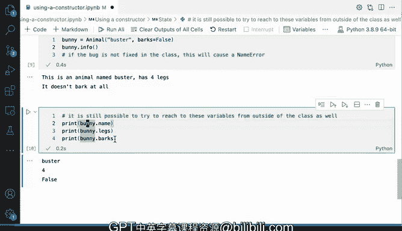

# 杜克大学《MLOps ｜ 机器学习运维（Python基础）｜MLOps ｜ Machine Learning Operations》 - P27：27_02_04_使用构造函数.zh_en - GPT中英字幕课程资源 - BV1kw4m167aV

。

Now that we have a quick overview， a quick introduction to Python classes。

 let's see what using a constructor is all about。 a constructor is the ability to set some things。

 some attributes do some things when the class is getting created in this case we're going to be using the d in it I mentioned it briefly before when we're doing the overview of classes so let's take a quick look at how we do that。

 this is how we define the ability of a class to take some arguments and define what those arguments are and set some behavior so here we have our same classes before it's a dog class I'm going to call it so that we can have it available there in the namespace and line number five is going to have this special method It's going to have self over there and line6 we're going use that self and say self that is underscore animal equals true This is slightly。

Miliar to what we had before with the class attribute， except that now we're using self and why self。

 because now it's part of the class dog， you you might feel slightly confused because if we if we do this dog。

And then we call we call these like that。 We are also going to have a is animal just like the class attribute。

 So if I run these， I'm gonna to get that true now the difference is that I can change these in effect every single class like before with a class attribute。

 So that' is a safer， safer thing to do， but let's not get distracted with this just be mindful that you're going to have self and you're gonna be able to set some stuff in there。

 Alright， so self was used again with this So not only。Not only done in it is a special method。

 but it's also using for setting its variables so I'm going to create two instances here and I'm going to run this and you can see that that that will be true and everything everything is fine now if I change if I change the the attribute is an core animal to false then nothing changes for these two instances so everything is kept the same so they're kind of like protected it's kind of like think about something that is inside a house like it's protected is within the boundaries of that house in these case that is the class。

So we have。We have state and one of the things that I wanted to show you is that we can also change that state by allowing to pass arguments into the constructor so in these animal class the constructor is going to have self as always as every single method and in a class I'm going to pass a required arguments which is name and to keyword arguments which are optional legs and barks so just like before the way to set those variables in the class from line 628 is going to be self and I'm choosing using the same name。

 but this could be anything line 6 could be self that something equals name perfectly fine but to keep things consistent I always like to name these attributes for the class name the same as as the arguments and keyword arguments that we're getting so we're going require name and then we're going。

Half legs。 and we're going to see if it barks or not。 so we are going to。Use those in here。

 but there's a bug。 see that comment in line number 10。

 there's a bug and we're gonna find out what that bug is all about。 So we want to have some info。

 So when I create this class called animal and when I have this info method when I call it it's going to print some information this is an animal name something and has so many legs and if it barks it will tell me if it barks or wise if it doesn't bark at all there's a bug can you see what the bug is here in line 12 it is a problem and we're getting quickly underlines from the editor although it's not telling me because I have that dis for now So I'm going run this and we're going to try and see if instantiating a bunny namebuter that doesn't bark will will work and we're going to get a name error why name error because name name is not the where is that error coming from line 12 and says this is an。

Animal name name and has like so this is a problem and we need to fix that The way we fix it is because this name is not a regular variable。

 it is self that name we no longer have access to this thing that was passed originally to the constructor。

 we have access to the variable that is within the class so if we update this to be self here。

And then we go to and do the same here to legs， and then the same here to barks。

 and then we say that and we runy class again。Then what happens is that this will work。

 This is an animal named Buster has four legs and it doesn'tbark at all Alright so that is how you use self within within methods and within the class actually and now we can we can print all of these attributes and we can see him printing name legs andbars and that works perfectly fine so the way you access those instances those attributes from outside the class is by using the name of the object in this case is bunny thatt name thatt legs thatt barks and that will work from within the class you have to use self we have to prefix those variables with self。

