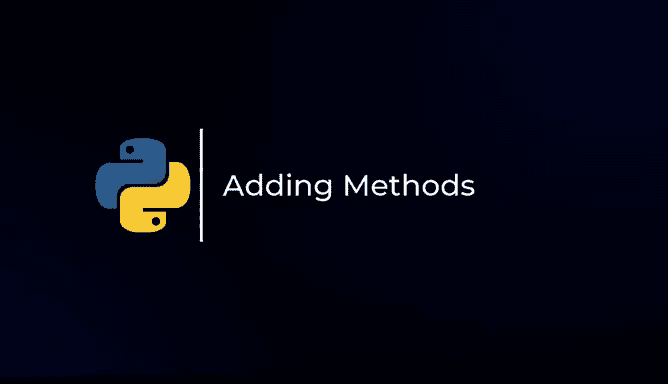
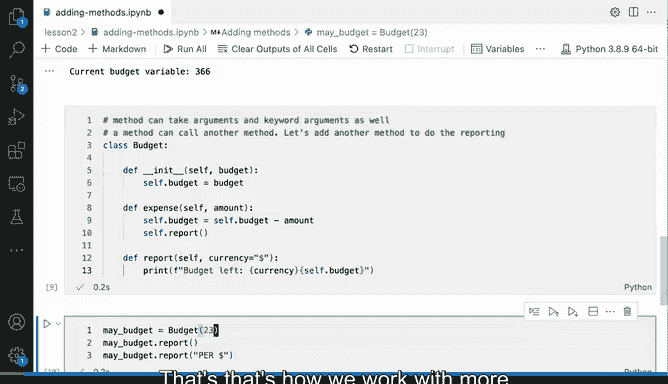

# 杜克大学《MLOps ｜ 机器学习运维（Python基础）｜MLOps ｜ Machine Learning Operations》 - P28：28_02_05_添加方法.zh_en - GPT中英字幕课程资源 - BV1kw4m167aV

。

We've briefly seen a little bit about methods in classes。

 but there's a little bit more to methods and adding methods and working with methods they kind of are like the special underended method but we' take a look a little bit more into detail so let me create this class with two methods in reality I'm using one constructor which is still a method on line5 let me create an R1 on line8 so what this is doing is a budget class and'm going to set some budget that budget is going to be part is going to be have like an America value and it's going to be part of the budget class and then expense is going to require an argument so here have the self always always have to have that argument first and I'm going to require an amount and then when I'm going to do is I'm going to reset the self that budget which is the same thing that we're starting。

We're defining here in96 and we're going to do Seta budget and we're going to sub that with the amount that we're passing in and then I'm going to print out budget left equals selfelta budget。

 so I'm going to start with a budget of 100。And let's see how that works。

 I'm gonna run it and because I'm starting with a budget of 100， I'm going to expensese 23。

 then I'm left with 77 then 45 and I'm left with 32 So that's all good now one thing that I like to do is separate concerns and and you might find a class that has more than one method。

 So in these case this the same class but it has another method called report and that report will only do the printing budget left equals the budget that is exactly what we're doing here before on line number 10 So line number 10 we were doing the reporting and I want to extract that put it somewhere else in a different method and now I'm going to have something different here。

 So this budget class is going to have a report method and you can see here well the editor is given given it away I am calling that method。

Another method and the way to call a method from R method is also using self。

So you can see here on line nine， after resetting self budgetdge I am also calling on line number nine I'm calling report so I've already run these and these will work exactly the same as before if I run this again well I'm also instant that here that's why it keeps being the same number but that's the same behavior as before all right so next we want to check that the internal state of the instance in this case the budget we instant it April underscore budget which was a budget of 400 we can access that because it remember it's always accessible after the dot so if I run these we see that that's available to us as 366 now this is accessible from us from the outside of the class externally like within the class。

You would access these as self that budget as you saw right here in line 12 on that cell All right but the other thing is that methods can take also arguments and Qword arguments right and we saw that we always have self and that we can take an argument like amount here but the reporting I decided to add a currency value and I'm going to make it optional and by default is going to have these dollar amounts I'm going to run these so execute these and it's going to give me the ability to report with that or without it and that that would basically mean that we can have different different types of results here so first I'm going to do a budget for。

It's going to be the same budget， but the reporting is going to change first with dollar sign and then with these PR and dollar sign and you can see that you can change that as well。

 So that's how you would very similar to a function isn't it and the same rules apply you always have to have arguments first and then keyword arguments later you can also use variable arguments variable keyword arguments as we saw for functions So it's one thing to also keep in mind。

 So that's it that's how we work with more methods having more methods and calling methods from other methods。

