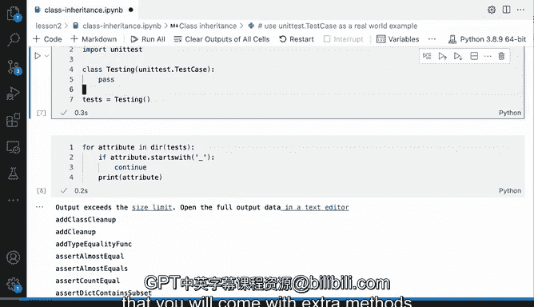

# 杜克大学《MLOps ｜ 机器学习运维（Python基础）｜MLOps ｜ Machine Learning Operations》 - P29：29_02_06_类继承.zh_en - GPT中英字幕课程资源 - BV1kw4m167aV

。

Class inheritance is one of those things that when I first encounter when I was first learning Python is one of those things that was very difficult for me to understand。

 I couldn't I had a hard time and it is perhaps one of the main reasons why I avoided using in classes to begin with it is very tricky to understand So hopefully with these short explanation it will help you clarify what it is and how to work with it and give you a good idea on how not perhaps how it actually works but like what the behavior and what should you be expecting。

 so I have a base class for house pets the premise of having inheritance and working with theheritance since youre to have a parent class and then the child classes are going to inherit are going have certain behavior attributes and anything that the parent class defines So I'm going have these PE class。

Here and it's going to define a single method called eat。And this method will say， hey。

 self self that food equals self that food minus self that appetite。

 So it's going to depend on self that food being present and self that appetite being present。

 No that I'm not defining anything here。 So these these glasses。

 it is if you instantiate it and you run it， you probably cause some trouble with E because there's some stuff here that is not defined。

 Actually， why don't we， why don't we do that So you can see what happens。 if I do。PD equals。Pet。

 and then I tried to make this pet eat。 then this would this would get into trouble。

 There we go attribute error。 It doesn't know， it doesn't know has no attribute food So so so lets let's just remove that。

 and that that's a problem right， but this is parent classes defining a method that we want all of the other classes to have so。

The way inheritance works with child classes is bypa it here you can see I'm going to create a class called paraket and parait is going to require iss going to inherit from the pet。

 the pet class over there on line number three that in this pet class this parakeet paraket class is going to have a constructor and it's going to define both the food and the appetite so it's going to say hey I have 100 items of food and appetite is going to be one and I'm going to have a dog that is also going to inherit from pet and similarly the dog has more food in this case is' 400 and appetite is going to be seven so I'm going to run this and see what happens。

So I've created Perry and rfus， Perry is the parake， rfus is a dog。

 and then we're going to make both of them eat， and you can see Perry one of food has 99 left and rfus eight。

 seven of food and has 393 left。So how can they have this method of eat if they don't define it。

 see the class dog， there's no method eat， it is inherited that is coming from the parent class。

 and perhaps that potential confusion is one of the things where I try as hard to not use inheritance。

 but it's good to know how they work。Okay， so one of the things that you can do to inspect classes and objects is used there which is a built in function and I'm going to run these and you can see here that anything that doesn't start with underscore will be printed and you can see appetite food and eat the method from the parent class are going to be present so one very common real worldd scenario is using the un test that test case base class whenever you're running test or green test with the un test library that comes with Python this is the way you have to create tests so I'm going to instantiate this I'm going to define these testing class I'm going to pass I'm not going to add any methods and then I'm going to create these object here in line7 and then I'm going to do the same exercises same quick loop to see what are all the attributes that I have and look at all of the。

that comes with that parent class， all the assert methods and some others that are not assert methods and some others were admittedted because they're too much so that is another thing that might be surprising to you if you're not used to inheritance is that you you will have a lot of things that come from a parent class and hopefully you're mindful about using inheritance and but if you if you find it out in the wild or you're working with an existing project that has some inheritance that's fine because you will be able to understand how that works and you will come with extra methods and things from the parent class。

