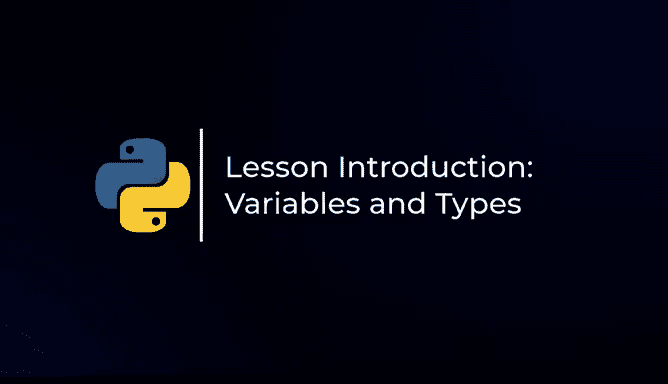

# 杜克大学《MLOps ｜ 机器学习运维（Python基础）｜MLOps ｜ Machine Learning Operations》 - P2：02_01_02_课程介绍-变量与类型.zh_en - GPT中英字幕课程资源 - BV1kw4m167aV

。

Let's see how we can work with variableable assignment， different types， and E。

 LF and else condition so you can handle some logic and finally we'll take a look at exceptions and how to work with them and how to handle them。

