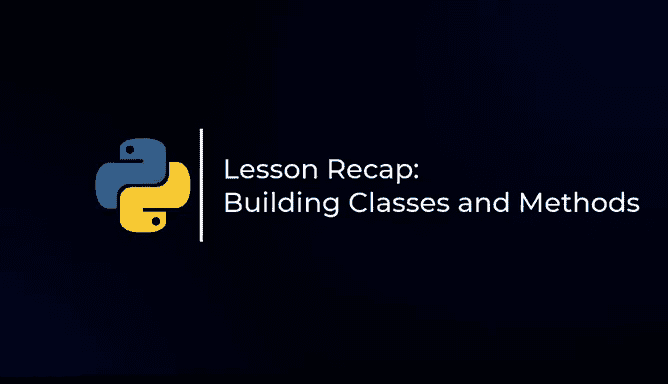

# 杜克大学《MLOps ｜ 机器学习运维（Python基础）｜MLOps ｜ Machine Learning Operations》 - P30：30_02_08_课程回顾-构建类与方法.zh_en - GPT中英字幕课程资源 - BV1kw4m167aV

。

So now you know how to work with classes， it took me a very long time to figure classes out and feel comfortable with。

 but hopefully what I explained in these videos can give you a better。

 more straightforward way of understanding and we covered a little bit of things like methods and self and what is a construct and even class attributes these can be fairly complicated concepts but should allow you to step up your Python knowledge and be more proficient。

