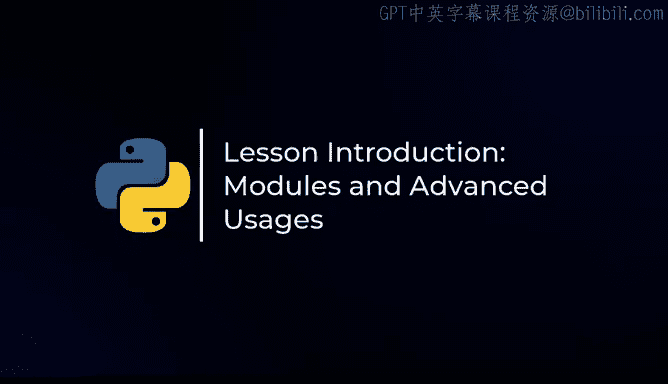

# 杜克大学《MLOps ｜ 机器学习运维（Python基础）｜MLOps ｜ Machine Learning Operations》 - P31：31_02_02_课程介绍-模块与高级用法.zh_en - GPT中英字幕课程资源 - BV1kw4m167aV

。

So now that you know the basics of Python writing a little bit of code。

 then the next level up is working with imports， understanding what a module is。

 how to organize your code with Python modules， directories。

 subdirecties and other files and finally also how to install dependencies。

 not everything that comes with Python which is already a lot will be useful to use。

 sometimes you will get into a project where you need to install dependencies。

 and will' take a look at how to do that with a safe， repeatable way。

