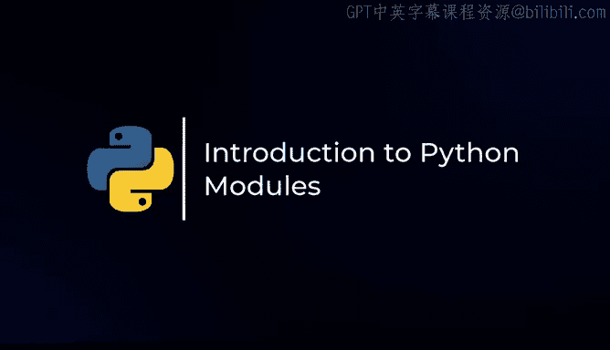
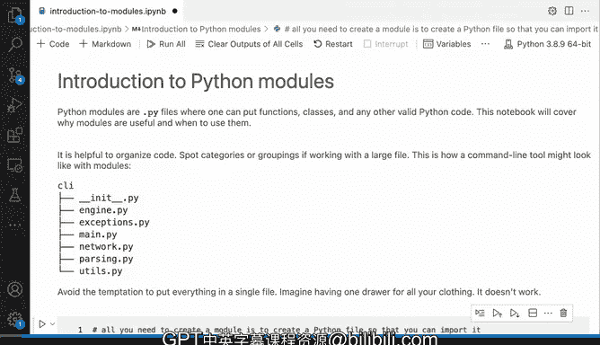

# 杜克大学《MLOps ｜ 机器学习运维（Python基础）｜MLOps ｜ Machine Learning Operations》 - P32：32_02_03_Python模块简介.zh_en - GPT中英字幕课程资源 - BV1kw4m167aV

。

Now let's see a little bit about Python modules， Python modules are nothing else that a file。

 a Python file， So if it ends in that Py it's a Python file， that's a module， that's it。

 that's really all you need to know。You can can think about it as a way of organizing your code if you see something like a very long Python file with several classes。

 hopefully not too much inheritance， perhaps lots of functions and it's more than like say 200 lines to give a number。

 it's not very well organized， you need to work with modules when you want to organize and the example that I usually give is that imagine。

Imagine having one drawer for all of your clothing like it probably wouldn't work right if you have everything in one spot。

 like it is better to have a separation of things and keep things neat and maintainable you definitely make a maintainable and this is just an example CI project that I have here like example structure you can see here that there's a under in it Pi I'll talk about that later in a different lesson but you see that I have engine and exceptions and main and network。

 so it gives you some sort of idea that things might go in separate places。

 So if you wanted to deal with certain exceptions or have some custom exceptions those would all be found in the exceptions Pi file which is a module。

Now that will give you a good a good neat way order way of working with things and Python itself also has its own modules right I mean importing OSs I haven't touched yet on imports we'll see that later。

 but if I do there in a cold there on OS you'll see that there's a lot of things in that one module now。

Besides these two examples I wanted to show you an example project that I have here。

 so this is a personal project that I have and I'm within within that project and I have a lot of different things here have decorators engine exceptions let's take a look at exceptions so you can see here that I have base exceptions。

 we're looking at inheritance a little bit there to have a custom exception and that's where you would go for custom exceptions。

 I have a our exception here our exception over there so it gives you a good a good way。

 so utilities a perfect spot to put things that you want to reuse and you want to make make it available to other module so that they can import that so that's a perfect use case know that's a very very good use case and then you have order and we'll talk about directories and how those work later but。

This is how you would get introduced to Python modules basically。

 what you need to know is anything that is in a that Py file。

 it's considered a module and it can help you organize your code better。

