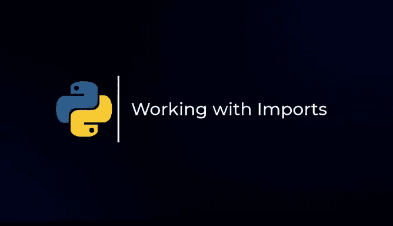
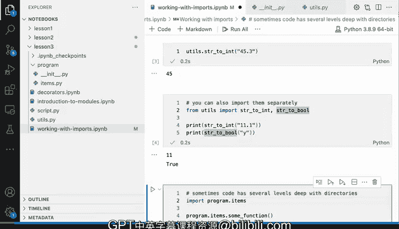

# 杜克大学《MLOps ｜ 机器学习运维（Python基础）｜MLOps ｜ Machine Learning Operations》 - P33：33_02_04_使用导入语句.zh_en - GPT中英字幕课程资源 - BV1kw4m167aV

。

Let's work now with imports， I have a utila pi here， it a utila file， a t module。

 it's a Python file and I've decided to show you a little bit the structure here and you can see that u is right there and I have a Jupyter notebook here called working with imports Now the way you work with imports is basically Python is a scripting language so if I go here you know you access them with a separation of a dot if I'm going to import here u and you can see everything that is available in U and disregard the underscore methods and names but you see that string toable and string to int are there if I go back to U you can see those are my2 helper functions in my utilities so the notation。

 the way to access them is u dot string to。Uils that string to end。

 there are different ways that you you can work with different ways of accessing these helper functions。

 but at the most basic level， if you import U and u is right there on your path So say if u what in a different path then you would have to worry about installing dependencies and properly making that available to Python but because I mean the same director in the same spot。

 this works fine So the way I would make a work is u dot and then the name of the function that I want to work with。

 I mean this could very well be a class or variable it would work the same that dot has to be present。

 that is how you would access whatever is within that u p file that u module in this case string toable is available。

 I run it it works u string to in works the same way Now you can also import them separately so I'm gonna say from Ut import string to end and string to。

And the one difference everything works the same except for the fact that I don't need to prefix them with u。

 so because I'm export or importing them explicitly from us and I'm adding them here。

 then those are available to me in the same scope， so those are a couple of ways that you can do。Now。

 I also have a directory and usually directories in Python or called packages。

 but it can kind of gets confusing because you are not necessarily installing these things。

 I use them to keep things in order。 but let's take a look at these program thing。

 So I have it right there and you can see that I have a underscore in it and an items that pie file and items module that has some function defined in here that just returns this is a function in a module。

 Now the module is items。 the underscore in it underscore a pie allows Python to understand， oh。

 these thing is kind of like a package。 I'm able to to make those modules available。

 So if I go back here to working with imports in my notebook you can see that I can run these I can import program that items and program items that some function is available to me。

 Now if I want it。If I wanted to have items to be available as part of a program。

 so if I wanted to do something like something like import import program。

 then I wouldn't be able to do these program that items that some function without adding that inside of underscore and it underscore that pie now that is just something to keep in mind now this is working the eight or knew exactly where I was going because it's kind of like cheating because it saw that I already imported that here so something to keep in mind and and that said that's how you work with imports different ways of importing in different ways to have access to that namespace for things that you need from our files and our modules。

