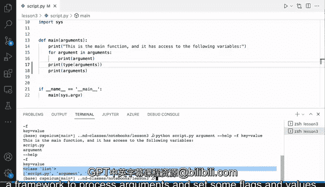

# 杜克大学《MLOps ｜ 机器学习运维（Python基础）｜MLOps ｜ Machine Learning Operations》 - P34：34_02_05_使用Python脚本.zh_en - GPT中英字幕课程资源 - BV1kw4m167aV

。

There are a couple of tricks that you should know about working with Python scripts and I'll try to summarize a few of those in these very short。

 very simple Python script that I've created here。 first I've started with a small documentation here this is called a Doc string when you have triple quotes at the very top and it kind of like explains what this thing is doing it doesn't do anything。

 It's just text and it explains and Python engineers。

 Python Sos developers they usually use this also to have nice documentation because it looks nicer than just using comments All right so what these Python script is doing is on line 10 it's important says that's not important right now。

 but I'm just going to mention it that that's going to be crucial later and it defines a main function。

And then this main function takes some arguments and its going to print some statement about being the main function and then for every argument that we receives ill print exactly what it received now the way to hook that up to the terminal or like whenever I'm executing this on the terminal so that it runs is by using this little snippet here at the very bottom。

 so in this case line 19 says if T name is T main。Then run the main function。

 everything that this means all that this means is that hey Python。

 if I'm being executed on the terminal on the command line， if someone is running me as a script。

 then run the the main function what that allows is to avoid having behavior if I'm also importing if I have a script that I also want to import stuff like if I have like say a helper function here and I'm importing that from a Jupyter notebook。

 then I may not want to process any arguments and I don't want to use any command line tool anything。

 I just want to use a utility， so that's the reason otherwise you would have something something like main says that RV here at the very at the very bottom but that would be problematic if you import because that would run right away when you're importing and when you import you don't necessarily want any side effects。

So that's what the script is and that is what Tunder name and like this line on line 19 is about now let's run it on the command line and see what happens I'm going to open a new terminal the very bottom here and I'm going to say Python script that pi。

And if I run this， it tells me this is the main function and it has access to the following variables script up pi。

 That's right， so says that A v， this thing that I'm passing on line 20。From the cis module。

 R v has the ability to understand every single thing that got passed into Python。 So Python。

 the first thing that I got was the argument， the first argument was script of pi and that is that is what it reported。

 Now if I pass more things。So first， it's always going to be the name of the script first。

 but if I pass more things like say， for example， argument here， help。You know。

 dash F flag or or key。 How about key equals value。 All those things are going to be past in。

 So you can see it's reporting argument， help F and value。 Now。

 the other thing that I didn't tell you and we can we can put it here， we can say， you know。

 we can print。Print the type。The type of the argument。That this is one thing that we didn't do。

 and then I'm going to print all of the arguments and so that you can see exactly what we're getting。

 So if I run this again， you can see that。Well I forgot to say well let me save that That's important if we want to change the state so you can see here I ran that thing again。

 you can see here that I'm getting a list that's right。

 so says that RV will pass you a list to the script so there you go that's a good way that's a foundational way if you want to pass in arguments without any frameworks without any libraries at all like a very quick and dirty way where you can consume arguments on the command line so this should give you like a good idea of how you want to get quickly started if you want to do something more complex。

 then definitely try to use a library or a framework to process arguments and set some flagques and values。

