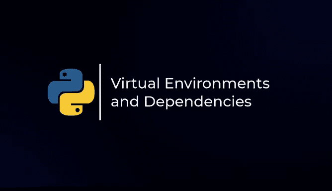
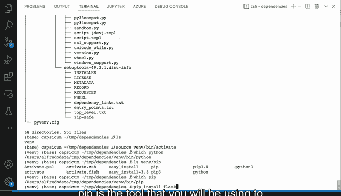

# 杜克大学《MLOps ｜ 机器学习运维（Python基础）｜MLOps ｜ Machine Learning Operations》 - P35：35_02_06_虚拟环境与依赖管理.zh_en - GPT中英字幕课程资源 - BV1kw4m167aV

。

Before we move on to other things， it is very important to understand that Python has a problem with packaging in general。

 Python packaging， installing dependencies and doing things with Python is kind of problematic。

 So here I'm going to show you I mean an empty directory in the terminal。

 I'm going to show you how to work with virtual environments。

 You have to work with some sort of a virtual environment to install dependencies。

 The way we do this is by using Python3， you will have to figure out which ones the Python executable on your system。

 And then I'm going to say dash M。 I'm going to say Vm。 that's the Vm module in in Python 3。

 and I'm going say I want to。I want to call this I'm going create a virtual environment and it's going to accept an argument and I want to say well you can use anything here for visibility。

 I'm not going to make it hidden with prefix with the dot I'm just going to call it VM as well so I'm going to run these it appears that nothing has been done but it's there it's a new directory if I do3 pm so you can see the contents there's a lot of goodness gracious there's a lot of a lot of files in there and all you need to know。

All you need to know is that it gives you the ability to install packages in a self-contained way within that directory and you won't get into trouble if you install the wrong thing。

 the only thing you need to do is you blow it away， you remove it， you throw it to the garbage。

 create a new one and start from scratch now。I've created the directory。

 but I have not activated the environment to activate it， I'm going to do source。

 then VM bin activate if you're using other other systems in Windows is a little bit different。

 but you will have Powerhell， you can see there's a Powerhell script as well。

 but in Linux and Mac Apple computers you will have these bin activate and I'm going to source it and you can see that these change my prompt changes now says VM。

 that's the name of the virtual environment if it was something else。

 it it would say these like something else here now if I do which Python。

To so that it tells me the system can tell me where the python is coming from。

 It's coming from this python that is in this Vm directory。

 So that is LS VM bin you can see here there is other stuff as well same thing with Pip if I do and say which Pipll it'll tell me that Pip is coming from there。

 That means if I install like say for example， flask。

I say Pip install flask Pip is how you is the tool that you will be using to install and uninstall dependencies。

 so if I run Pip install flask it will install in these dependencies VM bin directory so now if I that will essentially get into into the virtual environment if I go and poke and I think it's in Lib and you can see Python 38 and side packages we will see。

You know， Gingja2 click is installed because because I wanted to install flask。

 which you can see is right there， so it is a contained contained way where you can interact with Python similarly if you have many dependencies having a requirements file is useful。

 so if I say I'm going to add say flask into a requirements， the text file the way you would。

And I'm going show you the contents it flask and if I wanted to use PIip to install like several different ones instead of installing them one by one you could say Pip installs R requirements that text and it would run and in this case I already have it installed now to deactivate to remove to get away from this activation of this specific virtual environment you would do deactivate and you can see that my prompt change if I do which Python you can see it will come with my Conda or other system Python that I'm using here similarly with Pip it would no longer be that one that was pointing to my virtual environment and if I want to create an R1 Python 3m other VM and it would do that actually want I need to do is say module is VM and then other VM and then that will create another directory and you can see I can do source other VM bin active。

And then if I do which Python you can see that that will come from the other VM so there you have it。

 that's virtual environments， use them always when you're installing， un installsting。

 removing packages， installing packages， dependencies。

 it will save you make everything safe and contained if you get into trouble the only thing you need to do is deactiv it。

 remove it， start from scratch again， install the penencies again。

