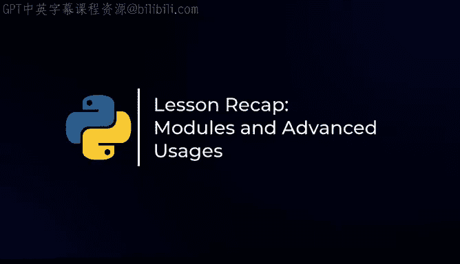

# 杜克大学《MLOps ｜ 机器学习运维（Python基础）｜MLOps ｜ Machine Learning Operations》 - P36：36_02_07_课程回顾-模块与高级用法.zh_en - GPT中英字幕课程资源 - BV1kw4m167aV

。

So that concludes the introduction to Python， you should now feel comfortable working with different imports。

 understanding what the virtual environment is， installing dependencies。

 not only the ones that I showed， but whenever new dependencies for new projects get started。

 now you have a solid foundation on how to set up your project and make things work for that project in a way that will be safe and useful for you and also other collaborators for your projects。

