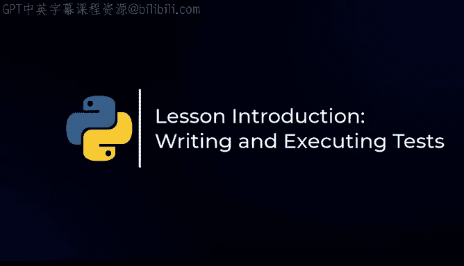

# 杜克大学《MLOps ｜ 机器学习运维（Python基础）｜MLOps ｜ Machine Learning Operations》 - P37：37_03_02_课程介绍-编写与执行测试.zh_en - GPT中英字幕课程资源 - BV1kw4m167aV

。

Why is testing important and how to be proficient at testing。

 these are some of the things that I'm going to help you answer in this lesson we'll take a look at few of the Python conventions。

 a few of the Python utilities and an external library that I really like which is PyTest。

 which will help you write very very straightforward tests so that you can validate your work is very robust。

 it works correctly and there are no bugs。

