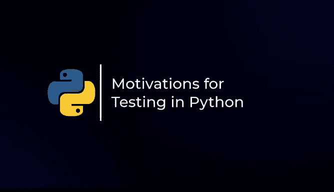
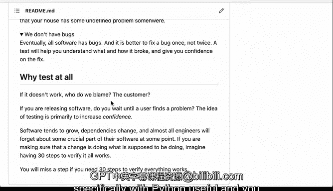

# 杜克大学《MLOps ｜ 机器学习运维（Python基础）｜MLOps ｜ Machine Learning Operations》 - P38：38_03_03_Python测试动机.zh_en - GPT中英字幕课程资源 - BV1kw4m167aV

。

Before getting started with testing and the testing basics and how does that work with Python it is important to go through some of the testing concepts When I first got introduced to Python and I'm going to cover here a little bit of these notes from the repository in the Readme itself so you can also go and review it later when I first got introduced to testing I didn't really understand what was a big deal about it。

 but the more I started working with Python and software in general I realized that it was great to automate things and double check that everything was right before setting up a release or get making a change into production software so along the way there are these three excuses that usually come about when working with testing or suggesting that we should be doing testing or the engineering team should be doing more testing one of those and the first one that I want to touch on is that it takes too much。

So let's take a look at the actual the actual。Reasoning there。

 so it isn't that it takes too much time because the thing is that as with anything in software。

 of course you'll have to invest a little bit upfront， you'll have to do certain things upfront。

But at the end of the day， it is something that validates the work that you're doing and if it takes too much time。

 well it is taking time but the benefits to return over the investment on testing。

 it pays off now you can gauge a little bit can set your own expectations and go at your own pace and try to add tests as you need them and don't go overboard and see how useful they are。

 but it's definitely something that you need to take into account on developing software and at the end of the day it will take a a lot more time as the project grows if you need to debug what is going on and why something might not be working the other one is that it's too difficult and again like almost anything it takes practice to make progress and to make something that works really well。

You'll have to take some time to try to get used to what makes a good test。

 what happens when you have a very slow test or a test that doesn't really represent。

 what is going on a good test will probably be pretty quick， especially if it's a unit test。

 it will actually tell you what the failure is， what are the things that it expected。

 and the problems， why it broke or why this test is not working anymore or so it's giving you a good foundation as to where the failure is。

 what was the expectation and perhaps hopefully how to fix it。

And now the last one and believe it or not， I had fellow engineers that told me like， hey。

 you know I write perfect code and I never have a bug and all software has bugs。

 that's the end of everything in every discussion in software is like every software it doesn't matter who you are how many years of experience you have you're going to face some bugs and if you have testing。

 then you'll get the ability to hopefully tell you exactly what these bug is。

 even before you're releasing it so you will understand where it's coming from。

 you will be able to patch and you will be able to verify the release or verify the fix once it's implemented which is also pretty good because if you're fixing something that you think about it is a bug。

 what is telling you that you've really fixed it， you somehow have done the testing already so why not automate it and write some code that will do that。

For you。And then at the end， and I did a presentation about these a few years ago。

 if it doesn't work， who do we blame it was the premise of this presentation and the premise。

 the whole idea behind these is that when you're releasing software and you're not testing Well you're in fact just waiting until someone complains about the testing about the software that is not working or in what ways is not working So something to keep in mind and at the end automation it's kind of like one of the foundations about automation in any project where if you have 30 steps like I'm mentioning here if you have 30 steps to verify that everything's working you know we're humans will probably forget about one step or half a typo somewhere and miss on a couple steps and then things are not quite what we're expecting and software like normally will keep growing and we keep increasing complexity and。

Testing software testing will be there to help you get a very robust a very highly maintainable piece of software so those are some of the reasons some of the excuses。

 common excuses and why test at all really and I hope you find these lessons about testing in general and specifically with Python useful and you get to implement them in your projects。

