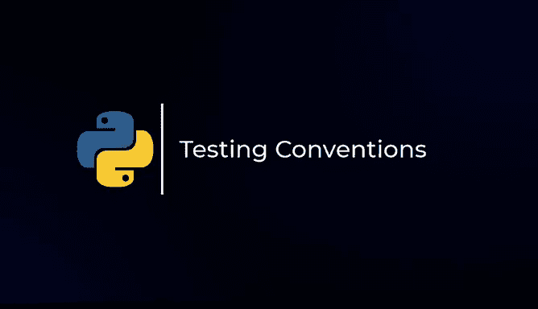
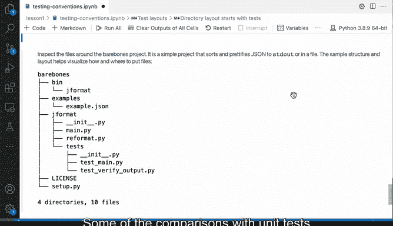

# 杜克大学《MLOps ｜ 机器学习运维（Python基础）｜MLOps ｜ Machine Learning Operations》 - P39：39_03_04_测试规范.zh_en - GPT中英字幕课程资源 - BV1kw4m167aV

。

Most testing libraries and frameworks in Python rely on testing conventions now we'll take a look at how those work。

 but first let's start talking a little bit about Python's Uni Test now the UniT library in Python comes with Python itself so you don't need to install anything but in these lessons I'm going to recommend using something different but before looking into these other thing that I recommend。

 let's take a look at Python Uni Test and why I think is not it shouldn't be your first option unless you don't have any other choice。

Now what does the standard library have to offer Well you can see here that have a simple eight lines of code here where I'm importing Uni tests。

 you have to import library and then you're going to have to create a class and you're going to have to do some inheritance in this case unit test that test case is the base class and then you're going to have your assertions certain methods and you're going to be using these certain helpers to make your comparison so here you see that I have I've imported unit test I'm creating a class I'm creating a method and then I'm using these self-asert equals if I run the thing is that these will fail of course because some string is not the same as some other string but the thing is that I find these output this report not very useful especially when there are failures and if you're dealing with。

Failures in testing。 Well， you will want to have very rich reporting。 Now。

 this is just a quick overview of Uni test， and it doesn't necessarily mean to be comprehensive。

 but you will see kind of like the the。The difference is when we come into the other things that I recommend looking into。

So again， two of the things is that it requires inheritance， you have to write a test class。

 you have to use these self that assert helper methods and the output is not that good Now these are all this is a very comprehensive list of all of the test methods from unit test and you can see that there's quite a few you know have equal not equal true false is is not and there' are some that are kind of kind of difficult to work with a certain not almost equal is especially one that you know I don't really like is this is a test example using a certain not almost equal and I'm saying two and comparing two and two like two integers and you can see here that the output is a certain error within seven places。

I don't think this is a very very not as good reporting as it could be and I think it needs a lot of work and so that's useful to understand。

 now given that context of what UniTest is and what Python has to offer by default I want introduce you to PyTest Pyteest is a very good solid framework。

 aline tool test runner and test helper， so it's only in one and it's very easy to get started but also has the ability to help you out with highly complex situations so a commandline tool but also a framework doesn't force you to use the framework no classes are required and you can run test functions which you can't on UniTest and you are allowed and encouraged to use plain Ass so usually in Python you are not encouraged to use plane Ass if I run these。

You will see that if I make an assertion called assert these strings long is exactly the same as these strings long this thing failed like the optional message here in theion。

 you will see that the assertion doesn't tell you doesn't tell you much so this is not useful so why what is to deal with with using them in Pyth as well but before we go into that。

 let's see one other reason why you might not want to use assert and why it's discourage is because if you look at the Python help there's a dash uppercase O option which remove asserts and deboxox statements on your Python code it's something that you can allow that allows Python to do some cleaning up of your code so he can do that on the fly so if you're relying on assertions not good now nobody will probably hopefully no relies on plain asserts on the production code but something to keep in mind。

Now it's usually you run your tests before running something in production production code。

 but basically the most important one is this one over here where the asserts are in Python are discouraged because are not really descriptive All right so let me keep scroll and and tell you why in py tests are very good。

 So pyte will have highly very rich very rich results that we will see later。

 but the beauty with pythte is that enhances the assert So when the reporting comes you shouldn't be afraid you shouldn't be worried about using the plain asserts because they're going to be very useful now tests can be functions or classes like I mentioned you don't need inheritance if you want to use a class that's perfect that's fine you don't need to use inheritance like we saw in unit test and your test methods can be very straightforward and here you can see here these assert statements are very straightforward。

I'm using a function over here and it has a plain insert two lines and it's very easy to get started now。

This lesson in particular is about talking about conventions and you need some some you need a layout but before getting into a layout there are some conventions they're not a strict rules but some conventions for automatically executing and finding your test if you run Py test if you run a tool like you test as well as Pythte they will rely on these conventions and these conventions are are these basically you have to use a tests directory that's a plural otherwise if you use a test。

 the singular directory for your test it will collide because there's a test module in Python dont try to avoid that usually tests。

 the plural directory is what you will find in most Python software projects files need to be prefix with test underscore so if it's a test file if it's a file that contains tests you will have to prefix it with test underscore otherwise it won't。

Coed test functions also need to be prefixed with test underscore and test classes need to be prefixed prefixed with uppercaset or capitalized tests where and that's kind of like what I've used here test underscore my function and capitalize test my class right there and this is a sample a sample project that I haveve added a link over there if you're to check it out but usually this is kind of like what you should expect in a Python project and here you can see I've added a test inside the actual project which is called J format but there's no requirement to do that you can also have your test outside of the project is is a thing of preference and you can see here that I have to test test underscore main test underscore verify output so that's it that some of the conventions I need to be aware of that some of the comparisons with unit test and why I think Pyth test is a very good and solid option。

