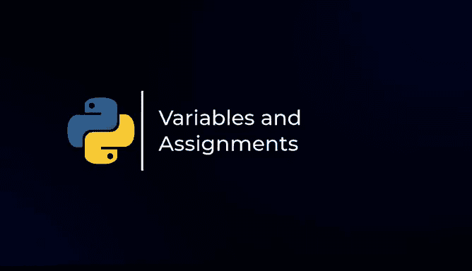
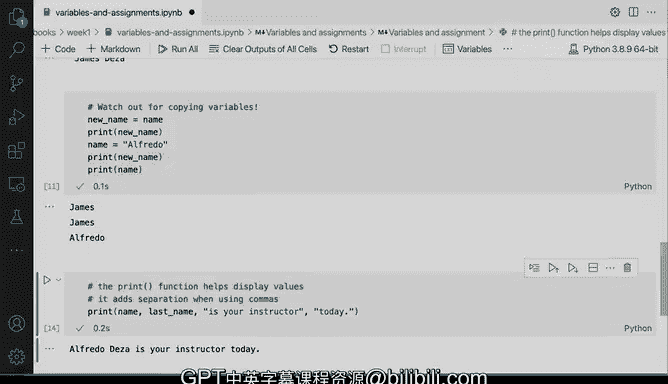

# 杜克大学《MLOps ｜ 机器学习运维（Python基础）｜MLOps ｜ Machine Learning Operations》 - P3：03_01_03_变量与赋值.zh_en - GPT中英字幕课程资源 - BV1kw4m167aV

。

In this lesson we will be working with variables and assignments。

 Python is not a strongly typed language that means that we can assign variables and not worry about the values so let's I'm going to be working here with Jupyter notebooks and all throughout this course you will see me using notebooks everywhere I have here Python 38 but this should work with any Python version that you may have locally I'm to hit execute cell here and as you can see I've assigned and assignment works with a key or a name and then equals and a single equals and then a value in this case I'm using string and we'll check about different types of values that you can use later。

Next， you don't need to worry again about the type of the value so as you can see here I have a string or it can be using a float here with a distance or height with an integer again we'll check types of different values that you can use in Python later but it is important to note that it doesn't matter how you assign them so that is why Python is referred to a programming language that is not strongly typed right continuing here we you know you have to be careful because the lack of type checking might get you into problems here I assigned the height that is a 10000 but 10。

000 is a string right so if you wanted to create a numerical operation with this string you might get into trouble and the representation here at the bottom you can see it's with single quotes again we'll check different types in Python。

how you can work with them and what does that mean when you're doing operations later but it is worth noting that you have to be careful with the types you can also reassign variable so so far we've had a name which if I scroll the way up is Alre like my first name but you can also feel free to reassign and no problem will happen so in this case we've reassigned to James and James is the output now you can see here that I'm also just typing in the name and that will come out and that's a fine operation。

Next， you can use print for variables and that's a nice way where you can check the output。

 the values of different different things in this case I'm using a comma so that's why James dea there comes out so you can use comma or no comma so if if I remove if I remove last name and just leave name alone give me just the variable output or the representation of the variable as a string and an output in the terminal in this case is Jupiter Jupyter notebooks al right so next you can create new variables from existing variables so we have name and last name but we can reassign them。

 construct something completely different and assign it to a new variable in this case we want to create a full name and click execute and you can see here and now I have a variable。

namee full underscore name and in this case I use F strings we'll take a look at how does stat work later when were talking about different types including strings later。

 but you're definitely able to create new variables from existing variables。Allright。

 so next we're going to see how copying variables might be a little bit surprising so we can create again new variables from existing variables in this case is new underscore name and then we're going to print that and then we're going to reassign that name to Alfredo remember right now is James I'm going to print the new name and then print the name and see what we get。

Allright so we get James， James and then Alfredo， why is that because the name when this was created and assigned to new name。

 the state of the Python interpreter said， this is the value for these is James for a new name and I'm going to reassign reassign name to Alfredo so that's why I'm going to use Alfredo right there but then I'm going to print both a new name and name。

One is change and the other one isn't so you can see that reflected here in the output and lastly one thing that you can you can do with print is again use commas and with the comma separator values what you will get is a nice nice spacing there if you don't use commas you won't get that spacing so if I were to say for example。

Something like name plus last name you will get that space removed。

 so it is convenient to pass items to print with a comma and you can use that definitely whenever you're passing multiple values to print to get that separation so that's it how you work with variables and assignments。

