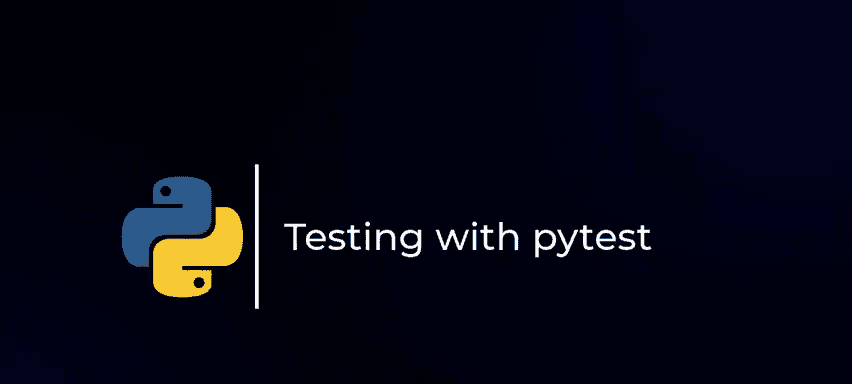
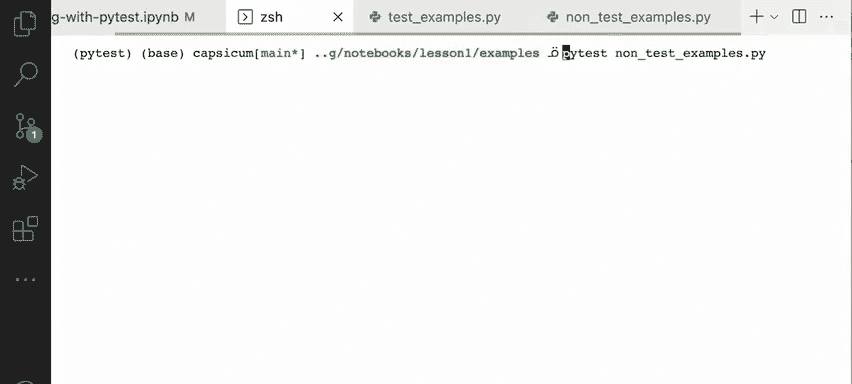

# 杜克大学《MLOps ｜ 机器学习运维（Python基础）｜MLOps ｜ Machine Learning Operations》 - P40：40_03_05_使用pytest测试.zh_en - GPT中英字幕课程资源 - BV1kw4m167aV

。

Now let's try to run some tests with PyT now before anything in like I've recommended all throughout these course。

 please create a virtual environment， you can do that with Python there's also Python 3 depending on what the correct executable is on your system and you're going to pass dashM VM for the module VM and then this is optional but you can name it anything I usually call it VM as well in that createsa directory and then you can source that and activate the environment。

Then with that activated， you will install P test and the way you install it is by using Pip。

 Pip install P test， that will bring everything to your system and that will be ready to go。

And optionally， but highly recommended you can add that to your requirements that text file is a place where you can put your dependencies。

 if you're also working with other dependencies that you need。

 you can put them in your requirements that text it will save you the pain of coming back to your project later on。

And not exactly understanding where these appencies are coming from what do you need to run that project we've already。

And cover how to write some of these functions and test functions and test classes。

 but I'm putting that here just as a fresher， a refresher and a reminder of how that works。

And we're gonna to do a hands on installing and running in this video so you will have to install P test and then I have an example directory I'm going to use with a few with a few files that we're going to use for trying out P test on the terminal and seeing how that works Now if you' are looking for more examples I also have a link to on our project that you can take a look with more tests and more examples on test files Now I'm going switch over here。

 and this is my terminal I mean the examples directory。

 remember the Jupyter notebook was telling you to change directories to the examples directory and P test now。

This is in the repository within notebooks lesson1 and examples and we have a couple of files here。

 we have non-test examples and test examples here and actually if we want to take a look at those we are going to open examples and we're going to open the test examples and then non-test examples Now remember we were talking about test conventions the nontest examples because it doesn't start with test is prefixed with non underscore things will not be automatically collected the test examples。

 however will be collected because it starts with test underscore Now I've I have created a pi test virtual environment I already have that activated I'm going to install pi test I've already have it installed but you can see that that one pretty fast because I already have it installed I'm going to clear these and I have my two files in here。

Two tests in the test examples， the test passes and the test fails and two tests here on the non test examples。

 So if I run pi test without any arguments。We will get this output Now this is on purpose。

 I have one failing in one passing and you can see here that it's reporting on test underscore examples of pi。

 It tells me where the root directory is what my platform what the Python version is what version of P test and how many items were collected I have four test Why did it collect to because I have only one valid file that will get automatically discovered so that's how that's where the conventions start kicking in okay so we have two files but only one is getting executed so we have two options Either we rename these non underscore test examples of pi to comply with what we want or we can call it explicitly we can say p test underscore nont examples。

And I'm gonna。We let's clear this out so that we can concentrate better so we say by test non test samples。

And we run these， you can see that now it runs that not like I'm forcing it， I'm telling us' like。

 hey， really pick this one up and and now you can see that none underscore test samples no now what happens if I go in here and say and I prefix this with something else like you know like an F or like like like a two right there。

 probably not like a two but let's say an R。And then we save that and we go back and we try to run tests on test examples and it'll tell me hey。

 I I couldn't collect collected zero items， couldn't find any tests。

 Now this is configurable you can still force the test runner to pick those up。

 but the conventions are it's easier if you just follow the conventions。

And then you do that and then you say anything that is starts with test is something that should get collected。

 otherwise don'tt don't mind don't mind those files and why you might be thinking like well why really do I want to have something that is not a test in a test file well you may have some utilities or some helpers that are doing some other work for you like say for example writing a file or creating some fake data set that you want to test that's the reason why it gives you flexibility So as long as you're filing the conventions with test underscore those will get picked up otherwise it won't。

 So that's how you install Pytest and you run Pt when there when there's a files in there and this is also true for subdirecty So here I mean the examples directory if I go one directory up where I have other Python U notebooks and examples directory somewhere else and I run P test it will still pick up。

From the test underscore examples， you can see here examples slash test underscore examples。

So that is how the basics of running PT will work for a simple project with just two files。

