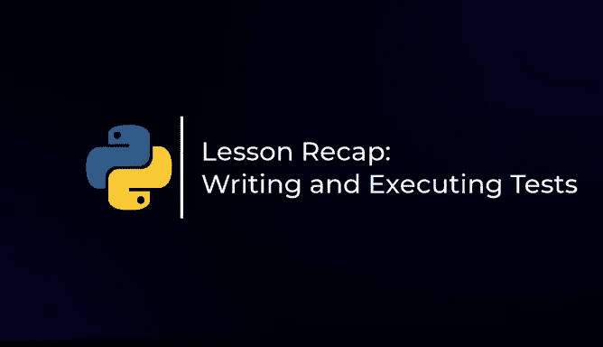

# 杜克大学《MLOps ｜ 机器学习运维（Python基础）｜MLOps ｜ Machine Learning Operations》 - P41：41_03_06_课程回顾-编写与执行测试.zh_en - GPT中英字幕课程资源 - BV1kw4m167aV

。

Testing is really important and not only in Python and now you know why now you have the foundation for understanding why testing is important。

 why you should be testing and how exactly it's going to make your code a little bit better。

 a little bit more robust， more maintainable so these are good foundations to have。

 but in addition to the foundations now you know about a tool pi test which allows you to write very good test with very。

 very good reporting that will make you a much better data scientist。

 data engineer or even a software engineer as well。

