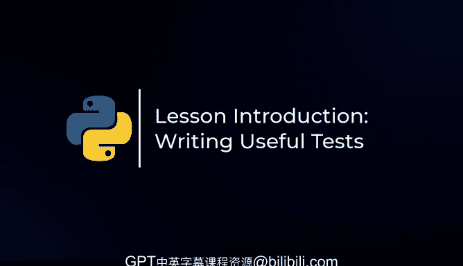

# 杜克大学《MLOps ｜ 机器学习运维（Python基础）｜MLOps ｜ Machine Learning Operations》 - P42：42_03_02_课程介绍-编写实用测试.zh_en - GPT中英字幕课程资源 - BV1kw4m167aV

。

In this lesson I'll cover using plain asserts why those are useful and writing classes and functions。

 but most importantly deciding how or when to use to write the tests in a class or writing tests with functions and then finally we'll take a look at one of these advanced features that I really like。

 which is called paramettriries and parametris allows you to really write even better tests when the outputs are different but the assertion is the same。

